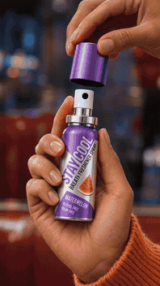

# AI Video Playbook · AI 视频创作方案库

收集、测试和复用效果好的 AI 视频生成方案，重点关注 **UGC 带货、搞笑创意和创意商品演示**。

## 精选视频与提示词

点击画面查看完整成片。STAY COOL 显示 6 秒动图，其余案例使用来源封面。提示词摘要展示每条片的关键动作，完整文字见各案例链接。

| 视频预览 | 提示词与素材 |
| --- | --- |
| <a href="https://github.com/jackroc/ai-video-playbook/releases/download/stay-cool-diner-2026-11-03-v1/stay-cool-diner-6s.mp4"></a> | **STAY COOL · 餐厅里的猛犸象**<br>喷雾带货 · Seedance 2.0 · 6 秒竖屏<br><br>**提示词摘要** 在夜间复古餐厅中，顾客先拔下紫色喷雾瓶盖，按压一次后转头。猛犸象破开冰壳，广角交代左象右人，最后落在顾客的淡定反应上。两张商品图锁包装与喷头，深度视频给动作节奏。<br><br>[完整成片](https://github.com/jackroc/ai-video-playbook/releases/download/stay-cool-diner-2026-11-03-v1/stay-cool-diner-6s.mp4) · [实际提交的完整提示词](experiments/assets/2026-11-03-REF-002/prompt.txt) · [分镜与实验](playbooks/reference-remix/REF-002-stay-cool-diner.md) |
| <a href="https://viralance.com/examples/ugc-blender-demo"></a> | **便携搅拌杯 · 果昔演示**<br>小家电 UGC · Seedance 2.0 · 5 秒竖屏<br><br>**提示词摘要** 明亮厨房、自然光和手持视角。人物用便携搅拌杯制作彩色果昔，再举起成品，给镜头一个自然的惊喜反应。<br><br>[完整成片与原提示词 · Viralance](https://viralance.com/examples/ugc-blender-demo#prompt-heading) |
| <a href="https://viralance.com/examples/perfume"></a> | **香水 · 湿黑大理石上的玻璃瓶**<br>美妆香氛 · Veo 3.1 Fast · 8 秒竖屏<br><br>**提示词摘要** 让香水瓶在湿黑石面上缓慢转动，镜头轻推。用金色轮廓光照亮瓶沿和水滴，浅景深突出商品。<br><br>[完整成片与原提示词 · Viralance](https://viralance.com/examples/perfume#prompt-heading) |
| <a href="https://x.com/Lianaalane/status/2080563926014779842"></a> | **浅蓝皮包 · 锁扣与五金微距**<br>配饰特写 · GPT Image 2 + Seedance 2.0 · 10 秒<br><br>**提示词摘要** 在干净米色背景上，用柔光与慢运镜依次拍标识、磁扣开合、可调肩带和皮纹。<br><br>[原作者成片 · @Lianaalane](https://x.com/Lianaalane/status/2080563926014779842) · [完整提示词与流程](https://behindthegen.com/w/luxury-handbag-product-ad-with-gpt-image-2-and-seedance-20) |

按商品继续浏览 [100 条带货创意参考](references/2026-11-03-commerce-video-reference-100.md) · [首批 10 条 X 精选](references/2026-11-03-x-creative-video-prompts.md)。

> 首批 4 套原创示例仍为「待验证」；新增 REF-002 实际生成案例为「测试中」，已有成片但尚未完整验收。已验证方案数仍为 0，带货效果均未测。创意设想、画面生成质量和实际带货效果分别记录。

## 从这里开始

| 你想做什么 | 入口 |
| --- | --- |
| 按商品、视频类型和验证状态找方案 | [方案目录](CATALOG.md) |
| 学习如何写可执行的视频提示词 | [提示词写作指南](docs/prompt-writing.md) |
| 从商品资料走到成片 | [生成与剪辑流程](docs/production-workflow.md) |
| 判断一套方案是否值得复用 | [验证与评分规则](docs/evaluation.md) |
| 修复人物、商品、动作和口型问题 | [常见失败与修复](docs/troubleshooting.md) |
| 记录新方案、测试结果或参考视频 | [模板目录](templates/README.md) |
| 收藏群内分享的公开 X、TikTok 案例 | [自动收录目录](references/community/README.md) · [飞书接入说明](docs/feishu-collection.md) |
| 浏览带原作者提示词和互动数据的创意视频 | [参考视频精选](references/README.md) |

## 首批方案

| ID | 方向 | 创意 | 状态 |
| --- | --- | --- | --- |
| UGC-001 | UGC 带货 | 桌面整理前后的生活演示 | 待验证 |
| COM-001 | 搞笑带货 | 打结的数据线被送上法庭 | 待验证 |
| DEM-001 | 商品演示 | 包内找钥匙的寻宝任务 | 待验证 |
| REF-001 | 参考改编 | 提取笑点结构，再换人货场 | 待验证 |
| REF-002 | 真实深度参考改编 | STAY COOL：餐厅里的猛犸象（已有成片） | 测试中 |

完整提示词及分镜见 [CATALOG.md](CATALOG.md)。示例中的商品和情境为假设，使用前替换为实物资料。

## 目录结构

```text
playbooks/       完整生成方案：脚本、分镜、提示词、素材要求
templates/       方案、实验、参考视频拆解模板
experiments/     每次实际生成的参数、结果、成本和复盘
references/     参考视频的来源及创意机制拆解
docs/           写作方法、制作流程、评分和排错
.github/        GitHub Issue 收录入口
```

## 收录原则

1. **记录完整方案。** 不只存一句提示词；同时保存素材、模型版本、设置、镜头和后期步骤。
2. **实物一致。** 外形、包装、颜色、尺寸、用法和可宣称卖点以实际商品资料为准。
3. **保留证据。** 标记为已验证必须有成片或可访问的存档、原始提示词、参数和复现记录。
4. **分开评估。** 视频好看、能稳定复现、能带来转化，是三个不同结论；没有投放数据就写未测。
5. **允许失败。** 保存失败样本和修复过程，让下一次少踩同样的坑。

## 如何添加

复制 [方案模板](templates/playbook.md) → 保存到相应分类 → 实际生成后填写 [实验模板](templates/experiment.md) → 更新 [目录](CATALOG.md)。也可以通过仓库的 Issues 提交方案和实验记录。

建议命名：`分类编号-英文短名.md`；实验命名：`日期-方案编号-轮次.md`。视频素材优先保存长期有效的存档链接，避免把大量视频直接提交到 Git。

公开仓库只收录可公开分享的内容。参考视频保留来源与署名；他人的原始素材、真实客户数据和私人肖像素材需有分享权限。仓库未附开放许可，第三方素材权利归原作者。
