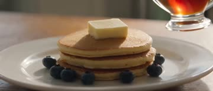
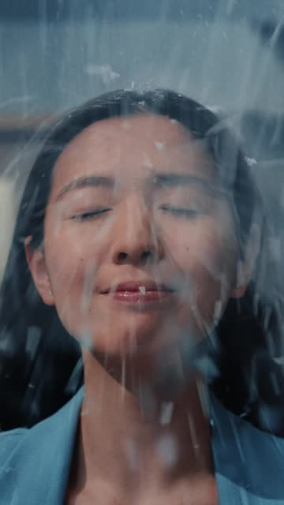
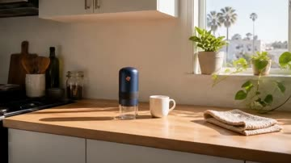
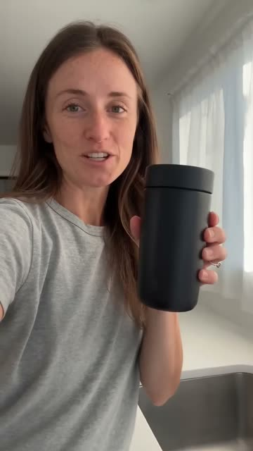

# AI Video Playbook · 商品创意视频参考库

为商品创意选片积累原片、观看依据、动作与跨品类联想。面向 TikTok 商品，也收录其他平台和品牌广告的创意参考。

[全部作品预览](#全部作品预览) · [20 条动作与换品详解](references/2026-11-06-priority-20-analysis.md) · [创意机制索引](references/INDEX.md) · [最新 100 条](references/2026-11-06-creative-commerce-100.md) · [收录与检索](docs/reference-library.md)

## 原创成片

### STAY COOL · 餐厅里的猛犸象

**喷雾带货 · Seedance 2.0 · 6 秒竖屏**

https://github.com/user-attachments/assets/ff538205-6d83-49db-84bd-b5febd76423e

**实际提示词节选**

```text
Create the approved SIX-SECOND 9:16 photoreal absurd STAYCOOL commercial,
matching the complete source shot order and tempo shown in the actual depth
reference. The storyboard image fixes the approved fictional adult woman,
wardrobe and night diner. The TWO original product photographs are authoritative
for real bottle design and white pump structure.
```

[完整提示词](experiments/assets/2026-11-03-REF-002/prompt.txt) · [分镜与素材](playbooks/reference-remix/REF-002-stay-cool-diner.md) · [实验记录](experiments/2026-11-03-REF-002-01.md) · [原始视频](https://github.com/jackroc/ai-video-playbook/releases/download/stay-cool-diner-2026-11-03-v1/stay-cool-diner-6s.mp4)

## 全部作品预览

收录 314 个案例。按商品浏览，或从[创意机制索引](references/INDEX.md)跨品类找动作与看点。

点击封面观看作品。卡片区分来源说明、抽帧和观看记录；提示词类型分别标注视频、分镜图与生图，中文要点为本库整理，原文见作者链接。具体商品能否替换，需要在使用时核对。

[美妆与香氛](#美妆与香氛) · [食品与饮料](#食品与饮料) · [服装与鞋履](#服装与鞋履) · [珠宝与配饰](#珠宝与配饰) · [数码与小家电](#数码与小家电) · [家居与空间](#家居与空间) · [汽车与出行](#汽车与出行) · [运动与健康](#运动与健康) · [通用商品与品牌](#通用商品与品牌)

[结构化数据](data/references.json) · [数据字段与收录方法](docs/reference-library.md)

### 美妆与香氛

<table>
<tr>
  <td width="50%" valign="top">
    <h4>睫毛膏刷头微距揭晓</h4>
    <p><strong>零件揭晓 · Wan 3.0 · 10 秒 · 4:3</strong></p>
    <p><a href="https://prompset.com/prompts/video/wan-3-0/commercial/luxury-vertical-mascara-ad-with-macro-brush-reveal"></a></p>
    <p><strong>提示词要点</strong></p>
    <blockquote>从包装外观过渡到抽出的刷头，重点锁定刷毛轮廓与连接位置。</blockquote>
    <p><a href="https://prompset.com/prompts/video/wan-3-0/commercial/luxury-vertical-mascara-ad-with-macro-brush-reveal">原片与视频提示词</a></p>
    <p><sub>legacy-006 · 来源说明 · 深度待评估</sub></p>
  </td>
  <td width="50%" valign="top">
    <h4>蓝铜色美发工具开箱</h4>
    <p><strong>开箱与配件 · Seedance 2.5</strong></p>
    <p><a href="https://x.com/AvelyrahnAI/status/2093932080497594740"></a></p>
    <p><strong>提示词要点</strong></p>
    <blockquote>让皮盒先开盖，再逐个展示主机与配件，末帧整理成一套。</blockquote>
    <p><a href="https://x.com/AvelyrahnAI/status/2093932080497594740">原片与视频提示词</a></p>
    <p><sub>legacy-008 · 来源说明 · 深度待评估</sub></p>
  </td>
</tr>
<tr>
  <td width="50%" valign="top">
    <h4>粉底局部上妆</h4>
    <p><strong>UGC 质地演示 · Seedance 2.0 · 5 秒竖屏</strong></p>
    <p><a href="https://viralance.com/examples/ugc-foundation-review"></a></p>
    <p><strong>提示词要点</strong></p>
    <blockquote>保留同侧脸与相同光线，把涂抹和最终质感放进一个连续动作。</blockquote>
    <p><a href="https://viralance.com/examples/ugc-foundation-review">原片与视频提示词</a> · <a href="https://viralance.com/videos/ugc-foundation-review.mp4">直接播放</a></p>
    <p><sub>legacy-009 · 来源说明 · 深度待评估</sub></p>
  </td>
  <td width="50%" valign="top">
    <h4>卧室里的香水喷洒试闻</h4>
    <p><strong>UGC 使用 · Seedance 2.0 · 5 秒竖屏</strong></p>
    <p><a href="https://viralance.com/examples/ugc-perfume-review"></a></p>
    <p><strong>提示词要点</strong></p>
    <blockquote>让喷头、雾化和试闻连成一段，保持玻璃瓶握法一致。</blockquote>
    <p><a href="https://viralance.com/examples/ugc-perfume-review">原片与视频提示词</a> · <a href="https://viralance.com/videos/ugc-perfume-review.mp4">直接播放</a></p>
    <p><sub>legacy-010 · 来源说明 · 深度待评估</sub></p>
  </td>
</tr>
<tr>
  <td width="50%" valign="top">
    <h4>护发精华与发丝展示</h4>
    <p><strong>UGC 质感 · Seedance 2.0 · 5 秒竖屏</strong></p>
    <p><a href="https://viralance.com/examples/ugc-hair-serum"></a></p>
    <p><strong>提示词要点</strong></p>
    <blockquote>让手指穿过发梢表现发丝状态，末尾露出瓶身。</blockquote>
    <p><a href="https://viralance.com/examples/ugc-hair-serum">原片与视频提示词</a> · <a href="https://viralance.com/videos/ugc-hair-serum.mp4">直接播放</a></p>
    <p><sub>legacy-011 · 来源说明 · 深度待评估</sub></p>
  </td>
  <td width="50%" valign="top">
    <h4>卧室自然光展示精华液</h4>
    <p><strong>UGC 种草 · Seedance 2.0 · 8 秒竖屏</strong></p>
    <p><a href="https://viralance.com/examples/ugc-skincare"></a></p>
    <p><strong>提示词要点</strong></p>
    <blockquote>用前置镜头的轻晃交代自拍视频语气，标签正对镜头。</blockquote>
    <p><a href="https://viralance.com/examples/ugc-skincare">原片与视频提示词</a> · <a href="https://viralance.com/videos/showcase_25.mp4">直接播放</a></p>
    <p><sub>legacy-012 · 来源说明 · 深度待评估</sub></p>
  </td>
</tr>
<tr>
  <td width="50%" valign="top">
    <h4>浴室日常面霜涂抹</h4>
    <p><strong>UGC 使用 · Seedance 2.0 · 8 秒竖屏</strong></p>
    <p><a href="https://viralance.com/examples/ugc-skincare-routine"></a></p>
    <p><strong>提示词要点</strong></p>
    <blockquote>用自然光近景记录一次涂抹，固定手与皮肤的接触点。</blockquote>
    <p><a href="https://viralance.com/examples/ugc-skincare-routine">原片与视频提示词</a> · <a href="https://viralance.com/videos/showcase_50.mp4">直接播放</a></p>
    <p><sub>legacy-013 · 来源说明 · 深度待评估</sub></p>
  </td>
  <td width="50%" valign="top">
    <h4>香水 · 湿黑大理石上的玻璃瓶</h4>
    <p><strong>美妆香氛 · Veo 3.1 Fast · 8 秒竖屏</strong></p>
    <p><a href="https://viralance.com/examples/perfume"></a></p>
    <p><strong>提示词 · 中文改写</strong></p>
    <blockquote>生成一段 8 秒的 9:16 香水广告。玻璃香水瓶在湿润的黑色大理石上缓慢旋转，镜头缓慢推近。用金色轮廓光勾出瓶沿与水滴，让瓶身在浅景深中保持清晰。</blockquote>
    <p><a href="https://viralance.com/examples/perfume">观看作品 · Viralance</a> · <a href="https://viralance.com/examples/perfume#prompt-heading">提示词原文</a> · <a href="https://viralance.com/videos/showcase_1.mp4">直接播放</a></p>
    <p><sub>legacy-014 · 来源说明 · 深度待评估</sub></p>
  </td>
</tr>
<tr>
  <td width="50%" valign="top">
    <h4>丝绸表面的口红旋转</h4>
    <p><strong>棚拍特写 · Veo 3.1 Fast · 6 秒竖屏</strong></p>
    <p><a href="https://viralance.com/examples/lipstick"></a></p>
    <p><strong>提示词要点</strong></p>
    <blockquote>丝绸提供柔软背景，旋转只沿单轴，保留管身与膏体比例。</blockquote>
    <p><a href="https://viralance.com/examples/lipstick">原片与视频提示词</a> · <a href="https://viralance.com/videos/showcase_11.mp4">直接播放</a></p>
    <p><sub>legacy-015 · 来源说明 · 深度待评估</sub></p>
  </td>
  <td width="50%" valign="top">
    <h4>眼影刷扫过眼睑</h4>
    <p><strong>极近景使用 · Veo 3.1 Fast · 8 秒竖屏</strong></p>
    <p><a href="https://viralance.com/examples/makeup"></a></p>
    <p><strong>提示词要点</strong></p>
    <blockquote>把刷尖接触点和色粉落下位置写清，动作保持一笔。</blockquote>
    <p><a href="https://viralance.com/examples/makeup">原片与视频提示词</a> · <a href="https://viralance.com/videos/showcase_33.mp4">直接播放</a></p>
    <p><sub>legacy-016 · 来源说明 · 深度待评估</sub></p>
  </td>
</tr>
<tr>
  <td width="50%" valign="top">
    <h4>五段琥珀色香水广告</h4>
    <p><strong>五镜棚拍 · Seedance 2.0 · 15 秒</strong></p>
    <p><a href="https://x.com/CaliraVal/status/2086686230029402183"></a></p>
    <p><strong>提示词要点</strong></p>
    <blockquote>交替拍瓶身与人物，固定黑底、琥珀色调和灯光方向。</blockquote>
    <p><a href="https://x.com/CaliraVal/status/2086686230029402183">原片</a> · <a href="https://behindthegen.com/w/15-second-perfume-ad-in-five-timed-scenes-with-seedance-20">视频提示词</a></p>
    <p><sub>legacy-017 · 来源说明 · 深度待评估</sub></p>
  </td>
  <td width="50%" valign="top">
    <h4>七镜唇釉 UGC</h4>
    <p><strong>角色与包装一致 · GPT Image 2 + Seedance</strong></p>
    <p><a href="https://x.com/AIwithSynthia/status/2080265839773933905"></a></p>
    <p><strong>提示词要点</strong></p>
    <blockquote>用参考人物锁住脸、衣服和配饰，再让手持商品与使用动作穿插。</blockquote>
    <p><a href="https://x.com/AIwithSynthia/status/2080265839773933905">原片</a> · <a href="https://behindthegen.com/w/lip-gloss-ugc-ad-in-7-shots-with-gpt-image-2-and-seedance">视频提示词</a></p>
    <p><sub>legacy-018 · 来源说明 · 深度待评估</sub></p>
  </td>
</tr>
<tr>
  <td width="50%" valign="top">
    <h4>晨光浴室放下磨砂护肤瓶</h4>
    <p><strong>UGC 开场 · Veo 3.1 Fast · 8 秒竖屏</strong></p>
    <p><a href="https://swayclip.com/examples/veo-skincare-ugc"></a></p>
    <p><strong>提示词要点</strong></p>
    <blockquote>手从前景把瓶子放到固定台面，蒸汽和自然光补情境。</blockquote>
    <p><a href="https://swayclip.com/examples/veo-skincare-ugc">原片与视频提示词</a></p>
    <p><sub>legacy-019 · 来源说明 · 深度待评估</sub></p>
  </td>
  <td width="50%" valign="top">
    <h4>地中海香水广告 4K / 1080p 对照</h4>
    <p><strong>美妆 · 商品特写 · Seedance 2.0 · 15 秒 · 8:9</strong></p>
    <p><a href="https://x.com/AIwithJessica/status/2074338150575677602"></a></p>
    <p><strong>提示词要点</strong></p>
    <blockquote>15 秒、16:9。开场用海岸航拍建立光线和氛围，接人物在泳池边行走，再切瓶身环绕特写与取用动作。提示词按秒分镜，为对应镜头分别指定运镜和旁白。作者另外分享了分镜图和人物及商品参考。</blockquote>
    <p><a href="https://x.com/AIwithJessica/status/2074338150575677602">原片</a> · <a href="https://x.com/AIwithJessica/status/2074338743226609862">作者提示词</a> · <a href="references/2026-11-03-x-creative-video-prompts.md#02-地中海香水广告-4k--1080p-对照">完整拆解</a></p>
    <p><sub>legacy-x02 · 来源说明 · 深度待评估</sub></p>
  </td>
</tr>
<tr>
  <td width="50%" valign="top">
    <h4>e.l.f. · 发型好到不戴宇航头盔</h4>
    <p><strong>美妆与香氛 · 异常用途 · 约32秒 · 16:9 · 已补动作拆解</strong></p>
    <p><a href="https://www.youtube.com/watch?v=YRZCRfnNzo8"></a></p>
    <p><strong>创意与动作 · 全片辅助分析</strong></p>
    <blockquote>好发型与必须戴头盔的场合冲突：照镜面、犹豫、放下头盔、出舱，最终用月面飘发放大“舍不得遮住”的心理。</blockquote>
    <p><strong>适合商品：</strong>发油、卷发定型乳、免洗护发素、发箍、发夹</p>
    <p><a href="https://www.youtube.com/watch?v=YRZCRfnNzo8">观看作品 · e.l.f. Cosmetics</a> · <a href="https://dailycommercials.com/elf-hair-astronaut-ad-review/">剧情与制作来源</a> · <a href="references/2026-11-06-priority-20-analysis.md#web-20261105-007">动作拆解 / 适合商品 / 替换步骤</a></p>
    <p><sub>web-20261105-007 · 全片工具分析＋逐秒抽帧复核 · 深度待评估 · 原作者提示词：已查来源未发现</sub></p>
  </td>
  <td width="50%" valign="top">
    <h4>e.l.f. · 化妆棒成了姐妹会的魔法</h4>
    <p><strong>美妆与香氛 · 异常用途 · 品牌创意参考</strong></p>
    <p><a href="https://www.youtube.com/watch?v=Rk41x8pYgGo"></a></p>
    <p><strong>创意线索 · 来源说明整理</strong></p>
    <blockquote>姐妹把美妆发现当成魔法突破，随后的超能力联想越滚越离谱，再回到商品。</blockquote>
    <p><a href="https://www.youtube.com/watch?v=Rk41x8pYgGo">观看作品 · e.l.f. Cosmetics</a> · <a href="https://dailycommercials.com/elf-magical-sisters-ad-review/">剧情与制作来源</a></p>
    <p><sub>web-20261105-023 · 来源说明 · 深度待评估 · 公开提示词待补</sub></p>
  </td>
</tr>
<tr>
  <td width="50%" valign="top">
    <h4>Old Spice · 海盗因太香被赶下船</h4>
    <p><strong>美妆与香氛 · 角色错位 · 约97秒 · 16:9 · 已补动作拆解</strong></p>
    <p><a href="https://www.youtube.com/watch?v=9lYHGsXLVD0"></a></p>
    <p><strong>创意与动作 · 全片辅助分析</strong></p>
    <blockquote>嗅到不合群的香味后，船员被怀疑是冒牌海盗；拿出宝箱里的除臭产品仍无法说服众人，跳海后用海马反转收场。</blockquote>
    <p><strong>适合商品：</strong>体香膏、香水、香氛喷雾、衣物香氛袋、织物喷雾</p>
    <p><a href="https://www.youtube.com/watch?v=9lYHGsXLVD0">观看作品 · Old Spice Europe</a> · <a href="https://dailycommercials.com/old-spices-unbelievably-long-lasting-campaign-sets-sail-with-pirate-themed-humor/">剧情与制作来源</a> · <a href="references/2026-11-06-priority-20-analysis.md#web-20261105-060">动作拆解 / 适合商品 / 替换步骤</a></p>
    <p><sub>web-20261105-060 · 全片工具分析＋逐秒抽帧复核 · 深度待评估 · 原作者提示词：已查来源未发现</sub></p>
  </td>
  <td width="50%" valign="top">
    <h4>e.l.f. × Tinder · 镜中分身预演约会灾难</h4>
    <p><strong>美妆与香氛 · 角色复制 · 约89秒 · 16:9 · 已补动作拆解</strong></p>
    <p><a href="https://www.youtube.com/watch?v=2MWAexV3MUU"></a></p>
    <p><strong>创意与动作 · 全片辅助分析</strong></p>
    <blockquote>镜子里的自己不再同步，而是不断提出糟糕约会假设；餐厅小剧场逐个兑现想象，最后回到梳妆台，由本人接管决定。</blockquote>
    <p><strong>适合商品：</strong>定妆喷雾、唇釉、底妆产品、耳饰、发夹、小手袋</p>
    <p><a href="https://www.youtube.com/watch?v=2MWAexV3MUU">观看作品 · e.l.f. Cosmetics</a> · <a href="https://dailycommercials.com/tinder-x-e-l-f-cosmetics-ad-dating-disasters-and-lip-oil/">剧情与制作来源</a> · <a href="references/2026-11-06-priority-20-analysis.md#web-20261105-069">动作拆解 / 适合商品 / 替换步骤</a></p>
    <p><sub>web-20261105-069 · 全片工具分析＋逐秒抽帧复核 · 深度待评估 · 原作者提示词：已查来源未发现</sub></p>
  </td>
</tr>
<tr>
  <td width="50%" valign="top">
    <h4>Hellmann’s · 蛋黄酱拍成高级香水</h4>
    <p><strong>美妆与香氛 · 类型错位 · 约40秒 · 16:9 · 已补动作拆解</strong></p>
    <p><a href="https://www.youtube.com/watch?v=TPRTAcFIFQ8"></a></p>
    <p><strong>创意与动作 · 全片辅助分析</strong></p>
    <blockquote>用跑雾、敞衫、凝视等香水片语法包装食物，吃面包与舔手指打破高冷，再用真实香氛瓶完成跨品类笑点。</blockquote>
    <p><strong>适合商品：</strong>花生酱、果酱、巧克力酱、香水、沐浴露</p>
    <p><a href="https://www.youtube.com/watch?v=TPRTAcFIFQ8">观看作品 · Hellmann&#x27;s</a> · <a href="https://dailycommercials.com/would-you-wear-mayo-hellmanns-thinks-you-should/">剧情与制作来源</a> · <a href="references/2026-11-06-priority-20-analysis.md#web-20261105-071">动作拆解 / 适合商品 / 替换步骤</a></p>
    <p><sub>web-20261105-071 · 全片工具分析＋逐秒抽帧复核 · 深度待评估 · 原作者提示词：已查来源未发现</sub></p>
  </td>
  <td width="50%" valign="top">
    <h4>e.l.f. × H&amp;M · 喷香动作连成舞步</h4>
    <p><strong>美妆与香氛 · 节奏同步 · 约60秒 · 320:213 · 已补动作拆解</strong></p>
    <p><a href="https://www.youtube.com/watch?v=wd1XfPtRVGc"></a></p>
    <p><strong>创意与动作 · 全片辅助分析</strong></p>
    <blockquote>把喷、走、挥臂散香与摆姿势编成可重复动作；青绿、粉色和棕色三组人物/材质分别承接不同产品风格。</blockquote>
    <p><strong>适合商品：</strong>三款香水、身体喷雾、运动套装、手提包、首饰套组</p>
    <p><a href="https://www.youtube.com/watch?v=wd1XfPtRVGc">观看作品 · H&amp;M</a> · <a href="https://dailycommercials.com/e-l-f-x-hm-make-it-make-scents-campaign-high-energy-fragrance-collab/">剧情与制作来源</a> · <a href="references/2026-11-06-priority-20-analysis.md#web-20261105-080">动作拆解 / 适合商品 / 替换步骤</a></p>
    <p><sub>web-20261105-080 · 全片工具分析＋逐秒抽帧复核 · 深度待评估 · 原作者提示词：已查来源未发现</sub></p>
  </td>
</tr>
<tr>
  <td width="50%" valign="top">
    <h4>Boots · 圣诞夫人经营美妆工坊</h4>
    <p><strong>美妆与香氛 · 角色错位 · 品牌创意参考 · 约60 秒</strong></p>
    <p><a href="https://www.youtube.com/watch?v=ncTd0Wfk6QE"></a></p>
    <p><strong>创意线索 · 来源说明整理</strong></p>
    <blockquote>圣诞夫人被拍成美妆帝国的负责人，北极工坊变成忙碌而华丽的美容工作间。</blockquote>
    <p><a href="https://www.youtube.com/watch?v=ncTd0Wfk6QE">观看作品 · Boots UK</a> · <a href="https://dailycommercials.com/boots-christmas-advert-2024/">剧情与制作来源</a></p>
    <p><sub>web-20261105-088 · 来源说明 · 深度待评估 · 公开提示词待补</sub></p>
  </td>
  <td width="50%" valign="top">
    <h4>Armani · 把香味拆成可见的柑橘与露珠</h4>
    <p><strong>美妆与香氛 · 感官隐喻 · 约20秒 · 16:9 · 已补动作拆解</strong></p>
    <p><a href="https://www.youtube.com/watch?v=GuFMb9EAvEM"></a></p>
    <p><strong>创意与动作 · 全片辅助分析</strong></p>
    <blockquote>用花瓣、果肉、琥珀色液滴、皮肤与瓶身的微距交替，让看不见的香味变成可见材质；眼睛与植物形状的相似性构成视觉转场。</blockquote>
    <p><strong>适合商品：</strong>香水、身体乳、香氛洗护、果酱、蜂蜜、果汁</p>
    <p><a href="https://www.youtube.com/watch?v=GuFMb9EAvEM">观看作品 · Armani beauty</a> · <a href="https://dailycommercials.com/can-you-smell-this-ad/">剧情与制作来源</a> · <a href="references/2026-11-06-priority-20-analysis.md#web-20261105-090">动作拆解 / 适合商品 / 替换步骤</a></p>
    <p><sub>web-20261105-090 · 全片工具分析＋逐秒抽帧复核 · 深度待评估 · 原作者提示词：已查来源未发现</sub></p>
  </td>
</tr>
<tr>
  <td width="50%" valign="top">
    <h4>Old Spice · 浴室讲着讲着就骑上马</h4>
    <p><strong>美妆与香氛 · 场景变换 · 约30秒 · 16:9 · 已补动作拆解</strong></p>
    <p><a href="https://www.youtube.com/watch?v=CaT_oieImqw"></a></p>
    <p><strong>创意与动作 · 全片辅助分析</strong></p>
    <blockquote>用持续的正面直视、口头指令和遮挡掩护，让场景与手中物件接连升级；人物看似镇定，世界却不断变化。</blockquote>
    <p><strong>适合商品：</strong>沐浴露、洗发水、香水、小型礼盒、首饰盒</p>
    <p><a href="https://www.youtube.com/watch?v=CaT_oieImqw">观看作品 · Old Spice</a> · <a href="https://www.commarts.com/project/15087/old-spice">剧情与制作来源</a> · <a href="references/2026-11-06-priority-20-analysis.md#web-20261105-095">动作拆解 / 适合商品 / 替换步骤</a></p>
    <p><sub>web-20261105-095 · 全片工具分析＋逐秒抽帧复核 · 深度待评估 · 原作者提示词：已查来源未发现</sub></p>
  </td>
  <td width="50%" valign="top">
    <h4>Dollar Shave Club · 仓库导览一路发生怪事</h4>
    <p><strong>美妆与香氛 · 冷面反应 · 品牌创意参考 · 约94 秒</strong></p>
    <p><a href="https://www.youtube.com/watch?v=ZUG9qYTJMsI"></a></p>
    <p><strong>创意线索 · 来源说明整理</strong></p>
    <blockquote>负责人带观众穿过仓库介绍剃须刀，周围依次出现无厘头人物与道具，他始终平静讲解。</blockquote>
    <p><a href="https://www.youtube.com/watch?v=ZUG9qYTJMsI">观看作品 · Dollar Shave Club</a> · <a href="https://lamag.com/business/on-the-cutting-edge-with-venice-start-up-dollar-shave-club/">剧情与制作来源</a></p>
    <p><sub>web-20261105-096 · 来源说明 · 深度待评估 · 公开提示词待补</sub></p>
  </td>
</tr>
<tr>
  <td width="50%" valign="top">
    <h4>染发喷雾 · 自拍演示转专业落版</h4>
    <p><strong>美妆与香氛 · Seedance 2.5 · 30.1秒 · 16:9</strong></p>
    <p><a href="https://x.com/Aqsahere_/status/2091372529709400169"></a></p>
    <p><strong>提示词写法 · 本库整理（视频）</strong></p>
    <blockquote>自拍使用演示和棚拍定版分开写，明确两段的时间与画面语言；发色变化需要单独验收。</blockquote>
    <p><strong>适合商品：</strong>临时染发喷雾、彩色发蜡</p>
    <p><a href="https://x.com/Aqsahere_/status/2091372529709400169">观看作品 / 来源</a> · <a href="https://x.com/Aqsahere_/status/2091372529709400169">作者提示词原帖</a> · <a href="references/2026-11-06-creative-commerce-100.md#web-20261106-015">商品适配 / 换品思路 / 核实记录</a> · <a href="https://video.twimg.com/amplify_video/2091372179510476800/vid/avc1/1280x720/bX6kL0s4vknCiqMa.mp4?tag=29">播放入口</a></p>
    <p><sub>web-20261106-015 · 抽帧观察 · 深度待评估</sub></p>
  </td>
  <td width="50%" valign="top">
    <h4>香水ASMR开箱 · 三段接力完成揭晓</h4>
    <p><strong>美妆与香氛 · Seedance 2.0 + GPT Image 2 / Nano Banana · 29.9秒 · 9:16</strong></p>
    <p><a href="https://x.com/Ciri_ai/status/2076552852194123851"></a></p>
    <p><strong>提示词写法 · 本库整理（分镜图）</strong></p>
    <blockquote>这是香水分镜图提示词：按开箱进程安排触感镜头、道具和画面组织；ASMR仍需另验声音。</blockquote>
    <p><strong>适合商品：</strong>香水礼盒、化妆包、旅行分装瓶</p>
    <p><a href="https://x.com/Ciri_ai/status/2076552852194123851">观看作品 / 来源</a> · <a href="https://x.com/Ciri_ai/status/2076552852194123851">作者提示词原帖</a> · <a href="references/2026-11-06-creative-commerce-100.md#web-20261106-027">商品适配 / 换品思路 / 核实记录</a> · <a href="https://video.twimg.com/amplify_video/2076552451113840640/vid/avc1/720x1280/LT3LtB-sMHbAw1ht.mp4?tag=28">播放入口</a></p>
    <p><sub>web-20261106-027 · 抽帧观察 · 深度待评估</sub></p>
  </td>
</tr>
<tr>
  <td width="50%" valign="top">
    <h4>洗发水五段 · 湿发到产品定版</h4>
    <p><strong>美妆与香氛 · Seedance 2.0 · 15.1秒 · 16:9</strong></p>
    <p><a href="https://x.com/Rosey_watson/status/2090369532435083731"></a></p>
    <p><strong>提示词写法 · 本库整理（视频）</strong></p>
    <blockquote>把湿发、使用、冲洗和定版拆开，分别约束头发、泡沫、光线与产品；结尾品牌占位字需替换。</blockquote>
    <p><strong>适合商品：</strong>洗发水、护发素</p>
    <p><a href="https://x.com/Rosey_watson/status/2090369532435083731">观看作品 / 来源</a> · <a href="https://x.com/Rosey_watson/status/2090369532435083731">作者提示词原帖</a> · <a href="references/2026-11-06-creative-commerce-100.md#web-20261106-033">商品适配 / 换品思路 / 核实记录</a> · <a href="https://video.twimg.com/amplify_video/2090369443348254720/vid/avc1/1280x720/KyzoVX0qkrgVFzEA.mp4?tag=29">播放入口</a></p>
    <p><sub>web-20261106-033 · 抽帧观察 · 深度待评估</sub></p>
  </td>
  <td width="50%" valign="top">
    <h4>酒红腮红盘 · 人货场三个锁分别写</h4>
    <p><strong>美妆与香氛 · Seedance 2.0 · 15.1秒 · 16:9</strong></p>
    <p><a href="https://x.com/sophiaparkerr_/status/2095862309285421150"></a></p>
    <p><strong>提示词写法 · 本库整理（视频）</strong></p>
    <blockquote>人物、穿着与四格腮红盘分别锁定，再安排取粉、上妆、转脸与包装定版。</blockquote>
    <p><strong>适合商品：</strong>腮红盘、眼影盘、粉盒</p>
    <p><a href="https://x.com/sophiaparkerr_/status/2095862309285421150">观看作品 / 来源</a> · <a href="https://x.com/sophiaparkerr_/status/2095862309285421150">作者提示词原帖</a> · <a href="references/2026-11-06-creative-commerce-100.md#web-20261106-034">商品适配 / 换品思路 / 核实记录</a> · <a href="https://video.twimg.com/amplify_video/2095861386173923328/vid/avc1/1920x1080/zg_f6QkzW2fimVH1.mp4?tag=29">播放入口</a></p>
    <p><sub>web-20261106-034 · 抽帧观察 · 深度待评估</sub></p>
  </td>
</tr>
<tr>
  <td width="50%" valign="top">
    <h4>覆盆子唇油 · 果色与妆色互相呼应</h4>
    <p><strong>美妆与香氛 · Seedance 2.5 · 38.2秒 · 9:16</strong></p>
    <p><a href="https://x.com/itxabdullaa/status/2103084704979394875"></a></p>
    <p><strong>提示词写法 · 本库整理（视频）</strong></p>
    <blockquote>人物图与唇油图分工引用，先定真实摄影，再写质地、颜色、持瓶与上妆展示。</blockquote>
    <p><strong>适合商品：</strong>唇油、唇釉、口红</p>
    <p><a href="https://x.com/itxabdullaa/status/2103084704979394875">观看作品 / 来源</a> · <a href="https://x.com/itxabdullaa/status/2103084704979394875">作者提示词原帖</a> · <a href="references/2026-11-06-creative-commerce-100.md#web-20261106-035">商品适配 / 换品思路 / 核实记录</a> · <a href="https://video.twimg.com/amplify_video/2103084654358306816/vid/avc1/720x1280/7pP1ul3N62QJ2d4s.mp4?tag=29">播放入口</a></p>
    <p><sub>web-20261106-035 · 抽帧观察 · 深度待评估</sub></p>
  </td>
  <td width="50%" valign="top">
    <h4>薰衣草面膜 · 挖取质地再回包装</h4>
    <p><strong>美妆与香氛 · Seedance 2.5 · 10.1秒 · 135:76</strong></p>
    <p><a href="https://x.com/AvelyrahnAI/status/2097908289619284300"></a></p>
    <p><strong>提示词写法 · 本库整理（视频）</strong></p>
    <blockquote>统一淡紫色棚景，分别写罐体、膏体、取用与上脸；效果词不替代真实商品功效资料。</blockquote>
    <p><strong>适合商品：</strong>泥膜、面霜、化妆刮勺</p>
    <p><a href="https://x.com/AvelyrahnAI/status/2097908289619284300">观看作品 / 来源</a> · <a href="https://x.com/AvelyrahnAI/status/2097908289619284300">作者提示词原帖</a> · <a href="references/2026-11-06-creative-commerce-100.md#web-20261106-038">商品适配 / 换品思路 / 核实记录</a> · <a href="https://video.twimg.com/amplify_video/2097908264403095552/vid/avc1/1080x608/yIC9DxwnrEGV0HVf.mp4?tag=29">播放入口</a></p>
    <p><sub>web-20261106-038 · 抽帧观察 · 深度待评估</sub></p>
  </td>
</tr>
<tr>
  <td width="50%" valign="top">
    <h4>MANSCAPED · 被剪掉的毛发唱离别歌</h4>
    <p><strong>美妆与香氛 · 品牌创意 · 约31秒</strong></p>
    <p><a href="https://www.youtube.com/watch?v=jI9V70EAXiI"></a></p>
    <p><strong>创意线索 · 来源说明整理</strong></p>
    <blockquote>毛发团被做成有情绪的小角色，为一次普通修剪唱起悲伤告别。</blockquote>
    <p><strong>适合商品：</strong>修剪器、剃须刀、清洁刷</p>
    <p><a href="https://www.youtube.com/watch?v=jI9V70EAXiI">观看作品 / 来源</a> · <a href="https://dailycommercials.com/manscapeds-hair-ballad-super-bowl-2026-ad-review-grotesque-humor-meets-grooming-marketing/">剧情 / 制作来源</a> · <a href="references/2026-11-06-creative-commerce-100.md#web-20261106-042">商品适配 / 换品思路 / 核实记录</a></p>
    <p><sub>web-20261106-042 · 来源说明 · 深度待评估 · 公开提示词待补</sub></p>
  </td>
  <td width="50%" valign="top">
    <h4>AXE · 邻居把普通淋浴变成荒诞事件</h4>
    <p><strong>美妆与香氛 · 品牌创意 · 约80秒</strong></p>
    <p><a href="https://www.youtube.com/watch?v=r2vuITs4xCs"></a></p>
    <p><strong>创意线索 · 来源说明整理</strong></p>
    <blockquote>普通清洁场景被旁人的夸张介入打断，严肃表演推动无厘头升级。</blockquote>
    <p><strong>适合商品：</strong>沐浴露、香氛、浴室配件</p>
    <p><a href="https://www.youtube.com/watch?v=r2vuITs4xCs">观看作品 / 来源</a> · <a href="https://dailycommercials.com/axe-the-neighbour-tv-commercial/">剧情 / 制作来源</a> · <a href="references/2026-11-06-creative-commerce-100.md#web-20261106-051">商品适配 / 换品思路 / 核实记录</a></p>
    <p><sub>web-20261106-051 · 来源说明 · 深度待评估 · 公开提示词待补</sub></p>
  </td>
</tr>
<tr>
  <td width="50%" valign="top">
    <h4>Every Man Jack · 篝火边讲洗护恐怖故事</h4>
    <p><strong>美妆与香氛 · 品牌创意 · 约100秒</strong></p>
    <p><a href="https://www.youtube.com/watch?v=deri-t_psnU"></a></p>
    <p><strong>创意线索 · 来源说明整理</strong></p>
    <blockquote>男人围火讲日常洗护糟心经历，按恐怖故事语气渲染，产品在解围时出现。</blockquote>
    <p><strong>适合商品：</strong>沐浴露、洗发水、旅行洗护包</p>
    <p><a href="https://www.youtube.com/watch?v=deri-t_psnU">观看作品 / 来源</a> · <a href="https://dailycommercials.com/every-man-jacks-scary-stories-ad/">剧情 / 制作来源</a> · <a href="references/2026-11-06-creative-commerce-100.md#web-20261106-053">商品适配 / 换品思路 / 核实记录</a></p>
    <p><sub>web-20261106-053 · 来源说明 · 深度待评估 · 公开提示词待补</sub></p>
  </td>
  <td width="50%" valign="top">
    <h4>Neutrogena · 看不见的代言人配看不见的防晒</h4>
    <p><strong>美妆与香氛 · 品牌创意 · 约31秒</strong></p>
    <p><a href="https://www.youtube.com/watch?v=dT7S75eYhcQ"></a></p>
    <p><strong>创意线索 · 来源说明整理</strong></p>
    <blockquote>借人物“看不见”的梗与产品轻薄隐形的表达，令代言人的缺席成为注意点。</blockquote>
    <p><strong>适合商品：</strong>防晒、透明定妆用品、隐形配饰</p>
    <p><a href="https://www.youtube.com/watch?v=dT7S75eYhcQ">观看作品 / 来源</a> · <a href="https://dailycommercials.com/neutrogena-ad-sunscreen-you-cant-see-campaign-ft-john-cena/">剧情 / 制作来源</a> · <a href="references/2026-11-06-creative-commerce-100.md#web-20261106-054">商品适配 / 换品思路 / 核实记录</a></p>
    <p><sub>web-20261106-054 · 来源说明 · 深度待评估 · 公开提示词待补</sub></p>
  </td>
</tr>
<tr>
  <td width="50%" valign="top">
    <h4>AXE · 沙发长到约会对象都睡着了</h4>
    <p><strong>美妆与香氛 · 品牌创意 · 约61秒</strong></p>
    <p><a href="https://www.youtube.com/watch?v=s-sMKrbVkQg"></a></p>
    <p><strong>创意线索 · 来源说明整理</strong></p>
    <blockquote>人物沿异常漫长的沙发努力靠近对方，等待本身被拉成视觉笑话。</blockquote>
    <p><strong>适合商品：</strong>香氛、靠垫、沙发毯</p>
    <p><a href="https://www.youtube.com/watch?v=s-sMKrbVkQg">观看作品 / 来源</a> · <a href="https://dailycommercials.com/axes-new-long-lasting-fragrance-commercial/">剧情 / 制作来源</a> · <a href="references/2026-11-06-creative-commerce-100.md#web-20261106-055">商品适配 / 换品思路 / 核实记录</a></p>
    <p><sub>web-20261106-055 · 来源说明 · 深度待评估 · 公开提示词待补</sub></p>
  </td>
  <td width="50%" valign="top">
    <h4>AXE · 狗也为香味吃醋</h4>
    <p><strong>美妆与香氛 · 品牌创意 · 约60秒</strong></p>
    <p><a href="https://www.youtube.com/watch?v=-Vk5cTxiMfA"></a></p>
    <p><strong>创意线索 · 来源说明整理</strong></p>
    <blockquote>人物的气味引发宠物过度在意与嫉妒，让日常亲近动作失控。</blockquote>
    <p><strong>适合商品：</strong>香氛、宠物衣物、衣物香氛袋</p>
    <p><a href="https://www.youtube.com/watch?v=-Vk5cTxiMfA">观看作品 / 来源</a> · <a href="https://dailycommercials.com/hilarious-axe-sweet-smelling-fragrance-that-drives-everyone-crazy/">剧情 / 制作来源</a> · <a href="references/2026-11-06-creative-commerce-100.md#web-20261106-058">商品适配 / 换品思路 / 核实记录</a></p>
    <p><sub>web-20261106-058 · 来源说明 · 深度待评估 · 公开提示词待补</sub></p>
  </td>
</tr>
<tr>
  <td width="50%" valign="top">
    <h4>Liquid Death × Dr. Squatch · 肥皂拍成连环恐怖片</h4>
    <p><strong>美妆与香氛 · 品牌创意 · 约32秒</strong></p>
    <p><a href="https://www.youtube.com/watch?v=8KR0KaLvyKU"></a></p>
    <p><strong>创意线索 · 来源说明整理</strong></p>
    <blockquote>用惊悚片的镜头、道具与严肃语气推一块名为Dirt Murderer的肥皂。</blockquote>
    <p><strong>适合商品：</strong>香皂、清洁海绵、沐浴用品</p>
    <p><a href="https://www.youtube.com/watch?v=8KR0KaLvyKU">观看作品 / 来源</a> · <a href="https://dailycommercials.com/liquid-death-ad-psycho-perfect-soap/">剧情 / 制作来源</a> · <a href="references/2026-11-06-creative-commerce-100.md#web-20261106-067">商品适配 / 换品思路 / 核实记录</a></p>
    <p><sub>web-20261106-067 · 来源说明 · 深度待评估 · 公开提示词待补</sub></p>
  </td>
  <td width="50%" valign="top">
    <h4>Lynx · 抢劫现场集体被香味带跑题</h4>
    <p><strong>美妆与香氛 · 品牌创意 · 约81秒</strong></p>
    <p><a href="https://www.youtube.com/watch?v=LMuDlEqMpNc"></a></p>
    <p><strong>创意线索 · 来源说明整理</strong></p>
    <blockquote>原本紧绷的抢劫场景被香味打断，人物注意力从危机转到气味。</blockquote>
    <p><strong>适合商品：</strong>香水、织物香氛、香氛袋</p>
    <p><a href="https://www.youtube.com/watch?v=LMuDlEqMpNc">观看作品 / 来源</a> · <a href="https://dailycommercials.com/lynx-hilarious-advert-2024-robbery/">剧情 / 制作来源</a> · <a href="references/2026-11-06-creative-commerce-100.md#web-20261106-074">商品适配 / 换品思路 / 核实记录</a></p>
    <p><sub>web-20261106-074 · 来源说明 · 深度待评估 · 公开提示词待补</sub></p>
  </td>
</tr>
<tr>
  <td width="50%" valign="top">
    <h4>Chanel N°5 · 赴约路线错开，期待反而成为主角</h4>
    <p><strong>美妆与香氛 · 品牌创意 · 约60秒</strong></p>
    <p><a href="https://www.youtube.com/watch?v=UyZFbgke1Bo"></a></p>
    <p><strong>创意线索 · 来源说明整理</strong></p>
    <blockquote>两人的出发与抵达被交叉剪接，地点和时间差制造期待，香氛以情绪与包装收束。</blockquote>
    <p><strong>适合商品：</strong>香水、约会穿搭、随身包</p>
    <p><a href="https://www.youtube.com/watch?v=UyZFbgke1Bo">观看作品 / 来源</a> · <a href="https://dailycommercials.com/chanel-ad-2024-ft-margot-robbie-and-jacob-elordi/">剧情 / 制作来源</a> · <a href="references/2026-11-06-creative-commerce-100.md#web-20261106-082">商品适配 / 换品思路 / 核实记录</a></p>
    <p><sub>web-20261106-082 · 来源说明 · 深度待评估 · 公开提示词待补</sub></p>
  </td>
  <td width="50%" valign="top">
    <h4>KENZO · 无聊宴会逃出来，身体突然失控起舞</h4>
    <p><strong>美妆与香氛 · 品牌创意 / 历史经典 · 约229秒</strong></p>
    <p><a href="https://www.youtube.com/watch?v=mBdbJbEnTzI"></a></p>
    <p><strong>创意线索 · 来源说明整理</strong></p>
    <blockquote>人物离开拘谨宴会，走廊与楼梯成为越跳越夸张的表演空间，最后与眼形图案回扣。</blockquote>
    <p><strong>适合商品：</strong>香水、礼服、舞鞋</p>
    <p><a href="https://www.youtube.com/watch?v=mBdbJbEnTzI">观看作品 / 来源</a> · <a href="https://www.thewrap.com/spike-jonze-kenzo-perfume-commericial-the-leftovers-margaret-qualley/">剧情 / 制作来源</a> · <a href="references/2026-11-06-creative-commerce-100.md#web-20261106-098">商品适配 / 换品思路 / 核实记录</a></p>
    <p><sub>web-20261106-098 · 来源说明 · 深度待评估 · 公开提示词待补</sub></p>
  </td>
</tr>
<tr>
  <td width="50%" valign="top">
    <h4>e.l.f. MELISA · 美妆广告变成长篇拉美肥皂剧</h4>
    <p><strong>美妆与香氛 · 品牌创意 · 约124秒</strong></p>
    <p><a href="https://www.youtube.com/watch?v=ClX4DldtGq0"></a></p>
    <p><strong>创意线索 · 来源说明整理</strong></p>
    <blockquote>用肥皂剧式关系、对白与夸张表演放大美妆场景，让普通产品展示承担戏剧转折。</blockquote>
    <p><strong>适合商品：</strong>彩妆、定妆喷雾、化妆包</p>
    <p><a href="https://www.youtube.com/watch?v=ClX4DldtGq0">观看作品 / 来源</a> · <a href="https://dailycommercials.com/e-l-f-cosmetics-super-bowl-2026-review-melisa-telenovela-ad-melissa-mccarthy-cultural-play/">剧情 / 制作来源</a> · <a href="references/2026-11-06-creative-commerce-100.md#web-20261106-100">商品适配 / 换品思路 / 核实记录</a></p>
    <p><sub>web-20261106-100 · 来源说明 · 深度待评估 · 公开提示词待补</sub></p>
  </td>
  <td width="50%" valign="top">
    <h4>海滩场景串联人物与美妆商品</h4>
    <p><strong>情境种草 · Seedance 2.5 · 30 秒竖屏</strong></p>
    <p><em>作品封面待补</em></p>
    <p><strong>提示词要点</strong></p>
    <blockquote>先建立海滩光线和人物，再留出可辨认的单独商品镜头。</blockquote>
    <p><a href="https://prompset.com/prompts/video/seedance-2-5/commercial/luxury-beach-beauty-commercial-with-product">原片与视频提示词</a></p>
    <p><sub>legacy-001 · 来源说明 · 深度待评估</sub></p>
  </td>
</tr>
<tr>
  <td width="50%" valign="top">
    <h4>化妆台前的上妆动作</h4>
    <p><strong>使用演示 · Kling 3.0 · 5 秒 · 4:3</strong></p>
    <p><em>作品封面待补</em></p>
    <p><strong>提示词要点</strong></p>
    <blockquote>让同一把工具只做一次清晰接触，保留手指、脸和镜中人物的一致性。</blockquote>
    <p><a href="https://prompset.com/prompts/video/kling-3-0/commercial/blonde-woman-applying-makeup-luxury-vanity">原片与视频提示词</a></p>
    <p><sub>legacy-002 · 来源说明 · 深度待评估</sub></p>
  </td>
  <td width="50%" valign="top">
    <h4>暗棚环绕睫毛膏</h4>
    <p><strong>环绕特写 · Seedance 2.5 · 20 秒横屏</strong></p>
    <p><em>作品封面待补</em></p>
    <p><strong>提示词要点</strong></p>
    <blockquote>让镜头围着同一支管身运动，侧光把刷头、管体和背景分开。</blockquote>
    <p><a href="https://prompset.com/prompts/video/seedance-2-5/commercial/luxury-mascara-ad-with-orbiting-camera-in-dark-studio">原片与视频提示词</a></p>
    <p><sub>legacy-003 · 来源说明 · 深度待评估</sub></p>
  </td>
</tr>
<tr>
  <td width="50%" valign="top">
    <h4>木炭、水花与香雾中的香水</h4>
    <p><strong>材质反差 · Kling 3.0 · 10 秒 · 2:3</strong></p>
    <p><em>作品封面待补</em></p>
    <p><strong>提示词要点</strong></p>
    <blockquote>用吸光的黑色材料衬玻璃高光，把飞溅和雾安排在瓶身两侧。</blockquote>
    <p><a href="https://prompset.com/prompts/video/kling-3-0/commercial/luxury-perfume-ad-with-charcoal-water-splash-and-mist">原片与视频提示词</a></p>
    <p><sub>legacy-004 · 来源说明 · 深度待评估</sub></p>
  </td>
  <td width="50%" valign="top">
    <h4>豪华列车上的面霜失窃疑案</h4>
    <p><strong>悬疑喜剧 · Seedance 2.5 · 30 秒横屏</strong></p>
    <p><em>作品封面待补</em></p>
    <p><strong>提示词要点</strong></p>
    <blockquote>先用失踪物建立疑问，保留线索物的固定外观，揭晓时给面霜清楚的近景。</blockquote>
    <p><a href="https://prompset.com/prompts/video/seedance-2-5/commercial/luxury-train-comedy-cream-theft-mystery">原片与视频提示词</a></p>
    <p><sub>legacy-005 · 来源说明 · 深度待评估</sub></p>
  </td>
</tr>
<tr>
  <td width="50%" valign="top">
    <h4>金色粉盒与模特五镜广告</h4>
    <p><strong>人物与商品交替 · Seedance 2.5 · 15 秒竖屏</strong></p>
    <p><em>作品封面待补</em></p>
    <p><strong>提示词要点</strong></p>
    <blockquote>人物镜头负责使用情境，粉盒近景负责色泽和外观，结尾重回主体。</blockquote>
    <p><a href="https://prompset.com/prompts/video/seedance-2-5/commercial/luxury-gold-compact-beauty-ad-with-model-five-shots">原片与视频提示词</a></p>
    <p><sub>legacy-007 · 来源说明 · 深度待评估</sub></p>
  </td>
  <td width="50%"></td>
</tr>
</table>

### 食品与饮料

<table>
<tr>
  <td width="50%" valign="top">
    <h4>薯片罐与悬浮金片</h4>
    <p><strong>悬浮定格 · Grok Imagine Video 1.5 · 10 秒横屏</strong></p>
    <p><a href="https://prompset.com/prompts/video/grok-imagine-1-5/commercial/pringles-can-hero-shot-with-floating-golden-chips"></a></p>
    <p><strong>提示词要点</strong></p>
    <blockquote>把罐身固定在构图中心，让薯片在外圈运动，包装保留完整正面。</blockquote>
    <p><a href="https://prompset.com/prompts/video/grok-imagine-1-5/commercial/pringles-can-hero-shot-with-floating-golden-chips">原片与视频提示词</a></p>
    <p><sub>legacy-020 · 来源说明 · 深度待评估</sub></p>
  </td>
  <td width="50%" valign="top">
    <h4>海滩上的水变成可乐</h4>
    <p><strong>液体反转 · Gemini Omni Flash · 10 秒横屏</strong></p>
    <p><a href="https://prompset.com/prompts/video/gemini-omni-flash/commercial/woman-transforms-water-into-coca-cola-on-beach"></a></p>
    <p><strong>提示词要点</strong></p>
    <blockquote>保持容器和机位一致，让液体颜色变化承担揭晓。</blockquote>
    <p><a href="https://prompset.com/prompts/video/gemini-omni-flash/commercial/woman-transforms-water-into-coca-cola-on-beach">原片与视频提示词</a></p>
    <p><sub>legacy-026 · 来源说明 · 深度待评估</sub></p>
  </td>
</tr>
<tr>
  <td width="50%" valign="top">
    <h4>清蒸河鱼四段垂直广告</h4>
    <p><strong>工序分段 · Gemini Omni Flash · 40 秒竖屏</strong></p>
    <p><a href="https://prompset.com/prompts/video/gemini-omni-flash/commercial/steamed-river-fish-commercial-4-segment-vertical-ad"></a></p>
    <p><strong>提示词要点</strong></p>
    <blockquote>用备料、蒸制、出锅和菜品呈现组织段落，主菜保持同一规格。</blockquote>
    <p><a href="https://prompset.com/prompts/video/gemini-omni-flash/commercial/steamed-river-fish-commercial-4-segment-vertical-ad">原片与视频提示词</a></p>
    <p><sub>legacy-028 · 来源说明 · 深度待评估</sub></p>
  </td>
  <td width="50%" valign="top">
    <h4>便利店滑行抢到冰汽水</h4>
    <p><strong>夸张动作</strong></p>
    <p><a href="https://x.com/CaliraVal/status/2068553291898958262"></a></p>
    <p><strong>提示词要点</strong></p>
    <blockquote>把普通取饮料写成慢动作滑行，最后用罐身冷凝把注意力拉回产品。</blockquote>
    <p><a href="https://x.com/CaliraVal/status/2068553291898958262">原片与视频提示词</a></p>
    <p><sub>legacy-031 · 来源说明 · 深度待评估</sub></p>
  </td>
</tr>
<tr>
  <td width="50%" valign="top">
    <h4>赛道终点后的 VOLT 运动饮料</h4>
    <p><strong>情节与包装</strong></p>
    <p><a href="https://x.com/yourPlugAI/status/2064788732285517886"></a></p>
    <p><strong>提示词要点</strong></p>
    <blockquote>用赛前静物与赛后喘息对照，把罐子留在前景，让疲劳反应承担叙事。</blockquote>
    <p><a href="https://x.com/yourPlugAI/status/2064788732285517886">原片</a> · <a href="https://x.com/yourPlugAI/status/2064795516840403224">视频提示词</a></p>
    <p><sub>legacy-032 · 来源说明 · 深度待评估</sub></p>
  </td>
  <td width="50%" valign="top">
    <h4>能量饮料第一口反应</h4>
    <p><strong>UGC 试饮 · Seedance 2.0 · 5 秒竖屏</strong></p>
    <p><a href="https://viralance.com/examples/ugc-energy-drink"></a></p>
    <p><strong>提示词要点</strong></p>
    <blockquote>从罐身转向第一口和点头动作，表情给短停顿。</blockquote>
    <p><a href="https://viralance.com/examples/ugc-energy-drink">原片与视频提示词</a> · <a href="https://viralance.com/videos/ugc-energy-drink.mp4">直接播放</a></p>
    <p><sub>legacy-033 · 来源说明 · 深度待评估</sub></p>
  </td>
</tr>
<tr>
  <td width="50%" valign="top">
    <h4>零食第一口表情反应</h4>
    <p><strong>UGC 试吃 · Seedance 2.0 · 8 秒竖屏</strong></p>
    <p><a href="https://viralance.com/examples/ugc-food"></a></p>
    <p><strong>提示词要点</strong></p>
    <blockquote>给入口前的产品近景和咬断时的清晰动作，保留自然停顿。</blockquote>
    <p><a href="https://viralance.com/examples/ugc-food">原片与视频提示词</a> · <a href="https://viralance.com/videos/showcase_49.mp4">直接播放</a></p>
    <p><sub>legacy-034 · 来源说明 · 深度待评估</sub></p>
  </td>
  <td width="50%" valign="top">
    <h4>热巧克力流过甜点</h4>
    <p><strong>微距流体 · Veo 3.1 Fast · 8 秒竖屏</strong></p>
    <p><a href="https://viralance.com/examples/chocolate"></a></p>
    <p><strong>提示词要点</strong></p>
    <blockquote>交代液体落点、覆盖方向和最终停留形状，固定甜点底座。</blockquote>
    <p><a href="https://viralance.com/examples/chocolate">原片与视频提示词</a> · <a href="https://viralance.com/videos/showcase_3.mp4">直接播放</a></p>
    <p><sub>legacy-035 · 来源说明 · 深度待评估</sub></p>
  </td>
</tr>
<tr>
  <td width="50%" valign="top">
    <h4>蜂蜜慢淋松饼塔</h4>
    <p><strong>微距流体 · Seedance 2.5 · 5 秒竖屏</strong></p>
    <p><a href="https://viralance.com/examples/seedance25-honey-pancakes"></a></p>
    <p><strong>提示词要点</strong></p>
    <blockquote>用暖晨光与缓慢流下的蜂蜜表现口感，明确落点和盘缘留白。</blockquote>
    <p><a href="https://viralance.com/examples/seedance25-honey-pancakes">原片与视频提示词</a> · <a href="https://viralance.com/videos/showcase_29.mp4">直接播放</a></p>
    <p><sub>legacy-036 · 来源说明 · 深度待评估</sub></p>
  </td>
  <td width="50%" valign="top">
    <h4>黏土 Nutella 咖啡馆搭建</h4>
    <p><strong>微缩定格 · Seedance 2.0 · 10 秒</strong></p>
    <p><a href="https://x.com/MayaAiCreator/status/2091397686104588650"></a></p>
    <p><strong>提示词要点</strong></p>
    <blockquote>小店逐层组装，最后让角色坐下吃早餐，商品成为世界的视觉中心。</blockquote>
    <p><a href="https://x.com/MayaAiCreator/status/2091397686104588650">原片</a> · <a href="https://behindthegen.com/w/stop-motion-claymation-nutella-cafe-from-a-5-scene-seedance-20-prompt">视频提示词</a></p>
    <p><sub>legacy-037 · 来源说明 · 深度待评估</sub></p>
  </td>
</tr>
<tr>
  <td width="50%" valign="top">
    <h4>德州牛胸肉烟熏到切片</h4>
    <p><strong>工序与切面 · Veo 3.1</strong></p>
    <p><a href="https://x.com/Fujimoto_hina/status/2114222481452019908"></a></p>
    <p><strong>提示词要点</strong></p>
    <blockquote>先给香料和木烟，再展示刀落位置与最终切面的纹理。</blockquote>
    <p><a href="https://x.com/Fujimoto_hina/status/2114222481452019908">原片</a> · <a href="https://behindthegen.com/w/texas-brisket-food-film-from-one-veo-31-json-prompt">视频提示词</a></p>
    <p><sub>legacy-038 · 来源说明 · 深度待评估</sub></p>
  </td>
  <td width="50%" valign="top">
    <h4>六段微缩鸡肉拉面</h4>
    <p><strong>微缩工序 · Veo 3.1 · 9:16</strong></p>
    <p><a href="https://x.com/Fujimoto_hina/status/2116404223470661929"></a></p>
    <p><strong>提示词要点</strong></p>
    <blockquote>用小比例厨具完成六段动作，景深和暖色厨房保持连贯。</blockquote>
    <p><a href="https://x.com/Fujimoto_hina/status/2116404223470661929">原片</a> · <a href="https://behindthegen.com/w/six-scene-miniature-chicken-ramen-cooking-video-in-veo-31">视频提示词</a></p>
    <p><sub>legacy-039 · 来源说明 · 深度待评估</sub></p>
  </td>
</tr>
<tr>
  <td width="50%" valign="top">
    <h4>法式黄油可颂从折叠到掰开</h4>
    <p><strong>工艺与切面 · Veo 3.1</strong></p>
    <p><a href="https://x.com/Fujimoto_hina/status/2112921424575005081"></a></p>
    <p><strong>提示词要点</strong></p>
    <blockquote>层压、卷制、烘焙、掰开按次序展示，最后用层次证明工艺。</blockquote>
    <p><a href="https://x.com/Fujimoto_hina/status/2112921424575005081">原片</a> · <a href="https://behindthegen.com/w/french-butter-croissant-food-film-in-veo-31-from-one-json-prompt">视频提示词</a></p>
    <p><sub>legacy-040 · 来源说明 · 深度待评估</sub></p>
  </td>
  <td width="50%" valign="top">
    <h4>披萨从入炉到拉丝</h4>
    <p><strong>连续工序 · Veo 3.1 · 10 秒横屏</strong></p>
    <p><a href="https://x.com/drzubi01/status/2112406349594464566"></a></p>
    <p><strong>提示词要点</strong></p>
    <blockquote>让面团、木火与出炉动作接续，终点放在一段清楚的拉丝。</blockquote>
    <p><a href="https://x.com/drzubi01/status/2112406349594464566">原片</a> · <a href="https://behindthegen.com/w/10-second-neapolitan-pizza-commercial-from-one-veo-31-json-prompt">视频提示词</a></p>
    <p><sub>legacy-041 · 来源说明 · 深度待评估</sub></p>
  </td>
</tr>
<tr>
  <td width="50%" valign="top">
    <h4>松饼糖浆流动到最终停住</h4>
    <p><strong>液体连续性 · Seedance 2.5 · 15 秒 · 21:9</strong></p>
    <p><a href="https://fal.ai/learn/devs/seedance-2-5-prompting-guide#:~:text=Describe%20where%20fluid%20motion%20ends"></a></p>
    <p><strong>提示词要点</strong></p>
    <blockquote>写出糖浆落点、边缘流路与盘中最终积液位置，水果数量保持一致。</blockquote>
    <p><a href="https://fal.ai/learn/devs/seedance-2-5-prompting-guide#:~:text=Describe%20where%20fluid%20motion%20ends">原片与视频提示词</a> · <a href="https://v3b.fal.media/files/b/0aa55ff4/oRgq8W30Y5MKV_04nBuqQ_video.mp4">直接播放</a></p>
    <p><sub>legacy-042 · 来源说明 · 深度待评估</sub></p>
  </td>
  <td width="50%" valign="top">
    <h4>Mentos · 办公室猛犸象</h4>
    <p><strong>食品广告 · 荒诞反转 · 6 秒竖屏</strong></p>
    <p><a href="https://www.tiktok.com/@mentosph/video/7677498635528998162"></a></p>
    <p><strong>创意线索 · 抽帧与来源说明</strong></p>
    <blockquote>用商品动作带出突兀的巨物揭晓，再回到人物的淡定反应。</blockquote>
    <p><a href="https://www.tiktok.com/@mentosph/video/7677498635528998162">原片</a> · <a href="references/REF-002-mentos-mammoth.md">镜头拆解</a></p>
    <p><sub>legacy-ref · 抽帧观察 · 深度待评估 · 公开提示词待补</sub></p>
  </td>
</tr>
<tr>
  <td width="50%" valign="top">
    <h4>狗狗调酒师</h4>
    <p><strong>情节带货 · Seedance 2.5 · 9 秒横屏</strong></p>
    <p><a href="https://x.com/MeenakshiYACS/status/2116879873730109558"></a></p>
    <p><strong>创意线索 · 来源说明整理</strong></p>
    <blockquote>把摇壶动作交给一只表情严肃的狗，靠角色与专业动作的反差制造笑点。</blockquote>
    <p><a href="https://x.com/MeenakshiYACS/status/2116879873730109558">原片</a> · <a href="references/community/inbox/x-2116879873730109558.md">收录记录</a></p>
    <p><sub>legacy-x-2116879873730109558 · 来源说明 · 深度待评估 · 公开提示词待补</sub></p>
  </td>
  <td width="50%" valign="top">
    <h4>煮面到第一口</h4>
    <p><strong>食品 · 使用演示 · Seedance 2.0 · 15 秒横屏</strong></p>
    <p><a href="https://x.com/ShamiWeb3/status/2054000894174450159"></a></p>
    <p><strong>提示词要点</strong></p>
    <blockquote>从拿起包装开始，依次拍入锅、调味、拌面、筷子挑面和试吃。用蒸汽和酱汁的质感把制作过程转成食欲，结尾让包装和成品同框。作者还在回复里给出手绘分镜的提示词。</blockquote>
    <p><a href="https://x.com/ShamiWeb3/status/2054000894174450159">原片与作者提示词</a> · <a href="references/2026-11-03-x-creative-video-prompts.md#04-煮面到第一口">完整拆解</a></p>
    <p><sub>legacy-x04 · 来源说明 · 深度待评估</sub></p>
  </td>
</tr>
<tr>
  <td width="50%" valign="top">
    <h4>Sainsbury’s · 给巨人送一餐</h4>
    <p><strong>食品与饮料 · 巨物反差 · 品牌创意参考</strong></p>
    <p><a href="https://www.youtube.com/watch?v=C9mEsqI8ULc"></a></p>
    <p><strong>创意线索 · 来源说明整理</strong></p>
    <blockquote>送餐员把食物送进巨人国，途中用食材应对巨型角色的阻挡。</blockquote>
    <p><a href="https://www.youtube.com/watch?v=C9mEsqI8ULc">观看作品 · Sainsbury&#x27;s</a> · <a href="https://dailycommercials.com/sainsburys-bfg-big-delivery-christmas-ad-review/">剧情与制作来源</a></p>
    <p><sub>web-20261105-002 · 来源说明 · 深度待评估 · 公开提示词待补</sub></p>
  </td>
  <td width="50%" valign="top">
    <h4>Wonderful Pistachios · 为吃零食把墙拽走</h4>
    <p><strong>食品与饮料 · 欲望升级 · 品牌创意参考</strong></p>
    <p><a href="https://www.youtube.com/watch?v=RbVFRzHpD1E"></a></p>
    <p><strong>创意线索 · 来源说明整理</strong></p>
    <blockquote>人物用弹力带把自己固定在墙上以免吃零食，想尝一口时连墙一起扯掉。</blockquote>
    <p><a href="https://www.youtube.com/watch?v=RbVFRzHpD1E">观看作品 · Wonderful Pistachios</a> · <a href="https://dailycommercials.com/wonderful-pistachios-resistance-snacking-ad-review/">剧情与制作来源</a></p>
    <p><sub>web-20261105-009 · 来源说明 · 深度待评估 · 公开提示词待补</sub></p>
  </td>
</tr>
<tr>
  <td width="50%" valign="top">
    <h4>Pringles · 薯片罐的终极用途</h4>
    <p><strong>食品与饮料 · 异常用途 · 品牌创意参考</strong></p>
    <p><a href="https://www.youtube.com/watch?v=0Hhys3lVZpI"></a></p>
    <p><strong>创意线索 · 来源说明整理</strong></p>
    <blockquote>葬礼主持人把薯片罐当成极不寻常的容器介绍，用庄严场景制造反差。</blockquote>
    <p><a href="https://www.youtube.com/watch?v=0Hhys3lVZpI">观看作品 · Pringles U.S.</a> · <a href="https://dailycommercials.com/pringles-once-you-drop-ad-review/">剧情与制作来源</a></p>
    <p><sub>web-20261105-010 · 来源说明 · 深度待评估 · 公开提示词待补</sub></p>
  </td>
  <td width="50%" valign="top">
    <h4>Chipotle · 外卖袋走上奢侈品秀场</h4>
    <p><strong>食品与饮料 · 巨物反差 · 品牌创意参考</strong></p>
    <p><a href="https://www.youtube.com/watch?v=DLaNMt6xjTw"></a></p>
    <p><strong>创意线索 · 来源说明整理</strong></p>
    <blockquote>巨型外卖袋被当成高定手袋背着穿城，时尚片语气与普通包装形成反差。</blockquote>
    <p><a href="https://www.youtube.com/watch?v=DLaNMt6xjTw">观看作品 · Chipotle Mexican Grill</a> · <a href="https://dailycommercials.com/chipotle-big-ass-bag-ad-review/">剧情与制作来源</a></p>
    <p><sub>web-20261105-013 · 来源说明 · 深度待评估 · 公开提示词待补</sub></p>
  </td>
</tr>
<tr>
  <td width="50%" valign="top">
    <h4>Sprite · 篮球高手的失败脱口秀</h4>
    <p><strong>食品与饮料 · 角色错位 · 品牌创意参考</strong></p>
    <p><a href="https://www.youtube.com/watch?v=81dQggAAVCU"></a></p>
    <p><strong>创意线索 · 来源说明整理</strong></p>
    <blockquote>球星带着饮料登台讲刻意不好笑的笑话，靠沉默与淡定制造观看回报。</blockquote>
    <p><a href="https://www.youtube.com/watch?v=81dQggAAVCU">观看作品 · Sprite</a> · <a href="https://dailycommercials.com/sprite-jokes-aside-nikola-jokic-ad-review/">剧情与制作来源</a></p>
    <p><sub>web-20261105-015 · 来源说明 · 深度待评估 · 公开提示词待补</sub></p>
  </td>
  <td width="50%" valign="top">
    <h4>Oat Cult · 恐怖仪式最后落到燕麦</h4>
    <p><strong>食品与饮料 · 类型错位 · 品牌创意参考 · 约110 秒</strong></p>
    <p><a href="https://www.youtube.com/watch?v=dI7s0dn4qB4"></a></p>
    <p><strong>创意线索 · 来源说明整理</strong></p>
    <blockquote>黑白民俗恐怖片式村民仪式把早餐品牌放到完全意外的叙事语境。</blockquote>
    <p><a href="https://www.youtube.com/watch?v=dI7s0dn4qB4">观看作品 · Oat Cult</a> · <a href="https://dailycommercials.com/oat-cult-tiramisu-commercial/">剧情与制作来源</a></p>
    <p><sub>web-20261105-016 · 来源说明 · 深度待评估 · 公开提示词待补</sub></p>
  </td>
</tr>
<tr>
  <td width="50%" valign="top">
    <h4>Twix · 僵尸圣诞老人递巧克力</h4>
    <p><strong>食品与饮料 · 角色错位 · 品牌创意参考</strong></p>
    <p><a href="https://www.youtube.com/watch?v=_m4_YH_rpPg"></a></p>
    <p><strong>创意线索 · 来源说明整理</strong></p>
    <blockquote>僵尸版圣诞老人现身客厅，女孩淡定追问究竟该开心还是害怕，双重节日对应双重零食。</blockquote>
    <p><a href="https://www.youtube.com/watch?v=_m4_YH_rpPg">观看作品 · TWIX</a> · <a href="https://dailycommercials.com/twix-hallowmas-zombie-claus-ad-review/">剧情与制作来源</a></p>
    <p><sub>web-20261105-019 · 来源说明 · 深度待评估 · 公开提示词待补</sub></p>
  </td>
  <td width="50%" valign="top">
    <h4>M&amp;M’s · 浪漫告白原来想做拌零食</h4>
    <p><strong>食品与饮料 · 情节反转 · 品牌创意参考</strong></p>
    <p><a href="https://www.youtube.com/watch?v=MeweRDuq0so"></a></p>
    <p><strong>创意线索 · 来源说明整理</strong></p>
    <blockquote>肥皂剧式求爱把糖果角色抱走，字幕逐渐透露对方想把它加入零食混合物。</blockquote>
    <p><a href="https://www.youtube.com/watch?v=MeweRDuq0so">观看作品 · M&amp;M&#x27;S</a> · <a href="https://dailycommercials.com/mms-screentime-telenovela-ad-review/">剧情与制作来源</a></p>
    <p><sub>web-20261105-022 · 来源说明 · 深度待评估 · 公开提示词待补</sub></p>
  </td>
</tr>
<tr>
  <td width="50%" valign="top">
    <h4>Stiller’s Soda · 猫装演员误入汽水采访</h4>
    <p><strong>食品与饮料 · 角色错位 · 品牌创意参考</strong></p>
    <p><a href="https://www.youtube.com/watch?v=XrTuYsldHdk"></a></p>
    <p><strong>创意线索 · 来源说明整理</strong></p>
    <blockquote>演员误以为要演音乐剧，穿完整猫装坐进真实餐馆接受汽水采访，周围人若无其事。</blockquote>
    <p><a href="https://www.youtube.com/watch?v=XrTuYsldHdk">观看作品 · Stiller&#x27;s Soda</a> · <a href="https://dailycommercials.com/stillers-soda-katzs-deli-ad-review/">剧情与制作来源</a></p>
    <p><sub>web-20261105-025 · 来源说明 · 深度待评估 · 公开提示词待补</sub></p>
  </td>
  <td width="50%" valign="top">
    <h4>Dunkin’ · 南瓜味是被遗忘的组合成员</h4>
    <p><strong>食品与饮料 · 角色错位 · 品牌创意参考</strong></p>
    <p><a href="https://www.youtube.com/watch?v=MukMhlAcs0g"></a></p>
    <p><strong>创意线索 · 来源说明整理</strong></p>
    <blockquote>假纪录访谈声称组合曾有一位南瓜味成员，再用夸张造型和歌曲段落解释季节饮品。</blockquote>
    <p><a href="https://www.youtube.com/watch?v=MukMhlAcs0g">观看作品 · Dunkin&#x27;</a> · <a href="https://dailycommercials.com/dunkin-pumpkin-spice-rachel-dratch-ad-review/">剧情与制作来源</a></p>
    <p><sub>web-20261105-029 · 来源说明 · 深度待评估 · 公开提示词待补</sub></p>
  </td>
</tr>
<tr>
  <td width="50%" valign="top">
    <h4>TRIP · 喝一口从混乱进入奇想空间</h4>
    <p><strong>食品与饮料 · 场景变换 · 品牌创意参考</strong></p>
    <p><a href="https://www.youtube.com/watch?v=6m36En9bIMs"></a></p>
    <p><strong>创意线索 · 来源说明整理</strong></p>
    <blockquote>派对与过载日常在喝饮料后切为云层、粉色房间和海边等不同安静空间。</blockquote>
    <p><a href="https://www.youtube.com/watch?v=6m36En9bIMs">观看作品 · trip.drinks</a> · <a href="https://dailycommercials.com/trip-calm-in-the-chaos-ad-review/">剧情与制作来源</a></p>
    <p><sub>web-20261105-031 · 来源说明 · 深度待评估 · 公开提示词待补</sub></p>
  </td>
  <td width="50%" valign="top">
    <h4>Hellmann’s · 三明治时间变成音乐演出</h4>
    <p><strong>食品与饮料 · 节奏同步 · 品牌创意参考 · 约68 秒</strong></p>
    <p><a href="https://www.youtube.com/watch?v=GaejIbCmqEk"></a></p>
    <p><strong>创意线索 · 来源说明整理</strong></p>
    <blockquote>围绕三明治与蛋黄酱的日常进食被包装为歌曲表演，让普通食物成为舞台主题。</blockquote>
    <p><a href="https://www.youtube.com/watch?v=GaejIbCmqEk">观看作品 · Hellmann&#x27;s</a> · <a href="https://dailycommercials.com/hellmanns-sweet-sandwich-time-super-bowl-2026-ad-review-mayo-gets-musical/">剧情与制作来源</a></p>
    <p><sub>web-20261105-032 · 来源说明 · 深度待评估 · 公开提示词待补</sub></p>
  </td>
</tr>
<tr>
  <td width="50%" valign="top">
    <h4>Waitrose · 节日甜点失踪案</h4>
    <p><strong>食品与饮料 · 悬疑揭晓 · 品牌创意参考 · 约91 秒</strong></p>
    <p><a href="https://www.youtube.com/watch?v=Xgwu6UIORvY"></a></p>
    <p><strong>创意线索 · 来源说明整理</strong></p>
    <blockquote>餐桌中心的甜点消失，家人和猫都成了嫌疑对象，用侦探片结构延迟食物揭晓。</blockquote>
    <p><a href="https://www.youtube.com/watch?v=Xgwu6UIORvY">观看作品 · Retro Ad Rewind</a> · <a href="https://dailycommercials.com/waitrose-christmas-advert-2024-sweet-suspicion/">剧情与制作来源</a></p>
    <p><sub>web-20261105-034 · 来源说明 · 深度待评估 · 公开提示词待补</sub></p>
  </td>
  <td width="50%" valign="top">
    <h4>McDonald’s · 偷一根薯条的小动作合集</h4>
    <p><strong>食品与饮料 · 工序演绎 · 品牌创意参考 · 约30 秒</strong></p>
    <p><a href="https://www.youtube.com/watch?v=-CEJ6j_mENw"></a></p>
    <p><strong>创意线索 · 来源说明整理</strong></p>
    <blockquote>围绕偷拿朋友薯条、蘸食等可辨认小动作，把普通吃法串成轻喜剧节奏。</blockquote>
    <p><a href="https://www.youtube.com/watch?v=-CEJ6j_mENw">观看作品 · jennymak80</a> · <a href="https://dailycommercials.com/mcdonalds-surprize-fries/">剧情与制作来源</a></p>
    <p><sub>web-20261105-036 · 来源说明 · 深度待评估 · 公开提示词待补</sub></p>
  </td>
</tr>
<tr>
  <td width="50%" valign="top">
    <h4>McDonald’s · 一个抬眉动作传遍办公室</h4>
    <p><strong>食品与饮料 · 群体反应 · 品牌创意参考 · 约66 秒</strong></p>
    <p><a href="https://www.youtube.com/watch?v=Zt336MYMY2c"></a></p>
    <p><strong>创意线索 · 来源说明整理</strong></p>
    <blockquote>办公室人物用抬眉发出默契邀请，动作逐人传递，最终形成共同出发。</blockquote>
    <p><a href="https://www.youtube.com/watch?v=Zt336MYMY2c">观看作品 · Budding</a> · <a href="https://dailycommercials.com/mcdonalds-ads-2023/">剧情与制作来源</a></p>
    <p><sub>web-20261105-037 · 来源说明 · 深度待评估 · 公开提示词待补</sub></p>
  </td>
  <td width="50%" valign="top">
    <h4>Bud Light · 一桶啤酒引发婚礼追逐</h4>
    <p><strong>食品与饮料 · 欲望升级 · 品牌创意参考 · 约61 秒</strong></p>
    <p><a href="https://www.youtube.com/watch?v=OxRa8ENkyyg"></a></p>
    <p><strong>创意线索 · 来源说明整理</strong></p>
    <blockquote>婚礼中的啤酒桶成为追逐中心，庆典人物为同一个物件进入滑稽行动。</blockquote>
    <p><a href="https://www.youtube.com/watch?v=OxRa8ENkyyg">观看作品 · ZHENG WEN</a> · <a href="https://dailycommercials.com/bud-light-super-bowl-2026-ad-ft-post-malone-shane-gillis-and-peyton-manning/">剧情与制作来源</a></p>
    <p><sub>web-20261105-042 · 来源说明 · 深度待评估 · 公开提示词待补</sub></p>
  </td>
</tr>
<tr>
  <td width="50%" valign="top">
    <h4>NERDS · 第一口糖果引出游行世界</h4>
    <p><strong>食品与饮料 · 场景变换 · 品牌创意参考 · 约31 秒</strong></p>
    <p><a href="https://www.youtube.com/watch?v=nwcZ2dxPUo0"></a></p>
    <p><strong>创意线索 · 来源说明整理</strong></p>
    <blockquote>吃下一口糖果后，平常街景展开为音乐游行，颗粒和软糖的组合变成视听体验。</blockquote>
    <p><a href="https://www.youtube.com/watch?v=nwcZ2dxPUo0">观看作品 · NERDS Candy</a> · <a href="https://dailycommercials.com/nerds-super-bowl-commercial-2025/">剧情与制作来源</a></p>
    <p><sub>web-20261105-046 · 来源说明 · 深度待评估 · 公开提示词待补</sub></p>
  </td>
  <td width="50%" valign="top">
    <h4>Stella Artois · 久别兄弟在啤酒桌前相认</h4>
    <p><strong>食品与饮料 · 角色错位 · 品牌创意参考 · 约61 秒</strong></p>
    <p><a href="https://www.youtube.com/watch?v=R9Jhm6sGg34"></a></p>
    <p><strong>创意线索 · 来源说明整理</strong></p>
    <blockquote>名人遇到意想不到的兄弟，以对照与共饮把家庭相认拍成轻喜剧。</blockquote>
    <p><a href="https://www.youtube.com/watch?v=R9Jhm6sGg34">观看作品 · QuirkyFilms</a> · <a href="https://dailycommercials.com/stella-artois-super-bowl-2025-ad-david-beckham-and-matt-damon/">剧情与制作来源</a></p>
    <p><sub>web-20261105-047 · 来源说明 · 深度待评估 · 公开提示词待补</sub></p>
  </td>
</tr>
<tr>
  <td width="50%" valign="top">
    <h4>Dunkin’ · 摇制咖啡成为全员动作梗</h4>
    <p><strong>食品与饮料 · 节奏同步 · 品牌创意参考 · 约31 秒</strong></p>
    <p><a href="https://www.youtube.com/watch?v=QB-LyTGqB4w"></a></p>
    <p><strong>创意线索 · 来源说明整理</strong></p>
    <blockquote>手摇咖啡的制作动作被扩成角色表演，让饮品名字与动作节奏相互呼应。</blockquote>
    <p><a href="https://www.youtube.com/watch?v=QB-LyTGqB4w">观看作品 · Dunkin&#x27;</a> · <a href="https://dailycommercials.com/dunkin-and-sabrina-carpenter-shake-things-up-with-shake-that-ess/">剧情与制作来源</a></p>
    <p><sub>web-20261105-049 · 来源说明 · 深度待评估 · 公开提示词待补</sub></p>
  </td>
  <td width="50%" valign="top">
    <h4>Pepsi · 汽水车追上披萨外卖</h4>
    <p><strong>食品与饮料 · 追逐升级 · 品牌创意参考 · 约77 秒</strong></p>
    <p><a href="https://www.youtube.com/watch?v=Ck3DljNaiz4"></a></p>
    <p><strong>创意线索 · 来源说明整理</strong></p>
    <blockquote>蓝色汽水车追着披萨配送车辆，到了顾客门口同步把两种商品送达。</blockquote>
    <p><a href="https://www.youtube.com/watch?v=Ck3DljNaiz4">观看作品 · Marcelo Nogueira</a> · <a href="https://dailycommercials.com/pepsi-chase-cars-hilarious-ad/">剧情与制作来源</a></p>
    <p><sub>web-20261105-053 · 来源说明 · 深度待评估 · 公开提示词待补</sub></p>
  </td>
</tr>
<tr>
  <td width="50%" valign="top">
    <h4>KitKat · 把办公室压力堆到人身上</h4>
    <p><strong>食品与饮料 · 处境可视化 · 品牌创意参考 · 约40 秒</strong></p>
    <p><a href="https://www.youtube.com/watch?v=S-oFKR7eVM8"></a></p>
    <p><strong>创意线索 · 来源说明整理</strong></p>
    <blockquote>办公用品与工作负担被夸张堆到职员身边，休息动作成为从压迫中退出的转折。</blockquote>
    <p><a href="https://www.youtube.com/watch?v=S-oFKR7eVM8">观看作品 · KITKAT</a> · <a href="https://dailycommercials.com/kitkats-latest-ad-shows-how-to-truly-break-better/">剧情与制作来源</a></p>
    <p><sub>web-20261105-054 · 来源说明 · 深度待评估 · 公开提示词待补</sub></p>
  </td>
  <td width="50%" valign="top">
    <h4>Ritz · 咸味小岛的落选派对客</h4>
    <p><strong>食品与饮料 · 冷面反应 · 品牌创意参考 · 约31 秒</strong></p>
    <p><a href="https://www.youtube.com/watch?v=8DoYkQ5wNTA"></a></p>
    <p><strong>创意线索 · 来源说明整理</strong></p>
    <blockquote>两人躲在树屋抱怨没被邀请，最后由品牌水上摩托接入海滩派对。</blockquote>
    <p><a href="https://www.youtube.com/watch?v=8DoYkQ5wNTA">观看作品 · RITZ Crackers</a> · <a href="https://dailycommercials.com/ritz-crackers-super-bowl-2026-review-ritz-island-brings-salty-humor-and-star-power/">剧情与制作来源</a></p>
    <p><sub>web-20261105-055 · 来源说明 · 深度待评估 · 公开提示词待补</sub></p>
  </td>
</tr>
<tr>
  <td width="50%" valign="top">
    <h4>Schweppes · 火星交换与姜味约会（双片拼接）</h4>
    <p><strong>食品与饮料 · 角色错位 · 约47秒 · 16:9 · 已补动作拆解</strong></p>
    <p><a href="https://www.youtube.com/watch?v=QYAs3vnWqh8"></a></p>
    <p><strong>创意与动作 · 全片辅助分析</strong></p>
    <blockquote>第一条把日常汽水抬到星际礼物的价值级别；第二条延续同一人物与宫殿，以手部火焰和表情反打构成另一个短笑点。</blockquote>
    <p><strong>适合商品：</strong>汽水、果汁、瓶装茶、香水、护手霜礼盒</p>
    <p><a href="https://www.youtube.com/watch?v=QYAs3vnWqh8">观看作品 · TBWA PARIS</a> · <a href="https://dailycommercials.com/schweppes-when-citrus-diplomacy-meets-sci-fi-spectacle/">剧情与制作来源</a> · <a href="references/2026-11-06-priority-20-analysis.md#web-20261105-056">动作拆解 / 适合商品 / 替换步骤</a></p>
    <p><sub>web-20261105-056 · 全片工具分析＋逐秒抽帧复核 · 深度待评估 · 原作者提示词：已查来源未发现</sub></p>
  </td>
  <td width="50%" valign="top">
    <h4>HARIBO · 成年人突然发出童声</h4>
    <p><strong>食品与饮料 · 角色错位 · 品牌创意参考 · 约20 秒</strong></p>
    <p><a href="https://www.youtube.com/watch?v=NxBhT_37sDw"></a></p>
    <p><strong>创意线索 · 来源说明整理</strong></p>
    <blockquote>两名成年人物坐在海滨分享糖果，讨论口味时使用孩子的声音。</blockquote>
    <p><a href="https://www.youtube.com/watch?v=NxBhT_37sDw">观看作品 · HARIBOUKI</a> · <a href="https://dailycommercials.com/haribo-brings-back-in-2015-kids-voices-nostalgix/">剧情与制作来源</a></p>
    <p><sub>web-20261105-057 · 来源说明 · 深度待评估 · 公开提示词待补</sub></p>
  </td>
</tr>
<tr>
  <td width="50%" valign="top">
    <h4>Oat Cult · 燕麦早餐被卷入异教仪式</h4>
    <p><strong>食品与饮料 · 类型错位 · 品牌创意参考 · 约61 秒</strong></p>
    <p><a href="https://www.youtube.com/watch?v=ZGIGIGRyBWk"></a></p>
    <p><strong>创意线索 · 来源说明整理</strong></p>
    <blockquote>穿睡衣的主角准备早餐时遇到仪式队伍，好奇加入后场面不断升级。</blockquote>
    <p><a href="https://www.youtube.com/watch?v=ZGIGIGRyBWk">观看作品 · Oat Cult</a> · <a href="https://dailycommercials.com/oat-cult-ad-a-darkly-comedic-take-on-breakfast/">剧情与制作来源</a></p>
    <p><sub>web-20261105-059 · 来源说明 · 深度待评估 · 公开提示词待补</sub></p>
  </td>
  <td width="50%" valign="top">
    <h4>KFC · 肉汁森林里的庄严仪式</h4>
    <p><strong>食品与饮料 · 类型错位 · 品牌创意参考 · 约125 秒</strong></p>
    <p><a href="https://www.youtube.com/watch?v=SVHHQKmzYOc"></a></p>
    <p><strong>创意线索 · 来源说明整理</strong></p>
    <blockquote>炸鸡信仰系列把肉汁放入神秘森林的仪式场面，用庄严语气夸张食物吸引力。</blockquote>
    <p><a href="https://www.youtube.com/watch?v=SVHHQKmzYOc">观看作品 · KFC UKI</a> · <a href="https://dailycommercials.com/kfcs-believe-campaign-from-chicken-hypnosis-to-gravy-baptisms/">剧情与制作来源</a></p>
    <p><sub>web-20261105-062 · 来源说明 · 深度待评估 · 公开提示词待补</sub></p>
  </td>
</tr>
<tr>
  <td width="50%" valign="top">
    <h4>Wonderful Halos · 偷吃一个橘子引来报复</h4>
    <p><strong>食品与饮料 · 欲望升级 · 品牌创意参考 · 约31 秒</strong></p>
    <p><a href="https://www.youtube.com/watch?v=TZ2MqeR7N7U"></a></p>
    <p><strong>创意线索 · 来源说明整理</strong></p>
    <blockquote>家长拿走孩子最后一颗橘子，孩子用极端且一本正经的方式实施报复。</blockquote>
    <p><a href="https://www.youtube.com/watch?v=TZ2MqeR7N7U">观看作品 · Wonderful Halos</a> · <a href="https://dailycommercials.com/wonderful-halos-hilarious-new-ads/">剧情与制作来源</a></p>
    <p><sub>web-20261105-063 · 来源说明 · 深度待评估 · 公开提示词待补</sub></p>
  </td>
  <td width="50%" valign="top">
    <h4>Bud Light · 普通人闯错香水广告</h4>
    <p><strong>食品与饮料 · 元广告 · 品牌创意参考 · 约87 秒</strong></p>
    <p><a href="https://www.youtube.com/watch?v=azB5TB_JGmQ"></a></p>
    <p><strong>创意线索 · 来源说明整理</strong></p>
    <blockquote>啤酒代言人突然出现在黑白香水大片中，发现走错广告后切回朋友共饮场景。</blockquote>
    <p><a href="https://www.youtube.com/watch?v=azB5TB_JGmQ">观看作品 · adDictives</a> · <a href="https://dailycommercials.com/bud-light-wrong-commercial-ft-shane-gillis/">剧情与制作来源</a></p>
    <p><sub>web-20261105-064 · 来源说明 · 深度待评估 · 公开提示词待补</sub></p>
  </td>
</tr>
<tr>
  <td width="50%" valign="top">
    <h4>Aldi · 胡萝卜特工营救圣诞</h4>
    <p><strong>食品与饮料 · 物件拟人 · 约90秒 · 16:9 · 已补动作拆解</strong></p>
    <p><a href="https://www.youtube.com/watch?v=LYt04t_6XMs"></a></p>
    <p><strong>创意与动作 · 全片辅助分析</strong></p>
    <blockquote>用胡萝卜扮特工闯入反派基地，穿过烤炉、布丁和点心机关，救出发光精灵；节日食品不是摆盘背景，而是闯关空间。</blockquote>
    <p><strong>适合商品：</strong>圣诞饼干、巧克力礼盒、节日甜点、串灯、圣诞摆件</p>
    <p><a href="https://www.youtube.com/watch?v=LYt04t_6XMs">观看作品 · Retro Ad Rewind</a> · <a href="https://dailycommercials.com/aldi-christmas-ad-2024-watch-kevin-the-carrot-saving-christmas/">剧情与制作来源</a> · <a href="references/2026-11-06-priority-20-analysis.md#web-20261105-065">动作拆解 / 适合商品 / 替换步骤</a></p>
    <p><sub>web-20261105-065 · 全片工具分析＋逐秒抽帧复核 · 深度待评估 · 原作者提示词：已查来源未发现</sub></p>
  </td>
  <td width="50%" valign="top">
    <h4>M&amp;S · 主人与自己的仙女分身合作</h4>
    <p><strong>食品与饮料 · 角色复制 · 品牌创意参考 · 约100 秒</strong></p>
    <p><a href="https://www.youtube.com/watch?v=BIOcGEkX6AQ"></a></p>
    <p><strong>创意线索 · 来源说明整理</strong></p>
    <blockquote>被节日准备压垮的主人遇到仙女分身，普通客厅随魔法变成食物丰盛的聚会空间。</blockquote>
    <p><a href="https://www.youtube.com/watch?v=BIOcGEkX6AQ">观看作品 · The Mirror</a> · <a href="https://dailycommercials.com/dawn-french-2024-christmas-ad/">剧情与制作来源</a></p>
    <p><sub>web-20261105-066 · 来源说明 · 深度待评估 · 公开提示词待补</sub></p>
  </td>
</tr>
<tr>
  <td width="50%" valign="top">
    <h4>KFC · 鸡柳竞争拍成史诗战场</h4>
    <p><strong>食品与饮料 · 类型错位 · 品牌创意参考 · 约65 秒</strong></p>
    <p><a href="https://www.youtube.com/watch?v=zUCS0PhgWME"></a></p>
    <p><strong>创意线索 · 来源说明整理</strong></p>
    <blockquote>快餐员工组成夸张队伍，争夺鸡柳市场被拍成电影式冲锋。</blockquote>
    <p><a href="https://www.youtube.com/watch?v=zUCS0PhgWME">观看作品 · Bull N Bear</a> · <a href="https://dailycommercials.com/kfcs-hilarious-new-ad-makes-chicken-wars-fun-again/">剧情与制作来源</a></p>
    <p><sub>web-20261105-067 · 来源说明 · 深度待评估 · 公开提示词待补</sub></p>
  </td>
  <td width="50%" valign="top">
    <h4>Little Caesars · 一家人甚至狗都长同一张脸</h4>
    <p><strong>食品与饮料 · 角色复制 · 品牌创意参考 · 约31 秒</strong></p>
    <p><a href="https://www.youtube.com/watch?v=wO45Tuciiyo"></a></p>
    <p><strong>创意线索 · 来源说明整理</strong></p>
    <blockquote>复古家庭喜剧里的每个家庭成员都像同一个球员，围绕披萨口味争论。</blockquote>
    <p><a href="https://www.youtube.com/watch?v=wO45Tuciiyo">观看作品 · robercik101</a> · <a href="https://dailycommercials.com/creepy-dog-little-caesars-ad-2024/">剧情与制作来源</a></p>
    <p><sub>web-20261105-068 · 来源说明 · 深度待评估 · 公开提示词待补</sub></p>
  </td>
</tr>
<tr>
  <td width="50%" valign="top">
    <h4>Cadbury · 一块巧克力让人完全分心</h4>
    <p><strong>食品与饮料 · 欲望升级 · 品牌创意参考 · 约21 秒</strong></p>
    <p><a href="https://www.youtube.com/watch?v=8ozypjAkbrM"></a></p>
    <p><strong>创意线索 · 来源说明整理</strong></p>
    <blockquote>一位母亲被新巧克力吸引，暂时忽略身边女儿；本条采用母亲版本。</blockquote>
    <p><a href="https://www.youtube.com/watch?v=8ozypjAkbrM">观看作品 · The advert official </a> · <a href="https://dailycommercials.com/how-cadburys-new-bar-is-causing-hilarious-distractions-everywhere/">剧情与制作来源</a></p>
    <p><sub>web-20261105-072 · 来源说明 · 深度待评估 · 公开提示词待补</sub></p>
  </td>
  <td width="50%" valign="top">
    <h4>Red Bull · 狗狗绕树牵住主人好约会</h4>
    <p><strong>食品与饮料 · 动物角色 · 约30秒 · 16:9 · 已补动作拆解</strong></p>
    <p><a href="https://www.youtube.com/watch?v=8J4eb_lzjHs"></a></p>
    <p><strong>创意与动作 · 全片辅助分析</strong></p>
    <blockquote>先给狗一个想留下的目标，随后饮用动作、套上牵引绳、快速绕圈，利用绳子与树形成因果明确的反客为主。</blockquote>
    <p><strong>适合商品：</strong>牵引绳、项圈、胸背带、罐装饮料</p>
    <p><a href="https://www.youtube.com/watch?v=8J4eb_lzjHs">观看作品 · QuirkyFilms</a> · <a href="https://dailycommercials.com/red-bull-dog-date-super-bowl-2026-ad-review-energetic-animated-and-playfully-canine/">剧情与制作来源</a> · <a href="references/2026-11-06-priority-20-analysis.md#web-20261105-074">动作拆解 / 适合商品 / 替换步骤</a></p>
    <p><sub>web-20261105-074 · 全片工具分析＋逐秒抽帧复核 · 深度待评估 · 原作者提示词：已查来源未发现</sub></p>
  </td>
</tr>
<tr>
  <td width="50%" valign="top">
    <h4>Liquid Death · 能量饮料警示片里人人爆头</h4>
    <p><strong>食品与饮料 · 类型错位 · 品牌创意参考 · 约31 秒</strong></p>
    <p><a href="https://www.youtube.com/watch?v=tEh050NGnVM"></a></p>
    <p><strong>创意线索 · 来源说明整理</strong></p>
    <blockquote>严肃健康警示片声称极端能量饮料会让人头部爆开，用荒诞后果制造品类反差。</blockquote>
    <p><a href="https://www.youtube.com/watch?v=tEh050NGnVM">观看作品 · Liquid Death</a> · <a href="https://dailycommercials.com/liquid-death-exploding-heads-super-bowl-2026-ad-review-absurd-energy-drink-messaging-at-super-bowl-lx/">剧情与制作来源</a></p>
    <p><sub>web-20261105-075 · 来源说明 · 深度待评估 · 公开提示词待补</sub></p>
  </td>
  <td width="50%" valign="top">
    <h4>Kinder Bueno · 黑洞危机被巧克力打断</h4>
    <p><strong>食品与饮料 · 冷面反应 · 约30秒 · 16:9 · 已补动作拆解</strong></p>
    <p><a href="https://www.youtube.com/watch?v=T1z-xbTkJNM"></a></p>
    <p><strong>创意与动作 · 全片辅助分析</strong></p>
    <blockquote>用灾难电影的巨大危机反衬一根零食；船舱、控制室、外星人三处重复“担忧—递出零食—态度转变”，再以滑稽变装和幼儿形象加码。</blockquote>
    <p><strong>适合商品：</strong>巧克力棒、威化饼、能量棒、捏捏玩具、指尖玩具</p>
    <p><a href="https://www.youtube.com/watch?v=T1z-xbTkJNM">观看作品 · Kinder Bueno USA</a> · <a href="https://dailycommercials.com/kinder-bueno-yes-bueno-super-bowl-2026-ad-review-a-sci-fi-chocolate-odyssey/">剧情与制作来源</a> · <a href="references/2026-11-06-priority-20-analysis.md#web-20261105-076">动作拆解 / 适合商品 / 替换步骤</a></p>
    <p><sub>web-20261105-076 · 全片工具分析＋逐秒抽帧复核 · 深度待评估 · 原作者提示词：已查来源未发现</sub></p>
  </td>
</tr>
<tr>
  <td width="50%" valign="top">
    <h4>SVEDKA · 机器人在夜店学人类喝酒跳舞</h4>
    <p><strong>食品与饮料 · 角色错位 · 品牌创意参考 · 约31 秒</strong></p>
    <p><a href="https://www.youtube.com/watch?v=pkeWRI2yJGM"></a></p>
    <p><strong>创意线索 · 来源说明整理</strong></p>
    <blockquote>两个机器人进入人群跳舞、调酒，把机械动作放进普通夜店社交。</blockquote>
    <p><a href="https://www.youtube.com/watch?v=pkeWRI2yJGM">观看作品 · SVEDKA</a> · <a href="https://dailycommercials.com/svedka-shake-your-bots-off-super-bowl-2026-ad-review-ai-robots-and-vodka-irony-at-super-bowl-lx/">剧情与制作来源</a></p>
    <p><sub>web-20261105-077 · 来源说明 · 深度待评估 · 公开提示词待补</sub></p>
  </td>
  <td width="50%" valign="top">
    <h4>Absolut × Tabasco · 火山喷出的竟是鸡尾酒</h4>
    <p><strong>食品与饮料 · 异常用途 · 品牌创意参考 · 约46 秒</strong></p>
    <p><a href="https://www.youtube.com/watch?v=1FBVEfTIGVg"></a></p>
    <p><strong>创意线索 · 来源说明整理</strong></p>
    <blockquote>防护服人物坐直升机来到火山口，喷出的红色液体变成玻璃杯中的鸡尾酒。</blockquote>
    <p><a href="https://www.youtube.com/watch?v=1FBVEfTIGVg">观看作品 · Absolut</a> · <a href="https://dailycommercials.com/absolut-x-tabasco-a-volcanic-ad-with-spicy-vodka-and-hot-takes/">剧情与制作来源</a></p>
    <p><sub>web-20261105-081 · 来源说明 · 深度待评估 · 公开提示词待补</sub></p>
  </td>
</tr>
<tr>
  <td width="50%" valign="top">
    <h4>Liquid Death · 生存游戏里的正经赞助播报</h4>
    <p><strong>食品与饮料 · 元广告 · 品牌创意参考 · 约47 秒</strong></p>
    <p><a href="https://www.youtube.com/watch?v=T3bgoouudCA"></a></p>
    <p><strong>创意线索 · 来源说明整理</strong></p>
    <blockquote>主持人以节目赞助语气播报，画面却是极端的生存竞赛，饮料被当作官方补给。</blockquote>
    <p><a href="https://www.youtube.com/watch?v=T3bgoouudCA">观看作品 · Liquid Death</a> · <a href="https://dailycommercials.com/liquid-death-the-running-man-advert/">剧情与制作来源</a></p>
    <p><sub>web-20261105-082 · 来源说明 · 深度待评估 · 公开提示词待补</sub></p>
  </td>
  <td width="50%" valign="top">
    <h4>Sainsbury’s · 贪吃巨人闯进节日餐桌</h4>
    <p><strong>食品与饮料 · 巨物反差 · 品牌创意参考 · 约90 秒</strong></p>
    <p><a href="https://www.youtube.com/watch?v=QaF1my5h-Os"></a></p>
    <p><strong>创意线索 · 来源说明整理</strong></p>
    <blockquote>意外巨人吞下配送食物，又去城中搜刮聚餐，日常用餐被放大成巨物危机。</blockquote>
    <p><a href="https://www.youtube.com/watch?v=QaF1my5h-Os">观看作品 · Sainsbury&#x27;s</a> · <a href="https://dailycommercials.com/sainsburys-christmas-2025-advert-the-unexpected-guest/">剧情与制作来源</a></p>
    <p><sub>web-20261105-083 · 来源说明 · 深度待评估 · 公开提示词待补</sub></p>
  </td>
</tr>
<tr>
  <td width="50%" valign="top">
    <h4>Ribena · 倒一杯饮料让客厅下起雨</h4>
    <p><strong>食品与饮料 · 场景变换 · 品牌创意参考 · 约60 秒</strong></p>
    <p><a href="https://www.youtube.com/watch?v=rtpOlpr77OU"></a></p>
    <p><strong>创意线索 · 来源说明整理</strong></p>
    <blockquote>兄妹倒饮料时室内出现雨，眼前生活与童年踩水回忆逐渐交叠。</blockquote>
    <p><a href="https://www.youtube.com/watch?v=rtpOlpr77OU">观看作品 · Ribena UK</a> · <a href="https://dailycommercials.com/ribenas-nostalgic-rain-ad-2025-theres-no-taste-like-home/">剧情与制作来源</a></p>
    <p><sub>web-20261105-084 · 来源说明 · 深度待评估 · 公开提示词待补</sub></p>
  </td>
  <td width="50%" valign="top">
    <h4>Lay’s · 一颗掉落土豆被种成希望</h4>
    <p><strong>食品与饮料 · 物件串联 · 品牌创意参考 · 约31 秒</strong></p>
    <p><a href="https://www.youtube.com/watch?v=Nogd0HC6KFg"></a></p>
    <p><strong>创意线索 · 来源说明整理</strong></p>
    <blockquote>女孩捡起货车落下的小土豆，照料种植并连接到家庭农场与薯片原料。</blockquote>
    <p><a href="https://www.youtube.com/watch?v=Nogd0HC6KFg">观看作品 · Lay&#x27;s</a> · <a href="https://dailycommercials.com/lays-super-bowl-2025-commercial-the-little-farmer/">剧情与制作来源</a></p>
    <p><sub>web-20261105-085 · 来源说明 · 深度待评估 · 公开提示词待补</sub></p>
  </td>
</tr>
<tr>
  <td width="50%" valign="top">
    <h4>Hellmann’s · 一口三明治重演餐馆名场面</h4>
    <p><strong>食品与饮料 · 角色错位 · 品牌创意参考 · 约61 秒</strong></p>
    <p><a href="https://www.youtube.com/watch?v=UX9qfSEKyuc"></a></p>
    <p><strong>创意线索 · 来源说明整理</strong></p>
    <blockquote>餐馆中的一口三明治引出夸张满足反应，旁人跟着想点同款。</blockquote>
    <p><a href="https://www.youtube.com/watch?v=UX9qfSEKyuc">观看作品 · Hellmann&#x27;s</a> · <a href="https://dailycommercials.com/hellmann-super-bowl-ad-2025-when-harry-met-sally/">剧情与制作来源</a></p>
    <p><sub>web-20261105-086 · 来源说明 · 深度待评估 · 公开提示词待补</sub></p>
  </td>
  <td width="50%" valign="top">
    <h4>Domino’s · 生存竞赛突然需要应急披萨</h4>
    <p><strong>食品与饮料 · 类型错位 · 品牌创意参考 · 约65 秒</strong></p>
    <p><a href="https://www.youtube.com/watch?v=4WpBqy4oYeI"></a></p>
    <p><strong>创意线索 · 来源说明整理</strong></p>
    <blockquote>紧绷游戏场面被应急披萨打断，普通外卖变成解决眼前危机的反差道具。</blockquote>
    <p><a href="https://www.youtube.com/watch?v=4WpBqy4oYeI">观看作品 · Commercial Break</a> · <a href="https://dailycommercials.com/dominos-pizza-squid-game-ads/">剧情与制作来源</a></p>
    <p><sub>web-20261105-087 · 来源说明 · 深度待评估 · 公开提示词待补</sub></p>
  </td>
</tr>
<tr>
  <td width="50%" valign="top">
    <h4>Lurpak · 切蔬菜拍成重金属演出</h4>
    <p><strong>食品与饮料 · 节奏同步 · 约30秒 · 16:9 · 已补动作拆解</strong></p>
    <p><a href="https://www.youtube.com/watch?v=KUPXAGPqoZk"></a></p>
    <p><strong>创意与动作 · 全片辅助分析</strong></p>
    <blockquote>磨、切、抛、烤、冲洗、撒与压按都按强节奏组织，让植物烹饪摆脱柔和田园语气；真实商品在融化、放置与落版中出现。</blockquote>
    <p><strong>适合商品：</strong>黄油、植物基涂抹脂、食用油、调味料、厨刀、切菜器、平底锅</p>
    <p><a href="https://www.youtube.com/watch?v=KUPXAGPqoZk">观看作品 · CHRISTIAN LOBO</a> · <a href="https://dailycommercials.com/lurpak-ad-goes-heavy-metal/">剧情与制作来源</a> · <a href="references/2026-11-06-priority-20-analysis.md#web-20261105-091">动作拆解 / 适合商品 / 替换步骤</a></p>
    <p><sub>web-20261105-091 · 全片工具分析＋逐秒抽帧复核 · 深度待评估 · 原作者提示词：已查来源未发现</sub></p>
  </td>
  <td width="50%" valign="top">
    <h4>McDonald’s · 小孩舞步点燃复古生日派对</h4>
    <p><strong>食品与饮料 · 群体反应 · 品牌创意参考 · 约61 秒</strong></p>
    <p><a href="https://www.youtube.com/watch?v=WyqPMYr4fjI"></a></p>
    <p><strong>创意线索 · 来源说明整理</strong></p>
    <blockquote>男孩在复古快餐生日聚会中开始跳舞，周围人陆续被带动，食品构成共享场景。</blockquote>
    <p><a href="https://www.youtube.com/watch?v=WyqPMYr4fjI">观看作品 · mark Isichei</a> · <a href="https://dailycommercials.com/from-cheeseburger-stools-to-hip-hop-mcdonalds-epic-50th-birthday-ad/">剧情与制作来源</a></p>
    <p><sub>web-20261105-093 · 来源说明 · 深度待评估 · 公开提示词待补</sub></p>
  </td>
</tr>
<tr>
  <td width="50%" valign="top">
    <h4>KFC · 一群人被节拍引向炸鸡</h4>
    <p><strong>食品与饮料 · 群体反应 · 品牌创意参考 · 约110 秒</strong></p>
    <p><a href="https://www.youtube.com/watch?v=UrfQaMAH0Ss"></a></p>
    <p><strong>创意线索 · 来源说明整理</strong></p>
    <blockquote>人群跟随神秘节拍穿行，最后由炸鸡揭晓他们共同追随的对象。</blockquote>
    <p><a href="https://www.youtube.com/watch?v=UrfQaMAH0Ss">观看作品 · KFC UKI</a> · <a href="https://dailycommercials.com/kfcs-hypnotic-ad-campaign-a-cult-of-chicken/">剧情与制作来源</a></p>
    <p><sub>web-20261105-094 · 来源说明 · 深度待评估 · 公开提示词待补</sub></p>
  </td>
  <td width="50%" valign="top">
    <h4>Cheetos · 沾满芝士的手什么都碰不了</h4>
    <p><strong>食品与饮料 · 异常用途 · 品牌创意参考 · 约31 秒</strong></p>
    <p><a href="https://www.youtube.com/watch?v=QK2lmJvshjg"></a></p>
    <p><strong>创意线索 · 来源说明整理</strong></p>
    <blockquote>吃零食沾上的手成为拒绝各种请求的理由，重复动作与音乐口号形成笑点。</blockquote>
    <p><a href="https://www.youtube.com/watch?v=QK2lmJvshjg">观看作品 · Superbowl Commercials</a> · <a href="https://www.ispot.tv/ad/ZERe/cheetos-popcorn-super-bowl-2020-cant-touch-this-featuring-mc-hammer">剧情与制作来源</a></p>
    <p><sub>web-20261105-097 · 来源说明 · 深度待评估 · 公开提示词待补</sub></p>
  </td>
</tr>
<tr>
  <td width="50%" valign="top">
    <h4>Doritos · 用零食挑选飞机邻座</h4>
    <p><strong>食品与饮料 · 情节反转 · 约30秒 · 16:9 · 已补动作拆解</strong></p>
    <p><a href="https://www.youtube.com/watch?v=2JqRXLQYF9o"></a></p>
    <p><strong>创意与动作 · 全片辅助分析</strong></p>
    <blockquote>用咳嗽、吹小乐器、剪趾甲和读书等假装不受欢迎的行为劝退旁人，再以举出零食反向吸引想要的邻座，婴儿揭晓反噬选择。</blockquote>
    <p><strong>适合商品：</strong>薯片、饼干、独立包装糖果、便携游戏机、卡牌套装</p>
    <p><a href="https://www.youtube.com/watch?v=2JqRXLQYF9o">观看作品 · Scott Zabielski</a> · <a href="https://www.ispot.tv/ad/7xYj/doritos-super-bowl-2015-middle-seat">剧情与制作来源</a> · <a href="references/2026-11-06-priority-20-analysis.md#web-20261105-099">动作拆解 / 适合商品 / 替换步骤</a></p>
    <p><sub>web-20261105-099 · 全片工具分析＋逐秒抽帧复核 · 深度待评估 · 原作者提示词：已查来源未发现</sub></p>
  </td>
  <td width="50%" valign="top">
    <h4>Snickers · 球场上状态不对，吃完换个人</h4>
    <p><strong>食品与饮料 · 角色错位 · 品牌创意参考 · 约30 秒</strong></p>
    <p><a href="https://www.youtube.com/watch?v=voqdFtr7FjU"></a></p>
    <p><strong>创意线索 · 来源说明整理</strong></p>
    <blockquote>球队成员被呈现为不适合比赛的人物，吃下一口巧克力后恢复另一种人物状态。</blockquote>
    <p><a href="https://www.youtube.com/watch?v=voqdFtr7FjU">观看作品 · CelebrityDBI</a> · <a href="https://www.prnewswire.com/news-releases/snickersr-kicks-off-new-advertising-campaign-at-super-bowl-xliv-82931857.html">剧情与制作来源</a></p>
    <p><sub>web-20261105-100 · 来源说明 · 深度待评估 · 公开提示词待补</sub></p>
  </td>
</tr>
<tr>
  <td width="50%" valign="top">
    <h4>可乐与薄荷糖 · 行车视角里的喷泉反转</h4>
    <p><strong>食品与饮料 · GPT Image 2.5 + Seedance 2.5 · 30.1秒 · 3:4</strong></p>
    <p><a href="https://x.com/techhalla/status/2100526482212712584"></a></p>
    <p><strong>创意线索 · 抽帧与来源说明</strong></p>
    <blockquote>日常道路与品牌车辆搭出真实感，巨杯与汽水喷流把普通饮料变成荒诞事件。</blockquote>
    <p><strong>适合商品：</strong>汽水、薄荷糖、巨型派对杯</p>
    <p><a href="https://x.com/techhalla/status/2100526482212712584">观看作品 / 来源</a> · <a href="references/2026-11-06-creative-commerce-100.md#web-20261106-001">商品适配 / 换品思路 / 核实记录</a> · <a href="https://video.twimg.com/amplify_video/2100525146381402112/vid/avc1/900x1200/39n4IpsklDU90_uu.mp4?tag=29">播放入口</a></p>
    <p><sub>web-20261106-001 · 抽帧观察 · 深度待评估 · 正文未取得完整提示词，评论待查</sub></p>
  </td>
  <td width="50%" valign="top">
    <h4>猪排饭工序 · 动漫提示词与写实成片的偏差</h4>
    <p><strong>食品与饮料 · Seedance 2.5 · 30.1秒 · 16:9</strong></p>
    <p><a href="https://x.com/Goodmanprotocol/status/2098845134326808734"></a></p>
    <p><strong>提示词写法 · 本库整理（视频）</strong></p>
    <blockquote>原帖写动漫料理、按工序推进，并排除分镜板入镜；实际抽帧偏写实，风格要求未兑现。</blockquote>
    <p><strong>适合商品：</strong>猪排半成品、日式酱汁、炒锅</p>
    <p><a href="https://x.com/Goodmanprotocol/status/2098845134326808734">观看作品 / 来源</a> · <a href="https://x.com/Goodmanprotocol/status/2098845134326808734">作者提示词原帖</a> · <a href="references/2026-11-06-creative-commerce-100.md#web-20261106-002">商品适配 / 换品思路 / 核实记录</a> · <a href="https://video.twimg.com/amplify_video/2098845053456404480/vid/avc1/1920x1080/ixERr56oigQB8Po5.mp4?tag=29">播放入口</a></p>
    <p><sub>web-20261106-002 · 抽帧观察 · 深度待评估</sub></p>
  </td>
</tr>
<tr>
  <td width="50%" valign="top">
    <h4>汽水一口 · 从厨房飞进水果山脉</h4>
    <p><strong>食品与饮料 · Seedance 2.5 · 60.1秒 · 16:9</strong></p>
    <p><a href="https://x.com/ShamiWeb3/status/2096388928416919829"></a></p>
    <p><strong>提示词写法 · 本库整理（视频）</strong></p>
    <blockquote>区分现实手持与梦境运镜，分段写开罐、失重、水果世界和回到厨房的构图衔接。</blockquote>
    <p><strong>适合商品：</strong>汽水、果味饮品、罐装茶</p>
    <p><a href="https://x.com/ShamiWeb3/status/2096388928416919829">观看作品 / 来源</a> · <a href="https://x.com/ShamiWeb3/status/2096388928416919829">作者提示词原帖</a> · <a href="references/2026-11-06-creative-commerce-100.md#web-20261106-008">商品适配 / 换品思路 / 核实记录</a> · <a href="https://video.twimg.com/amplify_video/2096388454389301248/vid/avc1/2560x1440/mzt_fzEMUtACcyfC.mp4?tag=29">播放入口</a></p>
    <p><sub>web-20261106-008 · 抽帧观察 · 深度待评估</sub></p>
  </td>
  <td width="50%" valign="top">
    <h4>屋顶蛋白咖啡 · 九格分镜顺序转视频</h4>
    <p><strong>食品与饮料 · GPT Image 2 + Seedance 2.0 · 14.9秒 · 90:121</strong></p>
    <p><a href="https://x.com/Just_sharon7/status/2054395226920464665"></a></p>
    <p><strong>提示词写法 · 本库整理（视频）</strong></p>
    <blockquote>给九格分镜严格执行顺序，同时固定人物、场景与光线；逐格检查操作衔接。</blockquote>
    <p><strong>适合商品：</strong>即饮咖啡、蛋白饮品、透明咖啡杯</p>
    <p><a href="https://x.com/Just_sharon7/status/2054395226920464665">观看作品 / 来源</a> · <a href="https://x.com/Just_sharon7/status/2054395226920464665">作者提示词原帖</a> · <a href="references/2026-11-06-creative-commerce-100.md#web-20261106-020">商品适配 / 换品思路 / 核实记录</a> · <a href="https://video.twimg.com/amplify_video/2054394791149101056/vid/avc1/1080x1452/D2ehjdt2LeS6nWWy.mp4?tag=27">播放入口</a></p>
    <p><sub>web-20261106-020 · 抽帧观察 · 深度待评估</sub></p>
  </td>
</tr>
<tr>
  <td width="50%" valign="top">
    <h4>早餐麦片 · 勺子和蓝莓也加入表演</h4>
    <p><strong>食品与饮料 · Seedance 2.0 · 15.1秒 · 9:16</strong></p>
    <p><a href="https://x.com/ShamiWeb3/status/2051101131502460948"></a></p>
    <p><strong>提示词写法 · 本库整理（视频）</strong></p>
    <blockquote>按早餐阶段分配包装、牛奶、勺子与水果动作，用小幅幻想打破普通吃早餐。</blockquote>
    <p><strong>适合商品：</strong>麦片、早餐谷物、早餐碗</p>
    <p><a href="https://x.com/ShamiWeb3/status/2051101131502460948">观看作品 / 来源</a> · <a href="https://x.com/ShamiWeb3/status/2051101131502460948">作者提示词原帖</a> · <a href="references/2026-11-06-creative-commerce-100.md#web-20261106-021">商品适配 / 换品思路 / 核实记录</a> · <a href="https://video.twimg.com/ext_tw_video/2051101092034097152/pu/vid/avc1/720x1280/an-dbwK624eL5gNe.mp4?tag=25">播放入口</a></p>
    <p><sub>web-20261106-021 · 抽帧观察 · 深度待评估</sub></p>
  </td>
  <td width="50%" valign="top">
    <h4>播客场景植入 · 谈话中途拿起饮料</h4>
    <p><strong>食品与饮料 · Seedance 2.0 · 19.1秒 · 16:9</strong></p>
    <p><a href="https://x.com/AmControo/status/2082140512769699859"></a></p>
    <p><strong>创意线索 · 抽帧与来源说明</strong></p>
    <blockquote>原帖展示播客式AI主持人与饮品推广，利用谈话环境提供商品进入画面的理由。</blockquote>
    <p><strong>适合商品：</strong>罐装饮料、咖啡杯、桌面麦克风</p>
    <p><a href="https://x.com/AmControo/status/2082140512769699859">观看作品 / 来源</a> · <a href="references/2026-11-06-creative-commerce-100.md#web-20261106-022">商品适配 / 换品思路 / 核实记录</a> · <a href="https://video.twimg.com/amplify_video/2082140385376088064/vid/avc1/1280x720/dQvF6_sK7Hou9tCt.mp4?tag=29">播放入口</a></p>
    <p><sub>web-20261106-022 · 抽帧观察 · 深度待评估 · 正文未取得完整提示词，评论待查</sub></p>
  </td>
</tr>
<tr>
  <td width="50%" valign="top">
    <h4>直播饼干酱 · 开罐拉丝引来弹幕</h4>
    <p><strong>食品与饮料 · GPT Image 2 + Seedance 2.0 · 15.1秒 · 16:9</strong></p>
    <p><a href="https://x.com/AIwithJessica/status/2062469235046301876"></a></p>
    <p><strong>提示词写法 · 本库整理（视频）</strong></p>
    <blockquote>先定义模拟直播与厨房场景，再安排开盖、舀起、涂抹和评论反应；弹幕也是生成内容。</blockquote>
    <p><strong>适合商品：</strong>饼干酱、花生酱、果酱</p>
    <p><a href="https://x.com/AIwithJessica/status/2062469235046301876">观看作品 / 来源</a> · <a href="https://x.com/AIwithJessica/status/2062469235046301876">作者提示词原帖</a> · <a href="references/2026-11-06-creative-commerce-100.md#web-20261106-023">商品适配 / 换品思路 / 核实记录</a> · <a href="https://video.twimg.com/amplify_video/2062236756611915776/vid/avc1/1280x720/To2-4UIAZFy6FatP.mp4?tag=27">播放入口</a></p>
    <p><sub>web-20261106-023 · 抽帧观察 · 深度待评估</sub></p>
  </td>
  <td width="50%" valign="top">
    <h4>巧克力冲饮 · 十二格第一人称工序</h4>
    <p><strong>食品与饮料 · GPT Image 2 + Gemini Omni Flash · 10.0秒 · 16:9</strong></p>
    <p><a href="https://x.com/Strength04_X/status/2078315376660939132"></a></p>
    <p><strong>提示词写法 · 本库整理（分镜图）</strong></p>
    <blockquote>这是十二格商业分镜图提示词：设置单页排版、镜头顺序与冲饮工序；成片需另做视频编排。</blockquote>
    <p><strong>适合商品：</strong>巧克力冲饮、咖啡粉、杯子</p>
    <p><a href="https://x.com/Strength04_X/status/2078315376660939132">观看作品 / 来源</a> · <a href="https://x.com/Strength04_X/status/2078315376660939132">作者提示词原帖</a> · <a href="references/2026-11-06-creative-commerce-100.md#web-20261106-026">商品适配 / 换品思路 / 核实记录</a> · <a href="https://video.twimg.com/amplify_video/2078315265662898178/vid/avc1/1280x720/SsNRVzcD6P77DRAl.mp4?tag=29">播放入口</a></p>
    <p><sub>web-20261106-026 · 抽帧观察 · 深度待评估</sub></p>
  </td>
</tr>
<tr>
  <td width="50%" valign="top">
    <h4>披萨夜自拍 · 开盒、拉丝、试吃与碰杯</h4>
    <p><strong>食品与饮料 · MiniMax H3 · 15.2秒 · 16:9</strong></p>
    <p><a href="https://x.com/ShamiWeb3/status/2082799917140197798"></a></p>
    <p><strong>提示词写法 · 本库整理（视频）</strong></p>
    <blockquote>用手机自拍限定影像质感，披萨的开盒、拉丝、试吃与朋友反应共同组成十五秒过程。</blockquote>
    <p><strong>适合商品：</strong>冷冻披萨、即食披萨、餐盘</p>
    <p><a href="https://x.com/ShamiWeb3/status/2082799917140197798">观看作品 / 来源</a> · <a href="https://x.com/ShamiWeb3/status/2082799917140197798">作者提示词原帖</a> · <a href="references/2026-11-06-creative-commerce-100.md#web-20261106-028">商品适配 / 换品思路 / 核实记录</a> · <a href="https://video.twimg.com/amplify_video/2082799495843295232/vid/avc1/2560x1440/ewWSpz_ZiSeXGKVA.mp4?tag=29">播放入口</a></p>
    <p><sub>web-20261106-028 · 抽帧观察 · 深度待评估</sub></p>
  </td>
  <td width="50%" valign="top">
    <h4>复古汽水开瓶 · 沙漠长出未来城市</h4>
    <p><strong>食品与饮料 · Seedance 2 Fast · 15.1秒 · 1253:720</strong></p>
    <p><a href="https://x.com/DjajaYerry75/status/2080666062690140315"></a></p>
    <p><strong>提示词写法 · 本库整理（视频）</strong></p>
    <blockquote>开瓶释放的红色能量作为转场桥梁，连接沙漠瓶身与复古未来城市。</blockquote>
    <p><strong>适合商品：</strong>玻璃瓶汽水、果味饮料</p>
    <p><a href="https://x.com/DjajaYerry75/status/2080666062690140315">观看作品 / 来源</a> · <a href="https://x.com/DjajaYerry75/status/2080666062690140315">作者提示词原帖</a> · <a href="references/2026-11-06-creative-commerce-100.md#web-20261106-036">商品适配 / 换品思路 / 核实记录</a> · <a href="https://video.twimg.com/amplify_video/2080665910692749312/vid/avc1/2506x1440/Z1OPgDyrHRx2VvpI.mp4?tag=29">播放入口</a></p>
    <p><sub>web-20261106-036 · 抽帧观察 · 深度待评估</sub></p>
  </td>
</tr>
<tr>
  <td width="50%" valign="top">
    <h4>复古卡座饮料 · 一口之间四次甩镜</h4>
    <p><strong>食品与饮料 · Seedance 2.5 · 15.1秒 · 16:9</strong></p>
    <p><a href="https://x.com/soulful__ai/status/2103844376120340877"></a></p>
    <p><strong>提示词写法 · 本库整理（视频）</strong></p>
    <blockquote>把人物、服装、卡座、品牌与饮料共同固定，靠抓杯、推近、喝一口与快速甩镜组织节奏。</blockquote>
    <p><strong>适合商品：</strong>奶昔、罐装饮品、咖啡杯</p>
    <p><a href="https://x.com/soulful__ai/status/2103844376120340877">观看作品 / 来源</a> · <a href="https://x.com/soulful__ai/status/2103844376120340877">作者提示词原帖</a> · <a href="references/2026-11-06-creative-commerce-100.md#web-20261106-039">商品适配 / 换品思路 / 核实记录</a> · <a href="https://video.twimg.com/amplify_video/2103843487385063424/vid/avc1/1280x720/z2E4QjxdGa-tfojw.mp4?tag=29">播放入口</a></p>
    <p><sub>web-20261106-039 · 抽帧观察 · 深度待评估</sub></p>
  </td>
  <td width="50%" valign="top">
    <h4>能量饮料前后 · 慢早晨切换高速模式</h4>
    <p><strong>食品与饮料 · Seedance 2.5 · 30.1秒 · 16:9</strong></p>
    <p><a href="https://x.com/doctorwasif/status/2099717908482207928"></a></p>
    <p><strong>提示词写法 · 本库整理（视频）</strong></p>
    <blockquote>饮用前后分配不同色温、动作速度与运镜，让情绪转折对应明确的产品动作节点。</blockquote>
    <p><strong>适合商品：</strong>罐装饮料、咖啡、早餐杯</p>
    <p><a href="https://x.com/doctorwasif/status/2099717908482207928">观看作品 / 来源</a> · <a href="https://x.com/doctorwasif/status/2099717908482207928">作者提示词原帖</a> · <a href="references/2026-11-06-creative-commerce-100.md#web-20261106-040">商品适配 / 换品思路 / 核实记录</a> · <a href="https://video.twimg.com/amplify_video/2099717844388999168/vid/avc1/1280x720/T0NLo3hFY5yhV230.mp4?tag=29">播放入口</a></p>
    <p><sub>web-20261106-040 · 抽帧观察 · 深度待评估</sub></p>
  </td>
</tr>
<tr>
  <td width="50%" valign="top">
    <h4>Liquid I.V. · 马桶合唱团提醒你补水</h4>
    <p><strong>食品与饮料 · 品牌创意 · 约31秒</strong></p>
    <p><a href="https://www.youtube.com/watch?v=ZjDfVdrtl48"></a></p>
    <p><strong>创意线索 · 来源说明整理</strong></p>
    <blockquote>浴室洁具唱起深情歌曲，把通常不入镜的生活物件变成广告主角。</blockquote>
    <p><strong>适合商品：</strong>冲饮粉、水杯、浴室清洁用品</p>
    <p><a href="https://www.youtube.com/watch?v=ZjDfVdrtl48">观看作品 / 来源</a> · <a href="https://dailycommercials.com/liquid-i-v-super-bowl-2026-ad-review-singing-toilets-bathroom-humor-hydration-gone-wild/">剧情 / 制作来源</a> · <a href="references/2026-11-06-creative-commerce-100.md#web-20261106-041">商品适配 / 换品思路 / 核实记录</a></p>
    <p><sub>web-20261106-041 · 来源说明 · 深度待评估 · 公开提示词待补</sub></p>
  </td>
  <td width="50%" valign="top">
    <h4>Pringles · 用薯片拼出理想恋人</h4>
    <p><strong>食品与饮料 · 品牌创意 · 约31秒</strong></p>
    <p><a href="https://www.youtube.com/watch?v=SBRUJs2PoGc"></a></p>
    <p><strong>创意线索 · 来源说明整理</strong></p>
    <blockquote>一罐薯片被拼成恋爱对象，约会越认真，脆弱薯片身体带来的荒诞越突出。</blockquote>
    <p><strong>适合商品：</strong>薯片、曲奇、积木摆件</p>
    <p><a href="https://www.youtube.com/watch?v=SBRUJs2PoGc">观看作品 / 来源</a> · <a href="https://dailycommercials.com/pringles-super-bowl-2026-ft-sabrina-carpenter/">剧情 / 制作来源</a> · <a href="references/2026-11-06-creative-commerce-100.md#web-20261106-044">商品适配 / 换品思路 / 核实记录</a></p>
    <p><sub>web-20261106-044 · 来源说明 · 深度待评估 · 公开提示词待补</sub></p>
  </td>
</tr>
<tr>
  <td width="50%" valign="top">
    <h4>NERDS · 糖果走红毯完成华丽变身</h4>
    <p><strong>食品与饮料 · 品牌创意 · 约31秒</strong></p>
    <p><a href="https://www.youtube.com/watch?v=XOIHAAuMwPI"></a></p>
    <p><strong>创意线索 · 来源说明整理</strong></p>
    <blockquote>拟人糖果接受造型指导，再像明星一样登上红毯，以体积和表面变化揭晓新品。</blockquote>
    <p><strong>适合商品：</strong>糖果、小玩具、盲盒</p>
    <p><a href="https://www.youtube.com/watch?v=XOIHAAuMwPI">观看作品 / 来源</a> · <a href="https://dailycommercials.com/nerds-super-bowl-2026-advert/">剧情 / 制作来源</a> · <a href="references/2026-11-06-creative-commerce-100.md#web-20261106-045">商品适配 / 换品思路 / 核实记录</a></p>
    <p><sub>web-20261106-045 · 来源说明 · 深度待评估 · 公开提示词待补</sub></p>
  </td>
  <td width="50%" valign="top">
    <h4>Pepsi · 北极熊盲喝后怀疑人生</h4>
    <p><strong>食品与饮料 · 品牌创意 · 约31秒</strong></p>
    <p><a href="https://www.youtube.com/watch?v=7vKCq52wWUY"></a></p>
    <p><strong>创意线索 · 来源说明整理</strong></p>
    <blockquote>熟悉的动物形象在盲测揭晓后改变偏好，引出一连串身份困惑和社交笑点。</blockquote>
    <p><strong>适合商品：</strong>饮料、咖啡、零食</p>
    <p><a href="https://www.youtube.com/watch?v=7vKCq52wWUY">观看作品 / 来源</a> · <a href="https://dailycommercials.com/pepsi-the-choice-super-bowl-2026-when-a-polar-bear-breaks-free-from-cola-loyalty/">剧情 / 制作来源</a> · <a href="references/2026-11-06-creative-commerce-100.md#web-20261106-046">商品适配 / 换品思路 / 核实记录</a></p>
    <p><sub>web-20261106-046 · 来源说明 · 深度待评估 · 公开提示词待补</sub></p>
  </td>
</tr>
<tr>
  <td width="50%" valign="top">
    <h4>Pringles · 薯片鸭嘴招来鸭王加冕</h4>
    <p><strong>食品与饮料 · 品牌创意 · 约31秒</strong></p>
    <p><a href="https://www.youtube.com/watch?v=PGvFIqghsTg"></a></p>
    <p><strong>创意线索 · 来源说明整理</strong></p>
    <blockquote>用两片薯片摆鸭嘴的小游戏，被真鸭群误认成首领，普通公园约会升级成仪式。</blockquote>
    <p><strong>适合商品：</strong>弧形薯片、趣味餐具、派对眼镜</p>
    <p><a href="https://www.youtube.com/watch?v=PGvFIqghsTg">观看作品 / 来源</a> · <a href="https://dailycommercials.com/pringles-duck-lips-advert-2025-by-fcb-new-york/">剧情 / 制作来源</a> · <a href="references/2026-11-06-creative-commerce-100.md#web-20261106-047">商品适配 / 换品思路 / 核实记录</a></p>
    <p><sub>web-20261106-047 · 来源说明 · 深度待评估 · 公开提示词待补</sub></p>
  </td>
  <td width="50%" valign="top">
    <h4>Nature Valley · 森林木偶熊盯上能量棒</h4>
    <p><strong>食品与饮料 · 品牌创意 · 约31秒</strong></p>
    <p><a href="https://www.youtube.com/watch?v=dr2oG9pBiJc"></a></p>
    <p><strong>创意线索 · 来源说明整理</strong></p>
    <blockquote>手工质感的林地动物为零食动心，让角色反应与食材近景交替。</blockquote>
    <p><strong>适合商品：</strong>谷物棒、坚果零食、花生酱</p>
    <p><a href="https://www.youtube.com/watch?v=dr2oG9pBiJc">观看作品 / 来源</a> · <a href="https://dailycommercials.com/nature-valley-we-make-nature-delicious-2025-campaign-by-the-martin-agency/">剧情 / 制作来源</a> · <a href="references/2026-11-06-creative-commerce-100.md#web-20261106-049">商品适配 / 换品思路 / 核实记录</a></p>
    <p><sub>web-20261106-049 · 来源说明 · 深度待评估 · 公开提示词待补</sub></p>
  </td>
</tr>
<tr>
  <td width="50%" valign="top">
    <h4>Starry · 访谈节目突然放出汽水吉祥物</h4>
    <p><strong>食品与饮料 · 品牌创意 · 约68秒</strong></p>
    <p><a href="https://www.youtube.com/watch?v=kxm0TIDqbjI"></a></p>
    <p><strong>创意线索 · 来源说明整理</strong></p>
    <blockquote>节目里认真讨论对汽水的恐惧，随后柑橘角色带着饮料闯入，打破访谈秩序。</blockquote>
    <p><strong>适合商品：</strong>柑橘饮品、派对零食、趣味杯</p>
    <p><a href="https://www.youtube.com/watch?v=kxm0TIDqbjI">观看作品 / 来源</a> · <a href="https://dailycommercials.com/starrys-bring-out-the-starry-takes-fear-of-soda-to-hilarious-heights/">剧情 / 制作来源</a> · <a href="references/2026-11-06-creative-commerce-100.md#web-20261106-056">商品适配 / 换品思路 / 核实记录</a></p>
    <p><sub>web-20261106-056 · 来源说明 · 深度待评估 · 公开提示词待补</sub></p>
  </td>
  <td width="50%" valign="top">
    <h4>SkinnyPop · 明星被手里爆米花抢了风头</h4>
    <p><strong>食品与饮料 · 品牌创意 · 约31秒</strong></p>
    <p><a href="https://www.youtube.com/watch?v=eM0HmZ24RGA"></a></p>
    <p><strong>创意线索 · 来源说明整理</strong></p>
    <blockquote>酒店员工看似在追捧明星，真正关心的却是她手中的零食。</blockquote>
    <p><strong>适合商品：</strong>爆米花、饼干、便携小零食</p>
    <p><a href="https://www.youtube.com/watch?v=eM0HmZ24RGA">观看作品 / 来源</a> · <a href="https://dailycommercials.com/jennifer-aniston-gets-upstaged-by-popcorn-in-skinnypops-witty-new-ad/">剧情 / 制作来源</a> · <a href="references/2026-11-06-creative-commerce-100.md#web-20261106-057">商品适配 / 换品思路 / 核实记录</a></p>
    <p><sub>web-20261106-057 · 来源说明 · 深度待评估 · 公开提示词待补</sub></p>
  </td>
</tr>
<tr>
  <td width="50%" valign="top">
    <h4>Mountain Dew · 喝一口来到海豹歌手的世界</h4>
    <p><strong>食品与饮料 · 品牌创意 · 约80秒</strong></p>
    <p><a href="https://www.youtube.com/watch?v=SUGqOQPfn5k"></a></p>
    <p><strong>创意线索 · 来源说明整理</strong></p>
    <blockquote>饮料带出热带幻想，歌手名字与动物海豹合体，让熟悉歌曲获得荒诞视觉版本。</blockquote>
    <p><strong>适合商品：</strong>果味汽水、冰饮杯、派对用品</p>
    <p><a href="https://www.youtube.com/watch?v=SUGqOQPfn5k">观看作品 / 来源</a> · <a href="https://dailycommercials.com/mountain-dew-super-bowl-ad-2025-ft-seal/">剧情 / 制作来源</a> · <a href="references/2026-11-06-creative-commerce-100.md#web-20261106-060">商品适配 / 换品思路 / 核实记录</a></p>
    <p><sub>web-20261106-060 · 来源说明 · 深度待评估 · 公开提示词待补</sub></p>
  </td>
  <td width="50%" valign="top">
    <h4>RITZ · 脾气咸的人聚在咸味俱乐部</h4>
    <p><strong>食品与饮料 · 品牌创意 · 约61秒</strong></p>
    <p><a href="https://www.youtube.com/watch?v=xNjINFAdmhI"></a></p>
    <p><strong>创意线索 · 来源说明整理</strong></p>
    <blockquote>把咸味与难相处性格连在一起，严肃私人会所被零食和意外来客搅动。</blockquote>
    <p><strong>适合商品：</strong>咸味饼干、坚果、派对零食</p>
    <p><a href="https://www.youtube.com/watch?v=xNjINFAdmhI">观看作品 / 来源</a> · <a href="https://dailycommercials.com/ritz-salty-club-super-bowl-commercial-2025-ft-michael-shannon-and-aubrey-plaza/">剧情 / 制作来源</a> · <a href="references/2026-11-06-creative-commerce-100.md#web-20261106-061">商品适配 / 换品思路 / 核实记录</a></p>
    <p><sub>web-20261106-061 · 来源说明 · 深度待评估 · 公开提示词待补</sub></p>
  </td>
</tr>
<tr>
  <td width="50%" valign="top">
    <h4>Oikos · 小个子反过来推着运动员赶飞机</h4>
    <p><strong>食品与饮料 · 品牌创意 · 约31秒</strong></p>
    <p><a href="https://www.youtube.com/watch?v=a1nZVblGBhs"></a></p>
    <p><strong>创意线索 · 来源说明整理</strong></p>
    <blockquote>机场改登机口后，外表柔弱的人承担意外的大力动作，反转对体型的预期。</blockquote>
    <p><strong>适合商品：</strong>酸奶、蛋白饮品、旅行包</p>
    <p><a href="https://www.youtube.com/watch?v=a1nZVblGBhs">观看作品 / 来源</a> · <a href="https://dailycommercials.com/oikos-super-bowl-advert-2025-ft-juno-temple-and-myles-garrett/">剧情 / 制作来源</a> · <a href="references/2026-11-06-creative-commerce-100.md#web-20261106-062">商品适配 / 换品思路 / 核实记录</a></p>
    <p><sub>web-20261106-062 · 来源说明 · 深度待评估 · 公开提示词待补</sub></p>
  </td>
  <td width="50%" valign="top">
    <h4>Coors Light · 周一办公室全员变树懒</h4>
    <p><strong>食品与饮料 · 品牌创意 · 约61秒</strong></p>
    <p><a href="https://www.youtube.com/watch?v=ZZPKkHQiYGg"></a></p>
    <p><strong>创意线索 · 来源说明整理</strong></p>
    <blockquote>工作与购物被树懒的超慢动作接管，把星期一的疲惫状态变得可见。</blockquote>
    <p><strong>适合商品：</strong>咖啡、休闲饮料、办公靠垫</p>
    <p><a href="https://www.youtube.com/watch?v=ZZPKkHQiYGg">观看作品 / 来源</a> · <a href="https://dailycommercials.com/coors-light-super-bowl-2025-sloths-in-the-office/">剧情 / 制作来源</a> · <a href="references/2026-11-06-creative-commerce-100.md#web-20261106-063">商品适配 / 换品思路 / 核实记录</a></p>
    <p><sub>web-20261106-063 · 来源说明 · 深度待评估 · 公开提示词待补</sub></p>
  </td>
</tr>
<tr>
  <td width="50%" valign="top">
    <h4>Pringles · 胡子飞离主人去买薯片</h4>
    <p><strong>食品与饮料 · 品牌创意 · 约31秒</strong></p>
    <p><a href="https://www.youtube.com/watch?v=vJukG10E1no"></a></p>
    <p><strong>创意线索 · 来源说明整理</strong></p>
    <blockquote>聚会缺零食后，多人的胡子像救援队一样离开脸部，去补货。</blockquote>
    <p><strong>适合商品：</strong>袋装零食、剃须用品、派对餐具</p>
    <p><a href="https://www.youtube.com/watch?v=vJukG10E1no">观看作品 / 来源</a> · <a href="https://dailycommercials.com/pringles-super-bowl-2025-call-of-the-mustaches/">剧情 / 制作来源</a> · <a href="references/2026-11-06-creative-commerce-100.md#web-20261106-064">商品适配 / 换品思路 / 核实记录</a></p>
    <p><sub>web-20261106-064 · 来源说明 · 深度待评估 · 公开提示词待补</sub></p>
  </td>
  <td width="50%" valign="top">
    <h4>Häagen-Dazs · 速度电影主角开始慢慢吃冰淇淋</h4>
    <p><strong>食品与饮料 · 品牌创意 · 约31秒</strong></p>
    <p><a href="https://www.youtube.com/watch?v=jPFmZMCMWUc"></a></p>
    <p><strong>创意线索 · 来源说明整理</strong></p>
    <blockquote>预期会极速驾驶的人物因为吃冰淇淋选择悠闲行进，另一角色追上来才发现原因。</blockquote>
    <p><strong>适合商品：</strong>冰淇淋、甜点、旅行杯</p>
    <p><a href="https://www.youtube.com/watch?v=jPFmZMCMWUc">观看作品 / 来源</a> · <a href="https://dailycommercials.com/haagen-dazs-super-bowl-2025-commercial/">剧情 / 制作来源</a> · <a href="references/2026-11-06-creative-commerce-100.md#web-20261106-065">商品适配 / 换品思路 / 核实记录</a></p>
    <p><sub>web-20261106-065 · 来源说明 · 深度待评估 · 公开提示词待补</sub></p>
  </td>
</tr>
<tr>
  <td width="50%" valign="top">
    <h4>Doritos · 外星吸力也抢不过一包零食</h4>
    <p><strong>食品与饮料 · 品牌创意 · 约31秒</strong></p>
    <p><a href="https://www.youtube.com/watch?v=sIAnQwiCpRc"></a></p>
    <p><strong>创意线索 · 来源说明整理</strong></p>
    <blockquote>外星绑架被改成抢零食的拔河，人类与飞船争夺同一个小目标。</blockquote>
    <p><strong>适合商品：</strong>薯片、饼干、糖果</p>
    <p><a href="https://www.youtube.com/watch?v=sIAnQwiCpRc">观看作品 / 来源</a> · <a href="https://dailycommercials.com/doritos-crash-the-super-bowl-2025-abduction/">剧情 / 制作来源</a> · <a href="references/2026-11-06-creative-commerce-100.md#web-20261106-066">商品适配 / 换品思路 / 核实记录</a></p>
    <p><sub>web-20261106-066 · 来源说明 · 深度待评估 · 公开提示词待补</sub></p>
  </td>
  <td width="50%" valign="top">
    <h4>Warburtons · 黑帮电影语气认真讲一条面包</h4>
    <p><strong>食品与饮料 · 品牌创意 · 约131秒</strong></p>
    <p><a href="https://www.youtube.com/watch?v=RwBUnabkHxA"></a></p>
    <p><strong>创意线索 · 来源说明整理</strong></p>
    <blockquote>演员接管面包厂老板身份，用犯罪片式叙事介绍平凡的生产与早餐食物。</blockquote>
    <p><strong>适合商品：</strong>吐司、烘焙原料、早餐酱</p>
    <p><a href="https://www.youtube.com/watch?v=RwBUnabkHxA">观看作品 / 来源</a> · <a href="https://dailycommercials.com/warburtons-commercial-samuel-l-jackson-stars-in-mad-about-the-bread/">剧情 / 制作来源</a> · <a href="references/2026-11-06-creative-commerce-100.md#web-20261106-075">商品适配 / 换品思路 / 核实记录</a></p>
    <p><sub>web-20261106-075 · 来源说明 · 深度待评估 · 公开提示词待补</sub></p>
  </td>
</tr>
<tr>
  <td width="50%" valign="top">
    <h4>Starbucks · 跑一趟咖啡穿过雪山训练场</h4>
    <p><strong>食品与饮料 · 品牌创意 · 约91秒</strong></p>
    <p><a href="https://www.youtube.com/watch?v=E2hakODWz_0"></a></p>
    <p><strong>创意线索 · 来源说明整理</strong></p>
    <blockquote>普通送咖啡任务被延伸到雪地、山村和训练场，杯子贯穿一段温暖的旅程。</blockquote>
    <p><strong>适合商品：</strong>保温杯、即饮咖啡、携带托盘</p>
    <p><a href="https://www.youtube.com/watch?v=E2hakODWz_0">观看作品 / 来源</a> · <a href="https://dailycommercials.com/starbucks-the-coffee-run-2026-ad-review-olympic-cinematic-coffee-and-ritual-amid-big-game-window/">剧情 / 制作来源</a> · <a href="references/2026-11-06-creative-commerce-100.md#web-20261106-077">商品适配 / 换品思路 / 核实记录</a></p>
    <p><sub>web-20261106-077 · 来源说明 · 深度待评估 · 公开提示词待补</sub></p>
  </td>
  <td width="50%" valign="top">
    <h4>KFC × Cheetos · 两个吉祥物先对决再合作</h4>
    <p><strong>食品与饮料 · 品牌创意 · 约81秒</strong></p>
    <p><a href="https://www.youtube.com/watch?v=IdsJPgKWQ0o"></a></p>
    <p><strong>创意线索 · 来源说明整理</strong></p>
    <blockquote>两种品牌代表角色把口味融合演成竞争与合作，让联名食物获得动作剧情。</blockquote>
    <p><strong>适合商品：</strong>混合零食、蘸酱套装、双款礼盒</p>
    <p><a href="https://www.youtube.com/watch?v=IdsJPgKWQ0o">观看作品 / 来源</a> · <a href="https://dailycommercials.com/kfc-x-cheetos-new-crunchin-cheese-from-kfc/">剧情 / 制作来源</a> · <a href="references/2026-11-06-creative-commerce-100.md#web-20261106-083">商品适配 / 换品思路 / 核实记录</a></p>
    <p><sub>web-20261106-083 · 来源说明 · 深度待评估 · 公开提示词待补</sub></p>
  </td>
</tr>
<tr>
  <td width="50%" valign="top">
    <h4>Reese’s · 太想吃巧克力，连熔岩都认错</h4>
    <p><strong>食品与饮料 · 品牌创意 · 约31秒</strong></p>
    <p><a href="https://www.youtube.com/watch?v=KCMjc-xGv_c"></a></p>
    <p><strong>创意线索 · 来源说明整理</strong></p>
    <blockquote>人们把火山熔岩当成夹心巧克力，护林员像做紧急公告一样劝阻。</blockquote>
    <p><strong>适合商品：</strong>夹心巧克力、熔岩蛋糕、甜点</p>
    <p><a href="https://www.youtube.com/watch?v=KCMjc-xGv_c">观看作品 / 来源</a> · <a href="https://dailycommercials.com/super-bowl-reese-2025-commercial/">剧情 / 制作来源</a> · <a href="references/2026-11-06-creative-commerce-100.md#web-20261106-085">商品适配 / 换品思路 / 核实记录</a></p>
    <p><sub>web-20261106-085 · 来源说明 · 深度待评估 · 公开提示词待补</sub></p>
  </td>
  <td width="50%" valign="top">
    <h4>Evian · 镜子里的人全变成婴儿</h4>
    <p><strong>食品与饮料 · 品牌创意 / 历史经典 · 约77秒</strong></p>
    <p><a href="https://www.youtube.com/watch?v=ikuiByrF6rs"></a></p>
    <p><strong>创意线索 · 来源说明整理</strong></p>
    <blockquote>街边倒影把成年人映成婴儿，越来越多人加入舞动，镜内外动作互相呼应。</blockquote>
    <p><strong>适合商品：</strong>饮用水、日常鞋服、镜面装饰</p>
    <p><a href="https://www.youtube.com/watch?v=ikuiByrF6rs">观看作品 / 来源</a> · <a href="references/2026-11-06-creative-commerce-100.md#web-20261106-086">商品适配 / 换品思路 / 核实记录</a></p>
    <p><sub>web-20261106-086 · 来源说明 · 深度待评估 · 公开提示词待补</sub></p>
  </td>
</tr>
<tr>
  <td width="50%" valign="top">
    <h4>Cravendale · 假如猫长出了拇指</h4>
    <p><strong>食品与饮料 · 品牌创意 / 历史经典 · 约42秒</strong></p>
    <p><a href="https://www.youtube.com/watch?v=IdA_fLC7WIQ"></a></p>
    <p><strong>创意线索 · 来源说明整理</strong></p>
    <blockquote>猫一旦能握东西，就开始练习、组织并设法自己取得牛奶，日常宠物关系反转。</blockquote>
    <p><strong>适合商品：</strong>宠物玩具、宠物收纳、人用饮品</p>
    <p><a href="https://www.youtube.com/watch?v=IdA_fLC7WIQ">观看作品 / 来源</a> · <a href="https://www.wk.com/work/cravendale-cats/">剧情 / 制作来源</a> · <a href="references/2026-11-06-creative-commerce-100.md#web-20261106-094">商品适配 / 换品思路 / 核实记录</a></p>
    <p><sub>web-20261106-094 · 来源说明 · 深度待评估 · 公开提示词待补</sub></p>
  </td>
  <td width="50%" valign="top">
    <h4>Cadbury · 大猩猩认真等着鼓点爆发</h4>
    <p><strong>食品与饮料 · 品牌创意 / 历史经典 · 约91秒</strong></p>
    <p><a href="https://www.youtube.com/watch?v=TnzFRV1LwIo"></a></p>
    <p><strong>创意线索 · 来源说明整理</strong></p>
    <blockquote>近景长时间拍准备演奏的大猩猩，音乐积累后终于进入鼓点高潮。</blockquote>
    <p><strong>适合商品：</strong>巧克力、节奏玩具、桌面摆件</p>
    <p><a href="https://www.youtube.com/watch?v=TnzFRV1LwIo">观看作品 / 来源</a> · <a href="references/2026-11-06-creative-commerce-100.md#web-20261106-097">商品适配 / 换品思路 / 核实记录</a></p>
    <p><sub>web-20261106-097 · 来源说明 · 深度待评估 · 公开提示词待补</sub></p>
  </td>
</tr>
<tr>
  <td width="50%" valign="top">
    <h4>客家三杯鸭烹饪广告</h4>
    <p><strong>工序快剪 · Gemini Omni Flash · 40 秒竖屏</strong></p>
    <p><em>作品封面待补</em></p>
    <p><strong>提示词要点</strong></p>
    <blockquote>把翻炒、酱汁和成菜拆成独立节拍，最后对齐参考菜品。</blockquote>
    <p><a href="https://prompset.com/prompts/video/gemini-omni-flash/commercial/hakka-three-cup-duck-cooking-ad-vertical">原片与视频提示词</a></p>
    <p><sub>legacy-021 · 来源说明 · 深度待评估</sub></p>
  </td>
  <td width="50%" valign="top">
    <h4>咖啡豆旋转聚成罐装咖啡</h4>
    <p><strong>原料变形 · Gemini Omni Flash · 10 秒横屏</strong></p>
    <p><em>作品封面待补</em></p>
    <p><strong>提示词要点</strong></p>
    <blockquote>让原料流向罐身，最后减少粒子遮挡并给标签一个完整停留。</blockquote>
    <p><a href="https://prompset.com/prompts/video/gemini-omni-flash/commercial/nescafe-jar-forms-from-swirling-coffee-beans">原片与视频提示词</a></p>
    <p><sub>legacy-022 · 来源说明 · 深度待评估</sub></p>
  </td>
</tr>
<tr>
  <td width="50%" valign="top">
    <h4>迷你厨师在拉面上冲浪</h4>
    <p><strong>微缩世界 · Gemini Omni Flash · 6 秒横屏</strong></p>
    <p><em>作品封面待补</em></p>
    <p><strong>提示词要点</strong></p>
    <blockquote>把面条和汤当成赛道与浪，保持食物纹理可辨，角色提供比例。</blockquote>
    <p><a href="https://prompset.com/prompts/video/gemini-omni-flash/commercial/tiny-chef-surfing-ramen-noodles-food-commercial">原片与视频提示词</a></p>
    <p><sub>legacy-023 · 来源说明 · 深度待评估</sub></p>
  </td>
  <td width="50%" valign="top">
    <h4>浆果村庄围绕巨型酸奶杯</h4>
    <p><strong>巨物场景 · Seedance 2.0 · 15 秒横屏</strong></p>
    <p><em>作品封面待补</em></p>
    <p><strong>提示词要点</strong></p>
    <blockquote>让航拍路线把观众引向杯身，浆果与建筑同时交代口味和尺度。</blockquote>
    <p><a href="https://prompset.com/prompts/video/seedance-2-0/commercial/berry-village-drone-ad-around-giant-yogurt-cup">原片与视频提示词</a></p>
    <p><sub>legacy-024 · 来源说明 · 深度待评估</sub></p>
  </td>
</tr>
<tr>
  <td width="50%" valign="top">
    <h4>画里人物偷可乐引来牛仔</h4>
    <p><strong>越界笑点 · Seedance 2.0 · 15 秒横屏</strong></p>
    <p><em>作品封面待补</em></p>
    <p><strong>提示词要点</strong></p>
    <blockquote>先确定画框内外的边界，跨界动作落在拿走同一件商品上。</blockquote>
    <p><a href="https://prompset.com/prompts/video/seedance-2-0/commercial/painting-character-steals-cola-cowboy-arrives">原片与视频提示词</a></p>
    <p><sub>legacy-025 · 来源说明 · 深度待评估</sub></p>
  </td>
  <td width="50%" valign="top">
    <h4>高端炒虾垂直广告</h4>
    <p><strong>热锅质感 · Gemini Omni Flash · 10 秒竖屏</strong></p>
    <p><em>作品封面待补</em></p>
    <p><strong>提示词要点</strong></p>
    <blockquote>把锅、食材接触和熟成结果拆开，保留虾形及最终摆盘。</blockquote>
    <p><a href="https://prompset.com/prompts/video/gemini-omni-flash/commercial/high-end-stir-fried-shrimp-ad">原片与视频提示词</a></p>
    <p><sub>legacy-027 · 来源说明 · 深度待评估</sub></p>
  </td>
</tr>
<tr>
  <td width="50%" valign="top">
    <h4>巧克力饼干淋酱、掰开与包装</h4>
    <p><strong>听觉质感 · Seedance 2.0 · 10 秒</strong></p>
    <p><em>作品封面待补</em></p>
    <p><strong>提示词要点</strong></p>
    <blockquote>把流动、脆断和包装定格做成三个动作，切面可见后再收尾。</blockquote>
    <p><a href="https://prompset.com/prompts/video/seedance-2-0/commercial/chocolate-biscuit-commercial-with-pour-snap-and-pack-shot">原片与视频提示词</a></p>
    <p><sub>legacy-029 · 来源说明 · 深度待评估</sub></p>
  </td>
  <td width="50%" valign="top">
    <h4>草莓原料变成成品饮料</h4>
    <p><strong>口味变形 · Hailuo 3.0 · 7 秒横屏</strong></p>
    <p><em>作品封面待补</em></p>
    <p><strong>提示词要点</strong></p>
    <blockquote>把果实、液体、容器依次出现，末帧留出可识别的饮品颜色。</blockquote>
    <p><a href="https://prompset.com/prompts/video/hailuo-3-0/commercial/strawberry-drink-transformation-commercial">原片与视频提示词</a></p>
    <p><sub>legacy-030 · 来源说明 · 深度待评估</sub></p>
  </td>
</tr>
</table>

### 服装与鞋履

<table>
<tr>
  <td width="50%" valign="top">
    <h4>女弓手演绎 STAR 时装</h4>
    <p><strong>角色动作 · HappyHorse 1.1 · 15 秒横屏</strong></p>
    <p><a href="https://prompset.com/prompts/video/happyhorse-1-1/commercial/luxury-fashion-ad-archer-woman-and-star-products"></a></p>
    <p><strong>提示词要点</strong></p>
    <blockquote>固定服装与商品身份，用拉弓动作建立张力，再切到服装的完整轮廓。</blockquote>
    <p><a href="https://prompset.com/prompts/video/happyhorse-1-1/commercial/luxury-fashion-ad-archer-woman-and-star-products">原片与视频提示词</a></p>
    <p><sub>legacy-043 · 来源说明 · 深度待评估</sub></p>
  </td>
  <td width="50%" valign="top">
    <h4>秋日睡衣十镜与动效</h4>
    <p><strong>场景穿搭 · Hailuo 3.0 · 15 秒横屏</strong></p>
    <p><a href="https://prompset.com/prompts/video/hailuo-3-0/commercial/10-shot-autumn-recovery-pajama-ad-with-animated-graphics"></a></p>
    <p><strong>提示词要点</strong></p>
    <blockquote>用穿着动作交代垂感，用图形接转场，保持整套睡衣的款式和颜色。</blockquote>
    <p><a href="https://prompset.com/prompts/video/hailuo-3-0/commercial/10-shot-autumn-recovery-pajama-ad-with-animated-graphics">原片与视频提示词</a></p>
    <p><sub>legacy-044 · 来源说明 · 深度待评估</sub></p>
  </td>
</tr>
<tr>
  <td width="50%" valign="top">
    <h4>地中海冲浪服的材质测试</h4>
    <p><strong>材质与使用 · Seedance 2.0 · 15 秒横屏</strong></p>
    <p><a href="https://x.com/ImaStudio_ai/status/2081346292996014293"></a></p>
    <p><strong>提示词要点</strong></p>
    <blockquote>从面料微距切到浪中动作、水下与海边定格，锁定同一件衣服和板。</blockquote>
    <p><a href="https://x.com/ImaStudio_ai/status/2081346292996014293">原片与视频提示词</a></p>
    <p><sub>legacy-045 · 来源说明 · 深度待评估</sub></p>
  </td>
  <td width="50%" valign="top">
    <h4>拿起整套衣服介绍穿搭</h4>
    <p><strong>UGC 分享 · Seedance 2.0 · 8 秒竖屏</strong></p>
    <p><a href="https://viralance.com/examples/ugc-fashion"></a></p>
    <p><strong>提示词要点</strong></p>
    <blockquote>先展示整件外观，再指向一个值得看的面料或剪裁。</blockquote>
    <p><a href="https://viralance.com/examples/ugc-fashion">原片与视频提示词</a> · <a href="https://viralance.com/videos/showcase_27.mp4">直接播放</a></p>
    <p><sub>legacy-046 · 来源说明 · 深度待评估</sub></p>
  </td>
</tr>
<tr>
  <td width="50%" valign="top">
    <h4>卧室镜前转身试穿</h4>
    <p><strong>UGC 试穿 · Seedance 2.0 · 8 秒竖屏</strong></p>
    <p><a href="https://viralance.com/examples/ugc-tryon"></a></p>
    <p><strong>提示词要点</strong></p>
    <blockquote>用一次转身同时展示衣服前后，镜中动作与人同步。</blockquote>
    <p><a href="https://viralance.com/examples/ugc-tryon">原片与视频提示词</a> · <a href="https://viralance.com/videos/showcase_48.mp4">直接播放</a></p>
    <p><sub>legacy-047 · 来源说明 · 深度待评估</sub></p>
  </td>
  <td width="50%" valign="top">
    <h4>渐变背景中的悬浮球鞋</h4>
    <p><strong>悬浮旋转 · Veo 3.1 Fast · 8 秒竖屏</strong></p>
    <p><a href="https://viralance.com/examples/sneakers"></a></p>
    <p><strong>提示词要点</strong></p>
    <blockquote>只让鞋对着同一方向缓慢旋转，背景灯色负责出场节奏。</blockquote>
    <p><a href="https://viralance.com/examples/sneakers">原片与视频提示词</a> · <a href="https://viralance.com/videos/showcase_55.mp4">直接播放</a></p>
    <p><sub>legacy-048 · 来源说明 · 深度待评估</sub></p>
  </td>
</tr>
<tr>
  <td width="50%" valign="top">
    <h4>黑棚白色人台四次换装</h4>
    <p><strong>固定机位换装 · Seedance 2.0 / Gemini Omni · 10 秒竖屏</strong></p>
    <p><a href="https://x.com/KrevixAi/status/2101361197400387598"></a></p>
    <p><strong>提示词要点</strong></p>
    <blockquote>固定正面全身构图，用手套手进出画面承接衣物切换。</blockquote>
    <p><a href="https://x.com/KrevixAi/status/2101361197400387598">原片</a> · <a href="https://behindthegen.com/w/10-second-mannequin-outfit-change-reel-in-seedance-20-or-gemini-omni">视频提示词</a></p>
    <p><sub>legacy-049 · 来源说明 · 深度待评估</sub></p>
  </td>
  <td width="50%" valign="top">
    <h4>跑步机变成走秀 T 台</h4>
    <p><strong>固定机位走秀 · GPT Image 2 + Seedance 2.0 · 10 秒竖屏</strong></p>
    <p><a href="https://x.com/KrevixAi/status/2088924016606113844"></a></p>
    <p><strong>提示词要点</strong></p>
    <blockquote>让模特在同一个机位里稳步前行，衣物本身的垂感承担画面变化。</blockquote>
    <p><a href="https://x.com/KrevixAi/status/2088924016606113844">原片</a> · <a href="https://behindthegen.com/w/treadmill-runway-fashion-ad-with-gpt-image-2-and-seedance-20">视频提示词</a></p>
    <p><sub>legacy-050 · 来源说明 · 深度待评估</sub></p>
  </td>
</tr>
<tr>
  <td width="50%" valign="top">
    <h4>帽饰分镜转十秒商品广告</h4>
    <p><strong>分镜驱动 · Seedance 2.5 · 10 秒</strong></p>
    <p><a href="https://x.com/OlatundeAI/status/2104496380722946061"></a></p>
    <p><strong>提示词要点</strong></p>
    <blockquote>把主体、商品、包装和构图固定在分镜里，动画只补自然动作与材质变化。</blockquote>
    <p><a href="https://x.com/OlatundeAI/status/2104496380722946061">原片</a> · <a href="https://behindthegen.com/w/turn-a-product-storyboard-into-a-10-second-ad-with-seedance-25">视频提示词</a></p>
    <p><sub>legacy-051 · 来源说明 · 深度待评估</sub></p>
  </td>
  <td width="50%" valign="top">
    <h4>主持人展示球鞋并带出价格</h4>
    <p><strong>UGC 口播 · Google Veo · 10 秒竖屏</strong></p>
    <p><a href="https://x.com/abs_crea8or/status/2116215640151237087"></a></p>
    <p><strong>提示词要点</strong></p>
    <blockquote>开头直接举鞋，转鞋面特写，末尾留价格信息与口播收束。</blockquote>
    <p><a href="https://x.com/abs_crea8or/status/2116215640151237087">原片</a> · <a href="https://behindthegen.com/w/10-second-vertical-sneaker-ad-with-a-presenter-in-google-veo">视频提示词</a></p>
    <p><sub>legacy-052 · 来源说明 · 深度待评估</sub></p>
  </td>
</tr>
<tr>
  <td width="50%" valign="top">
    <h4>黑橙球鞋搭配 HUD 快剪</h4>
    <p><strong>科技图形 · Kling · 15 秒</strong></p>
    <p><a href="https://x.com/Gladhex/status/2045019880693416015"></a></p>
    <p><strong>提示词要点</strong></p>
    <blockquote>固定鞋的黑橙色与外轮廓，HUD 只用于强化动势和节拍。</blockquote>
    <p><a href="https://x.com/Gladhex/status/2045019880693416015">原片</a> · <a href="https://behindthegen.com/w/black-and-orange-sneaker-ad-from-a-single-prompt">视频提示词</a></p>
    <p><sub>legacy-053 · 来源说明 · 深度待评估</sub></p>
  </td>
  <td width="50%" valign="top">
    <h4>霓虹店招下的街头夹克</h4>
    <p><strong>焦点转移 · Seedance 2.0 · 5 秒竖屏</strong></p>
    <p><a href="https://swayclip.com/examples/seedance-streetwear-vertical"></a></p>
    <p><strong>提示词要点</strong></p>
    <blockquote>从胸前标志拉焦到人物脸，夹克保持在同一光线下。</blockquote>
    <p><a href="https://swayclip.com/examples/seedance-streetwear-vertical">原片与视频提示词</a></p>
    <p><sub>legacy-054 · 来源说明 · 深度待评估</sub></p>
  </td>
</tr>
<tr>
  <td width="50%" valign="top">
    <h4>FILA 风格羽绒服快剪</h4>
    <p><strong>服装 · 材质演示 · Seedance 2.0 · 15 秒横屏</strong></p>
    <p><a href="https://x.com/sophiaparkerr_/status/2080117119694602738"></a></p>
    <p><strong>提示词要点</strong></p>
    <blockquote>15 秒白棚服装广告。用拉链、绗缝和色块的微距快剪开场，接披上外套、正面走位、侧面和回身动作，最后推近外套。服装参考明确指定领型、色块和胸前标识，剪辑跟着电子音乐节拍走。</blockquote>
    <p><a href="https://x.com/sophiaparkerr_/status/2080117119694602738">原片与作者提示词</a> · <a href="references/2026-11-03-x-creative-video-prompts.md#07-fila-风格羽绒服快剪">完整拆解</a></p>
    <p><sub>legacy-x07 · 来源说明 · 深度待评估</sub></p>
  </td>
  <td width="50%" valign="top">
    <h4>红绿黄三套穿搭循环</h4>
    <p><strong>服装编辑 · 换装 · BudgetPixel · 15 秒横屏</strong></p>
    <p><a href="https://x.com/iam_mian7/status/2094279654492533062"></a></p>
    <p><strong>提示词要点</strong></p>
    <blockquote>16 秒白棚时装片。人物与布光保持一致，把三套造型绑定到红、绿、黄三种信号，每种信号各有配件、姿势、文字和地面元素。作者展示了同一条提示词的三次输出。</blockquote>
    <p><a href="https://x.com/iam_mian7/status/2094279654492533062">原片与作者提示词</a> · <a href="references/2026-11-03-x-creative-video-prompts.md#08-红绿黄三套穿搭循环">完整拆解</a></p>
    <p><sub>legacy-x08 · 来源说明 · 深度待评估</sub></p>
  </td>
</tr>
<tr>
  <td width="50%" valign="top">
    <h4>Nike Air Max 赶稿反转</h4>
    <p><strong>鞋服 · 轻喜剧广告 · Seedance 2.5 · 30 秒 · 427:240</strong></p>
    <p><a href="https://x.com/SyntheSarah/status/2096099021152498159"></a></p>
    <p><strong>提示词要点</strong></p>
    <blockquote>30 秒六段。先写深夜赶稿的压力，由桌上球鞋触发灵感。中间插入跑者穿同款鞋穿过三种环境的想象广告，用落脚、缓震和水花特写串起来。回到工作室后先让角色松一口气，再用客户追加需求反转，最后回到商品英雄镜头。</blockquote>
    <p><a href="https://x.com/SyntheSarah/status/2096099021152498159">原片与作者提示词</a> · <a href="references/2026-11-03-x-creative-video-prompts.md#09-nike-air-max-赶稿反转">完整拆解</a></p>
    <p><sub>legacy-x09 · 来源说明 · 深度待评估</sub></p>
  </td>
  <td width="50%" valign="top">
    <h4>Prada · 老鼠偷走一只鞋</h4>
    <p><strong>服装与鞋履 · 微缩世界 · 品牌创意参考</strong></p>
    <p><a href="https://www.youtube.com/watch?v=jTiRRC-I1So"></a></p>
    <p><strong>创意线索 · 来源说明整理</strong></p>
    <blockquote>真人置身手绘雪林，老鼠偷走鞋子，追查后揭出微缩礼物藏匿处。</blockquote>
    <p><a href="https://www.youtube.com/watch?v=jTiRRC-I1So">观看作品 · Prada</a> · <a href="https://dailycommercials.com/prada-drawing-prada-animated-by-hand-ad-review/">剧情与制作来源</a></p>
    <p><sub>web-20261105-004 · 来源说明 · 深度待评估 · 公开提示词待补</sub></p>
  </td>
</tr>
<tr>
  <td width="50%" valign="top">
    <h4>J.Crew · 三个不靠谱的西装店员</h4>
    <p><strong>服装与鞋履 · 角色错位 · 品牌创意参考</strong></p>
    <p><a href="https://www.youtube.com/watch?v=hV_dkS-RF2k"></a></p>
    <p><strong>创意线索 · 来源说明整理</strong></p>
    <blockquote>三名新人把量尺寸、接待和改衣变成一连串离谱对话，经理总是晚一步到场。</blockquote>
    <p><a href="https://www.youtube.com/watch?v=hV_dkS-RF2k">观看作品 · J.Crew</a> · <a href="https://dailycommercials.com/jcrew-we-take-suiting-seriously-ad-review/">剧情与制作来源</a></p>
    <p><sub>web-20261105-006 · 来源说明 · 深度待评估 · 公开提示词待补</sub></p>
  </td>
  <td width="50%" valign="top">
    <h4>Corteiz × Nike · 广告边讨论边长出来</h4>
    <p><strong>服装与鞋履 · 元广告 · 品牌创意参考</strong></p>
    <p><a href="https://www.youtube.com/watch?v=FBSg0ncpbrs"></a></p>
    <p><strong>创意线索 · 来源说明整理</strong></p>
    <blockquote>幕后声音争论该怎么拍球鞋广告，标志、棚景、人物和造型随指令逐次出现。</blockquote>
    <p><a href="https://www.youtube.com/watch?v=FBSg0ncpbrs">观看作品 · CORTEIZ</a> · <a href="https://dailycommercials.com/corteiz-nike-how-to-make-an-advert-ad-review/">剧情与制作来源</a></p>
    <p><sub>web-20261105-008 · 来源说明 · 深度待评估 · 公开提示词待补</sub></p>
  </td>
</tr>
<tr>
  <td width="50%" valign="top">
    <h4>SKIMS × DoorDash · 拍广告时的衣橱急救</h4>
    <p><strong>服装与鞋履 · 元广告 · 品牌创意参考</strong></p>
    <p><a href="https://www.youtube.com/watch?v=jvw_lStBUf8"></a></p>
    <p><strong>创意线索 · 来源说明整理</strong></p>
    <blockquote>黑白成片突然切到彩色片场，人物下单补齐衣物，遮挡后回来继续拍摄。</blockquote>
    <p><a href="https://www.youtube.com/watch?v=jvw_lStBUf8">观看作品 · DoorDash</a> · <a href="https://dailycommercials.com/doordash-skims-delivered-ad-review/">剧情与制作来源</a></p>
    <p><sub>web-20261105-011 · 来源说明 · 深度待评估 · 公开提示词待补</sub></p>
  </td>
  <td width="50%" valign="top">
    <h4>On · 芭蕾感鞋款拍成动作大片</h4>
    <p><strong>服装与鞋履 · 类型错位 · 品牌创意参考</strong></p>
    <p><a href="https://www.youtube.com/watch?v=D35mMLBnAHk"></a></p>
    <p><strong>创意线索 · 来源说明整理</strong></p>
    <blockquote>轻巧鞋款被放进广场、楼梯和楼顶的一连串动作片打斗与追逐。</blockquote>
    <p><a href="https://www.youtube.com/watch?v=D35mMLBnAHk">观看作品 · On</a> · <a href="https://dailycommercials.com/on-zendaya-action-movie-cloudnova-moon-ad-review/">剧情与制作来源</a></p>
    <p><sub>web-20261105-020 · 来源说明 · 深度待评估 · 公开提示词待补</sub></p>
  </td>
</tr>
<tr>
  <td width="50%" valign="top">
    <h4>Gap · 牛仔穿搭融入群体舞蹈</h4>
    <p><strong>服装与鞋履 · 节奏同步 · 品牌创意参考 · 约91 秒</strong></p>
    <p><a href="https://www.youtube.com/watch?v=IwzF26o0AuU"></a></p>
    <p><strong>创意线索 · 来源说明整理</strong></p>
    <blockquote>不同牛仔造型通过群舞站位与动作重复呈现，把系列服装展示并入表演。</blockquote>
    <p><a href="https://www.youtube.com/watch?v=IwzF26o0AuU">观看作品 · Gap</a> · <a href="https://dailycommercials.com/gap-katseye-back-to-school-full-tv-commercial/">剧情与制作来源</a></p>
    <p><sub>web-20261105-033 · 来源说明 · 深度待评估 · 公开提示词待补</sub></p>
  </td>
  <td width="50%" valign="top">
    <h4>Levi’s · 洗衣店里的牛仔角色反转</h4>
    <p><strong>服装与鞋履 · 角色错位 · 品牌创意参考 · 约31 秒</strong></p>
    <p><a href="https://www.youtube.com/watch?v=q40oimgnN00"></a></p>
    <p><strong>创意线索 · 来源说明整理</strong></p>
    <blockquote>人物在洗衣店脱下牛仔外层洗涤，让旁观反应和经典场景重演承担看点。</blockquote>
    <p><a href="https://www.youtube.com/watch?v=q40oimgnN00">观看作品 · Levi&#x27;s®</a> · <a href="https://dailycommercials.com/levis-taps-beyonce-for-bold-new-spin-on-iconic-80s-ad/">剧情与制作来源</a></p>
    <p><sub>web-20261105-035 · 来源说明 · 深度待评估 · 公开提示词待补</sub></p>
  </td>
</tr>
<tr>
  <td width="50%" valign="top">
    <h4>Skechers · 旧鞋飞进泳池，新鞋直接穿上</h4>
    <p><strong>服装与鞋履 · 情绪转折 · 品牌创意参考 · 约30 秒</strong></p>
    <p><a href="https://www.youtube.com/watch?v=4nyKYDP21rM"></a></p>
    <p><strong>创意线索 · 来源说明整理</strong></p>
    <blockquote>人物为系鞋带烦恼，把旧鞋甩出窗外，再轻松穿上免手鞋；飞鞋影响楼下路人。</blockquote>
    <p><a href="https://www.youtube.com/watch?v=4nyKYDP21rM">观看作品 · SKECHERS</a> · <a href="https://dailycommercials.com/skechers-super-bowl-2026-ad-review-sofia-vergara-kicks-off-big-game-with-easy-comfort-and-humor/">剧情与制作来源</a></p>
    <p><sub>web-20261105-079 · 来源说明 · 深度待评估 · 公开提示词待补</sub></p>
  </td>
  <td width="50%" valign="top">
    <h4>Dolce &amp; Gabbana · 宠物也参加高级时装片</h4>
    <p><strong>服装与鞋履 · 动物角色 · 约33秒 · 16:9 · 已补动作拆解</strong></p>
    <p><a href="https://www.youtube.com/watch?v=p18xGXWatrI"></a></p>
    <p><strong>创意与动作 · 全片辅助分析</strong></p>
    <blockquote>把宠物出门、抱起、牵行和对视拍成时装街拍，交叉展示针织衣物、项圈与宠物包；主要是造型与亲密互动，剧情反转较弱。</blockquote>
    <p><strong>适合商品：</strong>宠物针织衫、宠物外套、胸背带、项圈、宠物便携包</p>
    <p><a href="https://www.youtube.com/watch?v=p18xGXWatrI">观看作品 · Dolce&amp;Gabbana</a> · <a href="https://dailycommercials.com/dolce-gabbanas-posh-pet-collection-is-cute/">剧情与制作来源</a> · <a href="references/2026-11-06-priority-20-analysis.md#web-20261105-089">动作拆解 / 适合商品 / 替换步骤</a></p>
    <p><sub>web-20261105-089 · 全片工具分析＋逐秒抽帧复核 · 深度待评估 · 原作者提示词：已查来源未发现</sub></p>
  </td>
</tr>
<tr>
  <td width="50%" valign="top">
    <h4>穿搭板活过来 · 人物与单品同步转圈</h4>
    <p><strong>服装与鞋履 · GPT Image 2.5 + Seedance 2.5 · 16.9秒 · 3:4</strong></p>
    <p><a href="https://x.com/AI__TSUBAKI/status/2102459655700287648"></a></p>
    <p><strong>提示词写法 · 本库整理（视频）</strong></p>
    <blockquote>固定版式、字标与单品位置，只让人物和单品转动；用动作范围限制布局漂移。</blockquote>
    <p><strong>适合商品：</strong>套装、鞋履、手袋、发饰</p>
    <p><a href="https://x.com/AI__TSUBAKI/status/2102459655700287648">观看作品 / 来源</a> · <a href="https://x.com/AI__TSUBAKI/status/2102459655700287648">作者提示词原帖</a> · <a href="references/2026-11-06-creative-commerce-100.md#web-20261106-004">商品适配 / 换品思路 / 核实记录</a> · <a href="https://video.twimg.com/amplify_video/2102454105415581696/vid/avc1/1440x1920/2EGV_ZoJ46ISurtr.mp4?tag=29">播放入口</a></p>
    <p><sub>web-20261106-004 · 抽帧观察 · 深度待评估</sub></p>
  </td>
  <td width="50%" valign="top">
    <h4>首尔穿搭日记 · 从醒来到出门</h4>
    <p><strong>服装与鞋履 · Seedance 2.5 · 30.1秒 · 16:9</strong></p>
    <p><a href="https://x.com/AIwithkhan/status/2113244959990329635"></a></p>
    <p><strong>提示词写法 · 本库整理（视频）</strong></p>
    <blockquote>先设统一人物、造型和影像风格，再逐镜指定景别与动作，串起从起床到城市活动的一天。</blockquote>
    <p><strong>适合商品：</strong>休闲套装、外套、太阳镜</p>
    <p><a href="https://x.com/AIwithkhan/status/2113244959990329635">观看作品 / 来源</a> · <a href="https://x.com/AIwithkhan/status/2113244959990329635">作者提示词原帖</a> · <a href="references/2026-11-06-creative-commerce-100.md#web-20261106-005">商品适配 / 换品思路 / 核实记录</a> · <a href="https://video.twimg.com/amplify_video/2113244892843622400/vid/avc1/1280x720/2xwtzwlQyzSY-nRa.mp4?tag=29">播放入口</a></p>
    <p><sub>web-20261106-005 · 抽帧观察 · 深度待评估</sub></p>
  </td>
</tr>
<tr>
  <td width="50%" valign="top">
    <h4>衬衫从商品图进入分镜广告</h4>
    <p><strong>服装与鞋履 · 模型未核实 · 15.1秒 · 120:133</strong></p>
    <p><a href="https://x.com/HeyAbhishek/status/2098058251921457332"></a></p>
    <p><strong>创意线索 · 抽帧与来源说明</strong></p>
    <blockquote>作者分享商品照、商品信息板与分镜串成成品的流程，成片以服装与人物造型为中心。</blockquote>
    <p><strong>适合商品：</strong>衬衫、短袖、外套</p>
    <p><a href="https://x.com/HeyAbhishek/status/2098058251921457332">观看作品 / 来源</a> · <a href="references/2026-11-06-creative-commerce-100.md#web-20261106-006">商品适配 / 换品思路 / 核实记录</a> · <a href="https://video.twimg.com/amplify_video/2098058232304648192/vid/avc1/720x798/JoH8G1Zr-cQKqY8p.mp4?tag=16">播放入口</a></p>
    <p><sub>web-20261106-006 · 抽帧观察 · 深度待评估 · 正文未取得完整提示词，评论待查</sub></p>
  </td>
  <td width="50%" valign="top">
    <h4>穿搭信息图 · 六件单品一起旋转</h4>
    <p><strong>服装与鞋履 · GPT Image 2 + Seedance 2.5 · 16.1秒 · 3:4</strong></p>
    <p><a href="https://x.com/AIwithkhan/status/2101148067458347258"></a></p>
    <p><strong>提示词写法 · 本库整理（视频）</strong></p>
    <blockquote>把人物与单品视为同一信息图内的独立运动对象，分别指定旋转，背景与版式固定。</blockquote>
    <p><strong>适合商品：</strong>整套穿搭、项链、鞋履</p>
    <p><a href="https://x.com/AIwithkhan/status/2101148067458347258">观看作品 / 来源</a> · <a href="https://x.com/AIwithkhan/status/2101148067458347258">作者提示词原帖</a> · <a href="references/2026-11-06-creative-commerce-100.md#web-20261106-007">商品适配 / 换品思路 / 核实记录</a> · <a href="https://video.twimg.com/amplify_video/2101148034981875712/vid/avc1/834x1112/b1c-QOtGFGUtKiPD.mp4?tag=29">播放入口</a></p>
    <p><sub>web-20261106-007 · 抽帧观察 · 深度待评估</sub></p>
  </td>
</tr>
<tr>
  <td width="50%" valign="top">
    <h4>吊扇叶片一扫 · 四套秋装轮换</h4>
    <p><strong>服装与鞋履 · Seedance 2.5 · 16.1秒 · 16:9</strong></p>
    <p><a href="https://x.com/AIwithkhan/status/2102221702667309467"></a></p>
    <p><strong>提示词写法 · 本库整理（视频）</strong></p>
    <blockquote>固定正上方机位，人物、场景与服装各用参考；让不透明扇叶完整遮挡后再切换造型。</blockquote>
    <p><strong>适合商品：</strong>秋季套装、靴子、肩包</p>
    <p><a href="https://x.com/AIwithkhan/status/2102221702667309467">观看作品 / 来源</a> · <a href="https://x.com/AIwithkhan/status/2102221702667309467">作者提示词原帖</a> · <a href="references/2026-11-06-creative-commerce-100.md#web-20261106-009">商品适配 / 换品思路 / 核实记录</a> · <a href="https://video.twimg.com/amplify_video/2102221642365825024/vid/avc1/1280x720/hFIfMV1Z8z9FFCCF.mp4?tag=29">播放入口</a></p>
    <p><sub>web-20261106-009 · 抽帧观察 · 深度待评估</sub></p>
  </td>
  <td width="50%" valign="top">
    <h4>粉色客厅吊扇换装 · 场景图先行</h4>
    <p><strong>服装与鞋履 · GPT Image 2.5（视频模型未核实） · 14.1秒 · 360:641</strong></p>
    <p><a href="https://x.com/TanLuAI/status/2108902456935801227"></a></p>
    <p><strong>提示词写法 · 本库整理（生图）</strong></p>
    <blockquote>这是场景生图提示词：先固定无人客厅与近景扇叶，让扇叶尺寸足以遮住未来的人物全身。视频提示词在评论区，本轮未取得。</blockquote>
    <p><strong>适合商品：</strong>家居服、连衣裙、套装</p>
    <p><a href="https://x.com/TanLuAI/status/2108902456935801227">观看作品 / 来源</a> · <a href="https://x.com/TanLuAI/status/2108902456935801227">作者提示词原帖</a> · <a href="references/2026-11-06-creative-commerce-100.md#web-20261106-010">商品适配 / 换品思路 / 核实记录</a> · <a href="https://video.twimg.com/amplify_video/2108901703735300097/vid/avc1/720x1282/4zwntzrrHEKdXmgQ.mp4?tag=29">播放入口</a></p>
    <p><sub>web-20261106-010 · 抽帧观察 · 深度待评估</sub></p>
  </td>
</tr>
<tr>
  <td width="50%" valign="top">
    <h4>火箭球鞋 · 超能力照样只是去上班</h4>
    <p><strong>服装与鞋履 · Seedance 2.5 · 29.0秒 · 16:9</strong></p>
    <p><a href="https://x.com/Just_sharon7/status/2111764736207716496"></a></p>
    <p><strong>提示词写法 · 本库整理（视频）</strong></p>
    <blockquote>明确为虚构推进鞋，先写核心概念，再分配人物动作、幻想效果与产品画面。</blockquote>
    <p><strong>适合商品：</strong>运动鞋、滑板鞋、鞋饰</p>
    <p><a href="https://x.com/Just_sharon7/status/2111764736207716496">观看作品 / 来源</a> · <a href="https://x.com/Just_sharon7/status/2111764736207716496">作者提示词原帖</a> · <a href="references/2026-11-06-creative-commerce-100.md#web-20261106-014">商品适配 / 换品思路 / 核实记录</a> · <a href="https://video.twimg.com/amplify_video/2111764002129010688/vid/avc1/2560x1440/UiGjun_rGVKl3pNI.mp4?tag=29">播放入口</a></p>
    <p><sub>web-20261106-014 · 抽帧观察 · 深度待评估</sub></p>
  </td>
  <td width="50%" valign="top">
    <h4>直播选裙子 · 观众意见推动换装</h4>
    <p><strong>服装与鞋履 · Seedance 2.5 · 15.1秒 · 9:16</strong></p>
    <p><a href="https://x.com/Rosey_watson/status/2086281029913133211"></a></p>
    <p><strong>提示词写法 · 本库整理（视频）</strong></p>
    <blockquote>先定直播卧室与自然手机质感，让人物读评论、在两件衣服间选择，再展示结果。</blockquote>
    <p><strong>适合商品：</strong>连衣裙、耳饰、手提包</p>
    <p><a href="https://x.com/Rosey_watson/status/2086281029913133211">观看作品 / 来源</a> · <a href="https://x.com/Rosey_watson/status/2086281029913133211">作者提示词原帖</a> · <a href="references/2026-11-06-creative-commerce-100.md#web-20261106-016">商品适配 / 换品思路 / 核实记录</a> · <a href="https://video.twimg.com/amplify_video/2086280978646114305/vid/avc1/720x1280/b-_ZpENOBu3l5UIe.mp4?tag=29">播放入口</a></p>
    <p><sub>web-20261106-016 · 抽帧观察 · 深度待评估</sub></p>
  </td>
</tr>
<tr>
  <td width="50%" valign="top">
    <h4>城堡婚纱 · 宏大空间与刺绣微距交替</h4>
    <p><strong>服装与鞋履 · Seedance 2.5 · 14.0秒 · 16:9</strong></p>
    <p><a href="https://x.com/Just_sharon7/status/2113203864371618209"></a></p>
    <p><strong>提示词写法 · 本库整理（视频）</strong></p>
    <blockquote>锁定礼服与人物外观，以花园远景、人物运动和刺绣细节分配不同展示职责。</blockquote>
    <p><strong>适合商品：</strong>婚纱、礼服、头纱</p>
    <p><a href="https://x.com/Just_sharon7/status/2113203864371618209">观看作品 / 来源</a> · <a href="https://x.com/Just_sharon7/status/2113203864371618209">作者提示词原帖</a> · <a href="references/2026-11-06-creative-commerce-100.md#web-20261106-017">商品适配 / 换品思路 / 核实记录</a> · <a href="https://video.twimg.com/amplify_video/2113203357309612032/vid/avc1/2560x1440/EzX2oA4wT1aku2pw.mp4?tag=29">播放入口</a></p>
    <p><sub>web-20261106-017 · 抽帧观察 · 深度待评估</sub></p>
  </td>
  <td width="50%" valign="top">
    <h4>Barbour · 围巾帽子救回冻住的合唱团</h4>
    <p><strong>服装与鞋履 · 品牌创意 · 约72秒</strong></p>
    <p><a href="https://www.youtube.com/watch?v=8XS_SG76kQ0"></a></p>
    <p><strong>创意线索 · 来源说明整理</strong></p>
    <blockquote>寒冷让羊群唱不下去，牧羊犬找来冬季配件分发，合唱重新开始。</blockquote>
    <p><strong>适合商品：</strong>围巾、帽子、手套</p>
    <p><a href="https://www.youtube.com/watch?v=8XS_SG76kQ0">观看作品 / 来源</a> · <a href="https://dailycommercials.com/shaun-the-sheep-thaw-hearts-in-barbour-christmas-ad-2024/">剧情 / 制作来源</a> · <a href="references/2026-11-06-creative-commerce-100.md#web-20261106-069">商品适配 / 换品思路 / 核实记录</a></p>
    <p><sub>web-20261106-069 · 来源说明 · 深度待评估 · 公开提示词待补</sub></p>
  </td>
</tr>
<tr>
  <td width="50%" valign="top">
    <h4>Skechers · 穿鞋不弯腰，连梦里也有人指导</h4>
    <p><strong>服装与鞋履 · 品牌创意 · 约31秒</strong></p>
    <p><a href="https://www.youtube.com/watch?v=FmOUV26pqMA"></a></p>
    <p><strong>创意线索 · 来源说明整理</strong></p>
    <blockquote>球员与意外出现的音乐人围绕轻松穿鞋展开对话，日常动作被梦境人物打断。</blockquote>
    <p><strong>适合商品：</strong>一脚蹬鞋、鞋拔、便携凳</p>
    <p><a href="https://www.youtube.com/watch?v=FmOUV26pqMA">观看作品 / 来源</a> · <a href="https://dailycommercials.com/harry-kane-dreams-of-snoop-dogg-in-hilarious-skechers-ad/">剧情 / 制作来源</a> · <a href="references/2026-11-06-creative-commerce-100.md#web-20261106-072">商品适配 / 换品思路 / 核实记录</a></p>
    <p><sub>web-20261106-072 · 来源说明 · 深度待评估 · 公开提示词待补</sub></p>
  </td>
  <td width="50%" valign="top">
    <h4>M&amp;S · 摇一下雪球，家里变成派对</h4>
    <p><strong>服装与鞋履 · 品牌创意 · 约90秒</strong></p>
    <p><a href="https://www.youtube.com/watch?v=sVHiDpPXako"></a></p>
    <p><strong>创意线索 · 来源说明整理</strong></p>
    <blockquote>孩子操控雪球，让平常的家人、房间和服装接连进入节庆歌舞状态。</blockquote>
    <p><strong>适合商品：</strong>雪球摆件、节日套装、灯串</p>
    <p><a href="https://www.youtube.com/watch?v=sVHiDpPXako">观看作品 / 来源</a> · <a href="https://dailycommercials.com/ms-christmas-ad-2024-i-believe-in-miracles/">剧情 / 制作来源</a> · <a href="references/2026-11-06-creative-commerce-100.md#web-20261106-081">商品适配 / 换品思路 / 核实记录</a></p>
    <p><sub>web-20261106-081 · 来源说明 · 深度待评估 · 公开提示词待补</sub></p>
  </td>
</tr>
</table>

### 珠宝与配饰

<table>
<tr>
  <td width="50%" valign="top">
    <h4>巨型商务女性跨过纽约展示眼镜</h4>
    <p><strong>比例反差 · Wan 3.0 · 7 秒 · 4:3</strong></p>
    <p><a href="https://prompset.com/prompts/video/wan-3-0/commercial/giant-businesswoman-strides-over-nyc-eyewear-ad"></a></p>
    <p><strong>提示词要点</strong></p>
    <blockquote>用街道和楼宇衬托人物尺度，眼镜款式贯穿远景与近景。</blockquote>
    <p><a href="https://prompset.com/prompts/video/wan-3-0/commercial/giant-businesswoman-strides-over-nyc-eyewear-ad">原片与视频提示词</a></p>
    <p><sub>legacy-055 · 来源说明 · 深度待评估</sub></p>
  </td>
  <td width="50%" valign="top">
    <h4>从微距到城市使用的腕表</h4>
    <p><strong>佩戴与特写 · Wan 3.0 · 15 秒</strong></p>
    <p><a href="https://x.com/navi_Ai2/status/2101311302841078204"></a></p>
    <p><strong>提示词要点</strong></p>
    <blockquote>先用暗场近景建立外观，再给都市人物的佩戴情境和清楚的收尾。</blockquote>
    <p><a href="https://x.com/navi_Ai2/status/2101311302841078204">原片与视频提示词</a></p>
    <p><sub>legacy-058 · 来源说明 · 深度待评估</sub></p>
  </td>
</tr>
<tr>
  <td width="50%" valign="top">
    <h4>室内快速试戴太阳镜</h4>
    <p><strong>UGC 试戴 · Seedance 2.0 · 5 秒竖屏</strong></p>
    <p><a href="https://viralance.com/examples/ugc-sunglasses-tryon"></a></p>
    <p><strong>提示词要点</strong></p>
    <blockquote>对比戴上前后，最后用一次轻微扶镜把镜框拉回焦点。</blockquote>
    <p><a href="https://viralance.com/examples/ugc-sunglasses-tryon">原片与视频提示词</a> · <a href="https://viralance.com/videos/ugc-sunglasses-tryon.mp4">直接播放</a></p>
    <p><sub>legacy-059 · 来源说明 · 深度待评估</sub></p>
  </td>
  <td width="50%" valign="top">
    <h4>近距离手持展示包袋</h4>
    <p><strong>UGC 展示 · Seedance 2.0 · 5 秒竖屏</strong></p>
    <p><a href="https://viralance.com/examples/ugc-handbag-haul"></a></p>
    <p><strong>提示词要点</strong></p>
    <blockquote>一次缓慢转动给正侧两面，注意肩带与五金在手持中连贯。</blockquote>
    <p><a href="https://viralance.com/examples/ugc-handbag-haul">原片与视频提示词</a> · <a href="https://viralance.com/videos/ugc-handbag-haul.mp4">直接播放</a></p>
    <p><sub>legacy-060 · 来源说明 · 深度待评估</sub></p>
  </td>
</tr>
<tr>
  <td width="50%" valign="top">
    <h4>黑色反光台上的腕表旋转</h4>
    <p><strong>反射与微距 · Veo 3.1 Fast · 8 秒竖屏</strong></p>
    <p><a href="https://viralance.com/examples/watch"></a></p>
    <p><strong>提示词要点</strong></p>
    <blockquote>用轮廓光依次扫过表盘玻璃与金属边缘，控制反光强度。</blockquote>
    <p><a href="https://viralance.com/examples/watch">原片与视频提示词</a> · <a href="https://viralance.com/videos/showcase_31.mp4">直接播放</a></p>
    <p><sub>legacy-061 · 来源说明 · 深度待评估</sub></p>
  </td>
  <td width="50%" valign="top">
    <h4>大理石台上的皮包慢转</h4>
    <p><strong>棚拍陈列 · Veo 3.1 Fast · 8 秒竖屏</strong></p>
    <p><a href="https://viralance.com/examples/handbag"></a></p>
    <p><strong>提示词要点</strong></p>
    <blockquote>用转台展示皮纹和包型，保持手柄、底角和金属件完整。</blockquote>
    <p><a href="https://viralance.com/examples/handbag">原片与视频提示词</a> · <a href="https://viralance.com/videos/showcase_60.mp4">直接播放</a></p>
    <p><sub>legacy-062 · 来源说明 · 深度待评估</sub></p>
  </td>
</tr>
<tr>
  <td width="50%" valign="top">
    <h4>深色镜面上的太阳镜</h4>
    <p><strong>镜片反光 · Veo 3.1 Fast · 8 秒竖屏</strong></p>
    <p><a href="https://viralance.com/examples/sunglasses"></a></p>
    <p><strong>提示词要点</strong></p>
    <blockquote>把反射限制在镜片和台面，保留镜脚、镜桥和边框比例。</blockquote>
    <p><a href="https://viralance.com/examples/sunglasses">原片与视频提示词</a> · <a href="https://viralance.com/videos/showcase_56.mp4">直接播放</a></p>
    <p><sub>legacy-063 · 来源说明 · 深度待评估</sub></p>
  </td>
  <td width="50%" valign="top">
    <h4>浅蓝皮包 · 锁扣与五金微距</h4>
    <p><strong>配饰特写 · GPT Image 2 + Seedance 2.0 · 10 秒竖屏</strong></p>
    <p><a href="https://x.com/Lianaalane/status/2080563926014779842"></a></p>
    <p><strong>提示词 · 中文改写</strong></p>
    <blockquote>拍一条浅蓝色皮包的竖屏商品短片。以米色背景和柔和棚光衬托金色五金，用缓慢的微距运镜依次展示标志、磁扣开合、可调肩带和皮革纹理。保持浅景深，让每个细节在对应镜头里清楚可见。</blockquote>
    <p><a href="https://x.com/Lianaalane/status/2080563926014779842">观看原作者作品 · @Lianaalane</a> · <a href="https://behindthegen.com/w/luxury-handbag-product-ad-with-gpt-image-2-and-seedance-20">提示词原文与流程</a></p>
    <p><sub>legacy-064 · 来源说明 · 深度待评估</sub></p>
  </td>
</tr>
<tr>
  <td width="50%" valign="top">
    <h4>机械表从齿轮微距拉到棚景</h4>
    <p><strong>由细到全 · Veo 3.1 · 10 秒</strong></p>
    <p><a href="https://x.com/drzubi01/status/2113115942582734912"></a></p>
    <p><strong>提示词要点</strong></p>
    <blockquote>先看摆轮和齿轮动作，再拉到整表与干净的展台。</blockquote>
    <p><a href="https://x.com/drzubi01/status/2113115942582734912">原片</a> · <a href="https://behindthegen.com/w/luxury-mechanical-watch-commercial-in-veo-31-from-one-json-prompt">视频提示词</a></p>
    <p><sub>legacy-065 · 来源说明 · 深度待评估</sub></p>
  </td>
  <td width="50%" valign="top">
    <h4>不锈钢腕表无缝转台</h4>
    <p><strong>循环陈列 · Veo 3.1 Fast · 8 秒横屏</strong></p>
    <p><a href="https://swayclip.com/examples/watch-metal-turntable"></a></p>
    <p><strong>提示词要点</strong></p>
    <blockquote>用正向参考图锁表壳，转台首尾姿态和光位对齐便于循环。</blockquote>
    <p><a href="https://swayclip.com/examples/watch-metal-turntable">原片与视频提示词</a></p>
    <p><sub>legacy-066 · 来源说明 · 深度待评估</sub></p>
  </td>
</tr>
<tr>
  <td width="50%" valign="top">
    <h4>沙漠交接箱里的三块表</h4>
    <p><strong>配饰 · 情节带货 · Seedance 2.5 · 30 秒横屏</strong></p>
    <p><a href="https://x.com/Diplomeme/status/2108406410207993921"></a></p>
    <p><strong>提示词要点</strong></p>
    <blockquote>三张产品图分别锁定三块 Jacob &amp; Co. 腕表的表壳、表盘、表带和材质。先建立沙漠路口两辆车与三个人的站位，再用交接箱开盖延后商品揭晓。检查腕表和交换箱包采用稳定机位，箱内三个槽位始终对应同一款表。</blockquote>
    <p><a href="https://x.com/Diplomeme/status/2108406410207993921">原片</a> · <a href="https://x.com/Diplomeme/status/2108406529217163496">作者提示词</a> · <a href="references/2026-11-03-x-creative-video-prompts.md#05-沙漠交接箱里的三块表">完整拆解</a></p>
    <p><sub>legacy-x05 · 来源说明 · 深度待评估</sub></p>
  </td>
  <td width="50%" valign="top">
    <h4>镜前试戴黑色墨镜</h4>
    <p><strong>配饰 · UGC · BudgetPixel · 15 秒横屏</strong></p>
    <p><a href="https://x.com/Inshrah_ali_/status/2079053784580493819"></a></p>
    <p><strong>提示词要点</strong></p>
    <blockquote>15 秒分成六段。镜前拿起黑色墨镜作为开场，戴上时切换光线，接街头步行、镜架和镜片特写、他人反应及屋顶收尾。口播、产品展示和结尾动作分别落在不同时间段。</blockquote>
    <p><a href="https://x.com/Inshrah_ali_/status/2079053784580493819">原片与作者提示词</a> · <a href="references/2026-11-03-x-creative-video-prompts.md#06-镜前试戴黑色墨镜">完整拆解</a></p>
    <p><sub>legacy-x06 · 来源说明 · 深度待评估</sub></p>
  </td>
</tr>
<tr>
  <td width="50%" valign="top">
    <h4>Tiffany · 蓝盒串起三代人的礼物</h4>
    <p><strong>珠宝与配饰 · 情绪转折 · 品牌创意参考</strong></p>
    <p><a href="https://www.youtube.com/watch?v=zFNioiOVo28"></a></p>
    <p><strong>创意线索 · 来源说明整理</strong></p>
    <blockquote>旧蓝盒触发母女回忆，同一份节日饰物从上一代传给下一代。</blockquote>
    <p><a href="https://www.youtube.com/watch?v=zFNioiOVo28">观看作品 · Tiffany &amp; Co.</a> · <a href="https://dailycommercials.com/tiffany-you-and-me-ad-review/">剧情与制作来源</a></p>
    <p><sub>web-20261105-005 · 来源说明 · 深度待评估 · 公开提示词待补</sub></p>
  </td>
  <td width="50%" valign="top">
    <h4>Oura · 手指走进微缩城市</h4>
    <p><strong>珠宝与配饰 · 微缩世界 · 约61秒 · 16:9 · 已补动作拆解</strong></p>
    <p><a href="https://www.youtube.com/watch?v=szmzlH_AaFU"></a></p>
    <p><strong>创意与动作 · 全片辅助分析</strong></p>
    <blockquote>把戴戒指的手当成城市居民，用两指步行和运动串起生活切片；戒指直接位于动作主体上，无需额外插入硬广。</blockquote>
    <p><strong>适合商品：</strong>戒指、可调节指环、穿戴甲、指甲贴</p>
    <p><a href="https://www.youtube.com/watch?v=szmzlH_AaFU">观看作品 · ŌURA</a> · <a href="https://dailycommercials.com/oura-wear-your-best-life-commercial-review/">剧情与制作来源</a> · <a href="references/2026-11-06-priority-20-analysis.md#web-20261105-017">动作拆解 / 适合商品 / 替换步骤</a></p>
    <p><sub>web-20261105-017 · 全片工具分析＋逐秒抽帧复核 · 深度待评估 · 原作者提示词：已查来源未发现</sub></p>
  </td>
</tr>
<tr>
  <td width="50%" valign="top">
    <h4>Meta · 美术馆的香蕉被当零食吃掉</h4>
    <p><strong>珠宝与配饰 · 情节反转 · 品牌创意参考 · 约31 秒</strong></p>
    <p><a href="https://www.youtube.com/watch?v=-cqwXxUo_q8"></a></p>
    <p><strong>创意线索 · 来源说明整理</strong></p>
    <blockquote>两人在美术馆把昂贵香蕉艺术品当食物，引出补救与智能眼镜问答。</blockquote>
    <p><a href="https://www.youtube.com/watch?v=-cqwXxUo_q8">观看作品 · Ray-Ban | Meta</a> · <a href="https://dailycommercials.com/meta-super-bowl-commercials-2025-ft-chris-pratt-and-chris-hemsworth/">剧情与制作来源</a></p>
    <p><sub>web-20261105-045 · 来源说明 · 深度待评估 · 公开提示词待补</sub></p>
  </td>
  <td width="50%" valign="top">
    <h4>通勤包的一天 · 装入物件再带出门</h4>
    <p><strong>珠宝与配饰 · Seedance 2.5 · 30.1秒 · 16:9</strong></p>
    <p><a href="https://x.com/AIwithSynthia/status/2103689025676828948"></a></p>
    <p><strong>提示词写法 · 本库整理（视频）</strong></p>
    <blockquote>要求生活化手持UGC，并把包的介绍、开合、装物、背负与外出逐步串起。</blockquote>
    <p><strong>适合商品：</strong>通勤包、托特包、收纳内胆</p>
    <p><a href="https://x.com/AIwithSynthia/status/2103689025676828948">观看作品 / 来源</a> · <a href="https://x.com/AIwithSynthia/status/2103689025676828948">作者提示词原帖</a> · <a href="references/2026-11-06-creative-commerce-100.md#web-20261106-012">商品适配 / 换品思路 / 核实记录</a> · <a href="https://video.twimg.com/amplify_video/2103688930457743361/vid/avc1/1280x720/o8p2wlyB4LN_8dz6.mp4?tag=29">播放入口</a></p>
    <p><sub>web-20261106-012 · 抽帧观察 · 深度待评估</sub></p>
  </td>
</tr>
<tr>
  <td width="50%" valign="top">
    <h4>太阳镜白棚 · 取戴动作带出镜腿细节</h4>
    <p><strong>珠宝与配饰 · GPT Image 2 + Seedance 2.0 · 14.7秒 · 16:9</strong></p>
    <p><a href="https://x.com/AIwithNatalia/status/2081273233740083648"></a></p>
    <p><strong>提示词写法 · 本库整理（视频）</strong></p>
    <blockquote>人物与太阳镜分别用参考锁定，白棚内用拿取、佩戴和侧脸转动展示外观。</blockquote>
    <p><strong>适合商品：</strong>太阳镜、光学眼镜</p>
    <p><a href="https://x.com/AIwithNatalia/status/2081273233740083648">观看作品 / 来源</a> · <a href="https://x.com/AIwithNatalia/status/2081273233740083648">作者提示词原帖</a> · <a href="references/2026-11-06-creative-commerce-100.md#web-20261106-024">商品适配 / 换品思路 / 核实记录</a> · <a href="https://video.twimg.com/amplify_video/2081273132208533504/vid/avc1/1920x1080/A69pYOvqgWHVXOtY.mp4?tag=29">播放入口</a></p>
    <p><sub>web-20261106-024 · 抽帧观察 · 深度待评估</sub></p>
  </td>
  <td width="50%" valign="top">
    <h4>Oakley Meta · 第一人称把观众带进运动现场</h4>
    <p><strong>珠宝与配饰 · 品牌创意 · 约61秒</strong></p>
    <p><a href="https://www.youtube.com/watch?v=ym-6Nw53bVw"></a></p>
    <p><strong>创意线索 · 来源说明整理</strong></p>
    <blockquote>通过运动员和创作者的视点切换，把眼镜佩戴与所见画面连接。</blockquote>
    <p><strong>适合商品：</strong>运动眼镜、头戴相机、运动头带</p>
    <p><a href="https://www.youtube.com/watch?v=ym-6Nw53bVw">观看作品 / 来源</a> · <a href="https://dailycommercials.com/oakley-meta-super-bowl-2026-review-athletic-intelligence-is-here-and-the-future-of-smart-wearables/">剧情 / 制作来源</a> · <a href="references/2026-11-06-creative-commerce-100.md#web-20261106-076">商品适配 / 换品思路 / 核实记录</a></p>
    <p><sub>web-20261106-076 · 来源说明 · 深度待评估 · 公开提示词待补</sub></p>
  </td>
</tr>
<tr>
  <td width="50%" valign="top">
    <h4>机械表从暗处显形</h4>
    <p><strong>微距扫光 · Seedance 2.0 · 12 秒横屏</strong></p>
    <p><em>作品封面待补</em></p>
    <p><strong>提示词要点</strong></p>
    <blockquote>让侧光逐步扫过表圈、表盘和机械细节，用光线揭晓外形。</blockquote>
    <p><a href="https://prompset.com/prompts/video/seedance-2-0/commercial/luxury-watch-emerging-from-darkness-with-mechanical-detail">原片与视频提示词</a></p>
    <p><sub>legacy-056 · 来源说明 · 深度待评估</sub></p>
  </td>
  <td width="50%" valign="top">
    <h4>海岸场景中的钻石项链</h4>
    <p><strong>佩戴与微距 · Seedance 2.0 · 15 秒</strong></p>
    <p><em>作品封面待补</em></p>
    <p><strong>提示词要点</strong></p>
    <blockquote>先用环境建立气质，再贴近锁骨看吊坠与链节的反光。</blockquote>
    <p><a href="https://prompset.com/prompts/video/seedance-2-0/commercial/luxury-diamond-necklace-commercial-on-amalfi-coast">原片与视频提示词</a></p>
    <p><sub>legacy-057 · 来源说明 · 深度待评估</sub></p>
  </td>
</tr>
</table>

### 数码与小家电

<table>
<tr>
  <td width="50%" valign="top">
    <h4>无线耳机暗棚陈列</h4>
    <p><strong>产品英雄镜头 · Wan 3.0 · 10 秒横屏</strong></p>
    <p><a href="https://prompset.com/prompts/video/wan-3-0/commercial/premium-wireless-earbuds-luxury-studio-ad-9-16"></a></p>
    <p><strong>提示词要点</strong></p>
    <blockquote>把耳机和充电盒分层呈现，用灯带划出不同材质和外轮廓。</blockquote>
    <p><a href="https://prompset.com/prompts/video/wan-3-0/commercial/premium-wireless-earbuds-luxury-studio-ad-9-16">原片与视频提示词</a></p>
    <p><sub>legacy-067 · 来源说明 · 深度待评估</sub></p>
  </td>
  <td width="50%" valign="top">
    <h4>戴上无线耳机后跟节奏点头</h4>
    <p><strong>UGC 使用 · Seedance 2.0 · 5 秒竖屏</strong></p>
    <p><a href="https://viralance.com/examples/ugc-headphones-review"></a></p>
    <p><strong>提示词要点</strong></p>
    <blockquote>以点头代替抽象音质描述，锁定耳罩和头梁的相对位置。</blockquote>
    <p><a href="https://viralance.com/examples/ugc-headphones-review">原片与视频提示词</a> · <a href="https://viralance.com/videos/ugc-headphones-review.mp4">直接播放</a></p>
    <p><sub>legacy-069 · 来源说明 · 深度待评估</sub></p>
  </td>
</tr>
<tr>
  <td width="50%" valign="top">
    <h4>便携搅拌杯 · 果昔演示</h4>
    <p><strong>小家电 UGC · Seedance 2.0 · 5 秒竖屏</strong></p>
    <p><a href="https://viralance.com/examples/ugc-blender-demo"></a></p>
    <p><strong>提示词 · 中文改写</strong></p>
    <blockquote>生成一段 5 秒的 9:16 手持 UGC 视频。在有自然窗光的明亮厨房里，一位年轻女性用便携搅拌杯制作彩色果昔。制作完成后，她把果昔举向镜头，露出自然的惊喜表情。镜头保持生活化的手持视角。</blockquote>
    <p><a href="https://viralance.com/examples/ugc-blender-demo">观看作品 · Viralance</a> · <a href="https://viralance.com/examples/ugc-blender-demo#prompt-heading">提示词原文</a> · <a href="https://viralance.com/videos/ugc-blender-demo.mp4">直接播放</a></p>
    <p><sub>legacy-070 · 来源说明 · 深度待评估</sub></p>
  </td>
  <td width="50%" valign="top">
    <h4>桌面智能手表开箱</h4>
    <p><strong>UGC 开箱 · Seedance 2.0 · 5 秒竖屏</strong></p>
    <p><a href="https://viralance.com/examples/ugc-smartwatch-unboxing"></a></p>
    <p><strong>提示词要点</strong></p>
    <blockquote>从盒内拿起手表再举到镜头前，包装开合和表带都可见。</blockquote>
    <p><a href="https://viralance.com/examples/ugc-smartwatch-unboxing">原片与视频提示词</a> · <a href="https://viralance.com/videos/ugc-smartwatch-unboxing.mp4">直接播放</a></p>
    <p><sub>legacy-071 · 来源说明 · 深度待评估</sub></p>
  </td>
</tr>
<tr>
  <td width="50%" valign="top">
    <h4>耳机充电盒近距离讲解</h4>
    <p><strong>UGC 评测 · Seedance 2.0 · 8 秒竖屏</strong></p>
    <p><a href="https://viralance.com/examples/ugc-tech"></a></p>
    <p><strong>提示词要点</strong></p>
    <blockquote>举起盒子后用手指定位卖点，盒盖状态在切镜中连贯。</blockquote>
    <p><a href="https://viralance.com/examples/ugc-tech">原片与视频提示词</a> · <a href="https://viralance.com/videos/showcase_47.mp4">直接播放</a></p>
    <p><sub>legacy-072 · 来源说明 · 深度待评估</sub></p>
  </td>
  <td width="50%" valign="top">
    <h4>九十年代 Sony 随身听广告</h4>
    <p><strong>复古分镜 · GPT Image 2 + Seedance 2.0 · 15 秒</strong></p>
    <p><a href="https://x.com/abxxai/status/2058125740252799322"></a></p>
    <p><strong>分镜提示要点</strong></p>
    <blockquote>用九格分镜把播放器、橙色耳机和旧时代服饰绑在一套视觉风格里。</blockquote>
    <p><a href="https://x.com/abxxai/status/2058125740252799322">原片</a> · <a href="https://behindthegen.com/w/late-90s-sony-cassette-player-ad-with-gpt-image-2-and-seedance-20">分镜提示</a></p>
    <p><sub>legacy-073 · 来源说明 · 深度待评估</sub></p>
  </td>
</tr>
<tr>
  <td width="50%" valign="top">
    <h4>LUMI 虚构耳机生活方式广告</h4>
    <p><strong>剧情与旁白 · Seedance 2.5 · 30 秒</strong></p>
    <p><a href="https://x.com/AIwithSynthia/status/2108194184465395862"></a></p>
    <p><strong>提示词要点</strong></p>
    <blockquote>人物佩戴和商品特写共同交代使用场景，旁白和视觉风格单独写。</blockquote>
    <p><a href="https://x.com/AIwithSynthia/status/2108194184465395862">原片</a> · <a href="https://behindthegen.com/w/headphone-ad-for-a-made-up-brand-in-one-seedance-25-prompt">视频提示词</a></p>
    <p><sub>legacy-074 · 来源说明 · 深度待评估</sub></p>
  </td>
  <td width="50%" valign="top">
    <h4>便携咖啡机的完整出液演示</h4>
    <p><strong>参考分工 · Seedance 2.5 · 14 秒</strong></p>
    <p><a href="https://fal.ai/learn/devs/seedance-2-5-prompting-guide#:~:text=Give%20each%20reference%20one%20job"></a></p>
    <p><strong>提示词要点</strong></p>
    <blockquote>商品图控制机身和按钮，环境图控制厨房，按下之后才有出液。</blockquote>
    <p><a href="https://fal.ai/learn/devs/seedance-2-5-prompting-guide#:~:text=Give%20each%20reference%20one%20job">原片与视频提示词</a> · <a href="https://v3b.fal.media/files/b/0aa55f8b/mlTjMQIzpIZ1SJ6UU7zEJ_video.mp4">直接播放</a></p>
    <p><sub>legacy-075 · 来源说明 · 深度待评估</sub></p>
  </td>
</tr>
<tr>
  <td width="50%" valign="top">
    <h4>耳机商品图转竖屏广告</h4>
    <p><strong>商品多角度 · Reigniter · 18 秒竖屏</strong></p>
    <p><a href="https://reigniter.ai/videos/headphones-product-video-ad"></a></p>
    <p><strong>制作要点</strong></p>
    <blockquote>以商品图为起点安排耳机特写，替换时补足侧面和耳罩参考。</blockquote>
    <p><a href="https://reigniter.ai/videos/headphones-product-video-ad">原片与来源流程</a></p>
    <p><sub>legacy-076 · 来源说明 · 深度待评估</sub></p>
  </td>
  <td width="50%" valign="top">
    <h4>Breville · 一杯咖啡由乐团伴奏</h4>
    <p><strong>数码与小家电 · 节奏同步 · 品牌创意参考</strong></p>
    <p><a href="https://www.youtube.com/watch?v=L5lav1UvXUs"></a></p>
    <p><strong>创意线索 · 来源说明整理</strong></p>
    <blockquote>磨豆、压粉和出液被拍成舞台仪式，厨房下方乐团跟随制作节拍演奏。</blockquote>
    <p><a href="https://www.youtube.com/watch?v=L5lav1UvXUs">观看作品 · Breville</a> · <a href="https://dailycommercials.com/breville-glorious-coffee-ad-review/">剧情与制作来源</a></p>
    <p><sub>web-20261105-012 · 来源说明 · 深度待评估 · 公开提示词待补</sub></p>
  </td>
</tr>
<tr>
  <td width="50%" valign="top">
    <h4>Beats · 一间咖啡馆全是不同版本的她</h4>
    <p><strong>数码与小家电 · 角色复制 · 约76秒 · 16:9 · 已补动作拆解</strong></p>
    <p><a href="https://www.youtube.com/watch?v=WiDpX3w-KJE"></a></p>
    <p><strong>创意与动作 · 全片辅助分析</strong></p>
    <blockquote>先展示可拆换耳垫，再把同一人物变成运动者、通话者、读者和店员；多色商品与多身份一一对应，最终群像揭晓。</blockquote>
    <p><strong>适合商品：</strong>耳机、太阳镜、帽子、手机壳、包挂、手提包</p>
    <p><a href="https://www.youtube.com/watch?v=WiDpX3w-KJE">观看作品 · Beats by Dre</a> · <a href="https://dailycommercials.com/beats-360-kendall-jenner-ad-review/">剧情与制作来源</a> · <a href="references/2026-11-06-priority-20-analysis.md#web-20261105-028">动作拆解 / 适合商品 / 替换步骤</a></p>
    <p><sub>web-20261105-028 · 全片工具分析＋逐秒抽帧复核 · 深度待评估 · 原作者提示词：已查来源未发现</sub></p>
  </td>
  <td width="50%" valign="top">
    <h4>De’Longhi · 一群狗管着人的早晨咖啡</h4>
    <p><strong>数码与小家电 · 动物角色 · 约107秒 · 16:9 · 已补动作拆解</strong></p>
    <p><a href="https://www.youtube.com/watch?v=7K13bjG_kJ4"></a></p>
    <p><strong>创意与动作 · 全片辅助分析</strong></p>
    <blockquote>狗占据室友与家长位置，人每次接近咖啡机都被挑剔；跨几个早晨累积重复笑点，最终真实出杯完成商品接入。</blockquote>
    <p><strong>适合商品：</strong>咖啡机、奶泡机、马克杯、宠物服饰、宠物沙发垫</p>
    <p><a href="https://www.youtube.com/watch?v=7K13bjG_kJ4">观看作品 · De&#x27;Longhi Global</a> · <a href="https://dailycommercials.com/delonghi-hot-or-cold-always-perfetto-brad-pitt-ad-review/">剧情与制作来源</a> · <a href="references/2026-11-06-priority-20-analysis.md#web-20261105-030">动作拆解 / 适合商品 / 替换步骤</a></p>
    <p><sub>web-20261105-030 · 全片工具分析＋逐秒抽帧复核 · 深度待评估 · 原作者提示词：已查来源未发现</sub></p>
  </td>
</tr>
<tr>
  <td width="50%" valign="top">
    <h4>Samsung · 手机关系被送进心理咨询室</h4>
    <p><strong>数码与小家电 · 角色错位 · 品牌创意参考</strong></p>
    <p><a href="https://www.youtube.com/watch?v=MXKoROfqeeo"></a></p>
    <p><strong>创意线索 · 来源说明整理</strong></p>
    <blockquote>换手机的疲惫与惯性被放进关系咨询情境，用严肃访谈呈现消费处境。</blockquote>
    <p><a href="https://www.youtube.com/watch?v=MXKoROfqeeo">观看作品 · Samsung US</a> · <a href="https://dailycommercials.com/samsung-bedrot-switchers-ad-review/">剧情与制作来源</a></p>
    <p><sub>web-20261105-041 · 来源说明 · 深度待评估 · 公开提示词待补</sub></p>
  </td>
  <td width="50%" valign="top">
    <h4>Apple · 举重动作轻得像舞蹈</h4>
    <p><strong>数码与小家电 · 处境可视化 · 品牌创意参考 · 约39 秒</strong></p>
    <p><a href="https://www.youtube.com/watch?v=my-6b3CZ8LM"></a></p>
    <p><strong>创意线索 · 来源说明整理</strong></p>
    <blockquote>举重者轻巧操纵巨型重量，把计算负载这个抽象概念变成有反差的身体表演。</blockquote>
    <p><a href="https://www.youtube.com/watch?v=my-6b3CZ8LM">观看作品 · Advertisement</a> · <a href="https://dailycommercials.com/johnny-weir-narrates-the-new-apple-weightlifter-ad/">剧情与制作来源</a></p>
    <p><sub>web-20261105-051 · 来源说明 · 深度待评估 · 公开提示词待补</sub></p>
  </td>
</tr>
<tr>
  <td width="50%" valign="top">
    <h4>Lavazza · 机器人也想加入咖啡休息</h4>
    <p><strong>数码与小家电 · 角色错位 · 品牌创意参考 · 约86 秒</strong></p>
    <p><a href="https://www.youtube.com/watch?v=r3UOAWSE1uo"></a></p>
    <p><strong>创意线索 · 来源说明整理</strong></p>
    <blockquote>办公室机器人观察同事喝咖啡的满足感，想加入这种人类的日常仪式。</blockquote>
    <p><a href="https://www.youtube.com/watch?v=r3UOAWSE1uo">观看作品 · Lavazza</a> · <a href="https://dailycommercials.com/lavazza-ad-2024-pleasure-makes-us-human-the-office/">剧情与制作来源</a></p>
    <p><sub>web-20261105-070 · 来源说明 · 深度待评估 · 公开提示词待补</sub></p>
  </td>
  <td width="50%" valign="top">
    <h4>Duracell · 球星失灵原来装错电池</h4>
    <p><strong>数码与小家电 · 物件拟人 · 约30秒 · 16:9 · 已补动作拆解</strong></p>
    <p><a href="https://www.youtube.com/watch?v=huRFGYDWvXA"></a></p>
    <p><strong>创意与动作 · 全片辅助分析</strong></p>
    <blockquote>把运动员暂时拟成电器，利用故障、检查、替换电源、恢复表现的演示链，把一个小电池变成故事转折点。</blockquote>
    <p><strong>适合商品：</strong>AA电池、AAA电池、遥控玩具、迷你风扇、手电筒</p>
    <p><a href="https://www.youtube.com/watch?v=huRFGYDWvXA">观看作品 · Duracell</a> · <a href="https://dailycommercials.com/duracell-and-messi-reboot-the-battery-ad/">剧情与制作来源</a> · <a href="references/2026-11-06-priority-20-analysis.md#web-20261105-073">动作拆解 / 适合商品 / 替换步骤</a></p>
    <p><sub>web-20261105-073 · 全片工具分析＋逐秒抽帧复核 · 深度待评估 · 原作者提示词：已查来源未发现</sub></p>
  </td>
</tr>
<tr>
  <td width="50%" valign="top">
    <h4>OnePlus · 金属手机遇上重金属怪物乐队</h4>
    <p><strong>数码与小家电 · 感官隐喻 · 品牌创意参考 · 约113 秒</strong></p>
    <p><a href="https://www.youtube.com/watch?v=1sxlT5dusZY"></a></p>
    <p><strong>创意线索 · 来源说明整理</strong></p>
    <blockquote>怪物造型乐队演奏重金属，把音乐类型与手机金属外壳建立双关。</blockquote>
    <p><a href="https://www.youtube.com/watch?v=1sxlT5dusZY">观看作品 · OnePlus</a> · <a href="https://dailycommercials.com/lordi-rocks-oneplus-nord-4-is-this-the-most-epic-phone-ad-yet/">剧情与制作来源</a></p>
    <p><sub>web-20261105-092 · 来源说明 · 深度待评估 · 公开提示词待补</sub></p>
  </td>
  <td width="50%" valign="top">
    <h4>Amazon · 智能音箱失声，替班人各有脾气</h4>
    <p><strong>数码与小家电 · 角色错位 · 品牌创意参考 · 约91 秒</strong></p>
    <p><a href="https://www.youtube.com/watch?v=iNxvsxU2rJE"></a></p>
    <p><strong>创意线索 · 来源说明整理</strong></p>
    <blockquote>语音助手失声后由不同人物代班，普通用户请求得到充满个人脾气的回答。</blockquote>
    <p><a href="https://www.youtube.com/watch?v=iNxvsxU2rJE">观看作品 · TheAdsWorld</a> · <a href="https://www.ispot.tv/ad/wao9/amazon-echo-super-bowl-2018-pre-release-alexa-loses-her-voice">剧情与制作来源</a></p>
    <p><sub>web-20261105-098 · 来源说明 · 深度待评估 · 公开提示词待补</sub></p>
  </td>
</tr>
<tr>
  <td width="50%" valign="top">
    <h4>困倦早晨 · 便携咖啡机成为清醒仪式</h4>
    <p><strong>数码与小家电 · Seedance 2.5 · 30.1秒 · 16:9</strong></p>
    <p><a href="https://x.com/Just_sharon7/status/2114344359600566303"></a></p>
    <p><strong>提示词写法 · 本库整理（视频）</strong></p>
    <blockquote>用产品外观描述锁定咖啡机，再把困倦、操作、萃取与饮用排成晨间小故事。</blockquote>
    <p><strong>适合商品：</strong>便携咖啡机、咖啡杯、奶泡机</p>
    <p><a href="https://x.com/Just_sharon7/status/2114344359600566303">观看作品 / 来源</a> · <a href="https://x.com/Just_sharon7/status/2114344359600566303">作者提示词原帖</a> · <a href="references/2026-11-06-creative-commerce-100.md#web-20261106-011">商品适配 / 换品思路 / 核实记录</a> · <a href="https://video.twimg.com/amplify_video/2114320710311251968/vid/avc1/1280x720/UkMJsfHY9IQiq5pk.mp4?tag=29">播放入口</a></p>
    <p><sub>web-20261106-011 · 抽帧观察 · 深度待评估</sub></p>
  </td>
  <td width="50%" valign="top">
    <h4>拍立得提前五秒 · 先看到即将发生的照片</h4>
    <p><strong>数码与小家电 · Seedance 2.5 · 30.1秒 · 16:9</strong></p>
    <p><a href="https://x.com/john_my07/status/2104220928796499974"></a></p>
    <p><strong>提示词写法 · 本库整理（视频）</strong></p>
    <blockquote>把相机外观参考与时间反转规则分开写：照片提前出现，后续现实重现照片里的事件。</blockquote>
    <p><strong>适合商品：</strong>拍立得、照片打印机、相框</p>
    <p><a href="https://x.com/john_my07/status/2104220928796499974">观看作品 / 来源</a> · <a href="https://x.com/john_my07/status/2104220928796499974">作者提示词原帖</a> · <a href="references/2026-11-06-creative-commerce-100.md#web-20261106-018">商品适配 / 换品思路 / 核实记录</a> · <a href="https://video.twimg.com/amplify_video/2104220702094344192/vid/avc1/1280x720/q5h4RAbLqebHqR8Z.mp4?tag=29">播放入口</a></p>
    <p><sub>web-20261106-018 · 抽帧观察 · 深度待评估</sub></p>
  </td>
</tr>
<tr>
  <td width="50%" valign="top">
    <h4>镜头爆炸图 · 外壳与内部结构分层揭晓</h4>
    <p><strong>数码与小家电 · MiniMax H3 · 15.1秒 · 16:9</strong></p>
    <p><a href="https://x.com/AmControo/status/2085366255540637965"></a></p>
    <p><strong>创意线索 · 抽帧与来源说明</strong></p>
    <blockquote>原帖展示虚构NOVA X1镜头的概念广告，外观反光和结构层次构成技术感。</blockquote>
    <p><strong>适合商品：</strong>相机镜头、耳机、机械配件</p>
    <p><a href="https://x.com/AmControo/status/2085366255540637965">观看作品 / 来源</a> · <a href="references/2026-11-06-creative-commerce-100.md#web-20261106-029">商品适配 / 换品思路 / 核实记录</a> · <a href="https://video.twimg.com/amplify_video/2085366162620051457/vid/avc1/1280x720/2EEYmUqMKe-IP9hB.mp4?tag=29">播放入口</a></p>
    <p><sub>web-20261106-029 · 抽帧观察 · 深度待评估 · 正文未取得完整提示词，评论待查</sub></p>
  </td>
  <td width="50%" valign="top">
    <h4>有线打结到无线 · 八次快切的小烦恼反转</h4>
    <p><strong>数码与小家电 · GPT Image 2 + Kling 3.0 · 15.7秒 · 4:5</strong></p>
    <p><a href="https://x.com/ShamiWeb3/status/2058717714055930230"></a></p>
    <p><strong>提示词写法 · 本库整理（视频）</strong></p>
    <blockquote>先写耳机线缠绕的小困扰，再按日式生活片段安排新耳机；原帖把竖屏与16:9混写，画幅以实际文件为准。</blockquote>
    <p><strong>适合商品：</strong>无线耳机、耳机收纳盒</p>
    <p><a href="https://x.com/ShamiWeb3/status/2058717714055930230">观看作品 / 来源</a> · <a href="https://x.com/ShamiWeb3/status/2058717714055930230">作者提示词原帖</a> · <a href="references/2026-11-06-creative-commerce-100.md#web-20261106-030">商品适配 / 换品思路 / 核实记录</a> · <a href="https://video.twimg.com/amplify_video/2058717113418915840/vid/avc1/2160x2700/kY2N0GITkHWhVeX4.mp4?tag=27">播放入口</a></p>
    <p><sub>web-20261106-030 · 抽帧观察 · 深度待评估</sub></p>
  </td>
</tr>
<tr>
  <td width="50%" valign="top">
    <h4>Hatch · 睡前刷手机拍成恐怖预告</h4>
    <p><strong>数码与小家电 · 品牌创意 · 约91秒</strong></p>
    <p><a href="https://www.youtube.com/watch?v=LcdPZ0aEdRQ"></a></p>
    <p><strong>创意线索 · 来源说明整理</strong></p>
    <blockquote>把停不下来的手机通知与黑夜恐怖片语法结合，让睡前习惯变成悬念。</blockquote>
    <p><strong>适合商品：</strong>闹钟、床头灯、手机收纳盒</p>
    <p><a href="https://www.youtube.com/watch?v=LcdPZ0aEdRQ">观看作品 / 来源</a> · <a href="https://dailycommercials.com/hatchs-goodnight-phone-faux-horror-trailer-ad-review/">剧情 / 制作来源</a> · <a href="references/2026-11-06-creative-commerce-100.md#web-20261106-048">商品适配 / 换品思路 / 核实记录</a></p>
    <p><sub>web-20261106-048 · 来源说明 · 深度待评估 · 公开提示词待补</sub></p>
  </td>
  <td width="50%" valign="top">
    <h4>Duracell · 解说员卡住后换电池重启</h4>
    <p><strong>数码与小家电 · 品牌创意 · 约31秒</strong></p>
    <p><a href="https://www.youtube.com/watch?v=PIB7bs4zhjE"></a></p>
    <p><strong>创意线索 · 来源说明整理</strong></p>
    <blockquote>直播解说突然停摆，科学家角色像修电器一样替换电池，让评论重新继续。</blockquote>
    <p><strong>适合商品：</strong>AA电池、遥控器、桌面小电器</p>
    <p><a href="https://www.youtube.com/watch?v=PIB7bs4zhjE">观看作品 / 来源</a> · <a href="https://dailycommercials.com/duracell-super-bowl-commercial-2025-ft-tom-brady/">剧情 / 制作来源</a> · <a href="references/2026-11-06-creative-commerce-100.md#web-20261106-059">商品适配 / 换品思路 / 核实记录</a></p>
    <p><sub>web-20261106-059 · 来源说明 · 深度待评估 · 公开提示词待补</sub></p>
  </td>
</tr>
<tr>
  <td width="50%" valign="top">
    <h4>Currys · 网购习惯碰到真实吹风机</h4>
    <p><strong>数码与小家电 · 品牌创意 · 约30秒</strong></p>
    <p><a href="https://www.youtube.com/watch?v=bEUeGOxx-G4"></a></p>
    <p><strong>创意线索 · 来源说明整理</strong></p>
    <blockquote>习惯点屏幕的人走进实体店，尝试真实商品后被夸张风力打破预期。</blockquote>
    <p><strong>适合商品：</strong>吹风机、桌面风扇、美容仪</p>
    <p><a href="https://www.youtube.com/watch?v=bEUeGOxx-G4">观看作品 / 来源</a> · <a href="https://dailycommercials.com/currys-latest-ad-blows-away-online-shopping-literally/">剧情 / 制作来源</a> · <a href="references/2026-11-06-creative-commerce-100.md#web-20261106-071">商品适配 / 换品思路 / 核实记录</a></p>
    <p><sub>web-20261106-071 · 来源说明 · 深度待评估 · 公开提示词待补</sub></p>
  </td>
  <td width="50%" valign="top">
    <h4>Beats Pill · 隔壁大声放的偏偏是自己的歌</h4>
    <p><strong>数码与小家电 · 品牌创意 · 约92秒</strong></p>
    <p><a href="https://www.youtube.com/watch?v=VKv55xU_OuQ"></a></p>
    <p><strong>创意线索 · 来源说明整理</strong></p>
    <blockquote>想睡觉的歌手被邻居派对吵醒，更尴尬的是音箱正放自己的作品。</blockquote>
    <p><strong>适合商品：</strong>便携音箱、耳塞、夜灯</p>
    <p><a href="https://www.youtube.com/watch?v=VKv55xU_OuQ">观看作品 / 来源</a> · <a href="https://dailycommercials.com/lil-wayne-lebron-james-star-in-beats-by-dre-commercial/">剧情 / 制作来源</a> · <a href="references/2026-11-06-creative-commerce-100.md#web-20261106-073">商品适配 / 换品思路 / 核实记录</a></p>
    <p><sub>web-20261106-073 · 来源说明 · 深度待评估 · 公开提示词待补</sub></p>
  </td>
</tr>
<tr>
  <td width="50%" valign="top">
    <h4>Apple · 一滴水让跑者开始同时处理多项任务</h4>
    <p><strong>数码与小家电 · 品牌创意 · 约66秒</strong></p>
    <p><a href="https://www.youtube.com/watch?v=dJObc0V6hJU"></a></p>
    <p><strong>创意线索 · 来源说明整理</strong></p>
    <blockquote>沙漠跑者被水滴点醒，奔跑中演奏、解谜与突破障碍，把芯片和散热抽象成表演。</blockquote>
    <p><strong>适合商品：</strong>散热配件、运动水杯、手机支架</p>
    <p><a href="https://www.youtube.com/watch?v=dJObc0V6hJU">观看作品 / 来源</a> · <a href="https://dailycommercials.com/apple-iphone-17-pro-peak-performance-ad-review/">剧情 / 制作来源</a> · <a href="references/2026-11-06-creative-commerce-100.md#web-20261106-078">商品适配 / 换品思路 / 核实记录</a></p>
    <p><sub>web-20261106-078 · 来源说明 · 深度待评估 · 公开提示词待补</sub></p>
  </td>
  <td width="50%" valign="top">
    <h4>Apple Heartstrings · 声音视角带出家庭连接</h4>
    <p><strong>数码与小家电 · 品牌创意 · 约111秒</strong></p>
    <p><a href="https://www.youtube.com/watch?v=w2NN3OvfJFY"></a></p>
    <p><strong>创意线索 · 来源说明整理</strong></p>
    <blockquote>从父亲听不清的主观状态出发，声音逐渐回归，女儿的音乐完成情绪回报。</blockquote>
    <p><strong>适合商品：</strong>有依据的听力辅助设备、耳机、家庭礼物</p>
    <p><a href="https://www.youtube.com/watch?v=w2NN3OvfJFY">观看作品 / 来源</a> · <a href="https://dailycommercials.com/apple-christmas-ad-2024-a-holiday-ad-that-hears-you-out/">剧情 / 制作来源</a> · <a href="references/2026-11-06-creative-commerce-100.md#web-20261106-080">商品适配 / 换品思路 / 核实记录</a></p>
    <p><sub>web-20261106-080 · 来源说明 · 深度待评估 · 公开提示词待补</sub></p>
  </td>
</tr>
<tr>
  <td width="50%" valign="top">
    <h4>Blendtec · 手机放进搅拌机，结果到底怎样</h4>
    <p><strong>数码与小家电 · 品牌创意 / 历史经典 · 约98秒</strong></p>
    <p><a href="https://www.youtube.com/watch?v=qg1ckCkm8YI"></a></p>
    <p><strong>创意线索 · 来源说明整理</strong></p>
    <blockquote>主持人用清晰规则和等待揭晓，把家电演示做成可持续追看的实验栏目。</blockquote>
    <p><strong>适合商品：</strong>搅拌机、切菜器、厨房收纳</p>
    <p><a href="https://www.youtube.com/watch?v=qg1ckCkm8YI">观看作品 / 来源</a> · <a href="references/2026-11-06-creative-commerce-100.md#web-20261106-093">商品适配 / 换品思路 / 核实记录</a></p>
    <p><sub>web-20261106-093 · 来源说明 · 深度待评估 · 公开提示词待补</sub></p>
  </td>
  <td width="50%" valign="top">
    <h4>Samsung · 鸵鸟戴上VR后开始练飞</h4>
    <p><strong>数码与小家电 · 品牌创意 / 历史经典 · 约60秒</strong></p>
    <p><a href="https://www.youtube.com/watch?v=Czl-Y9kQ3H4"></a></p>
    <p><strong>创意线索 · 来源说明整理</strong></p>
    <blockquote>不会飞的动物看到飞行视角后不断尝试，最后升空，设备成为想象的入口。</blockquote>
    <p><strong>适合商品：</strong>VR配件、运动眼镜、玩具飞行器</p>
    <p><a href="https://www.youtube.com/watch?v=Czl-Y9kQ3H4">观看作品 / 来源</a> · <a href="https://www.samsungmobilepress.com/articles/ostrich-samsung-electronics-galaxy-brand-commercial-wins-thirteen-awards-including-seven-gold-pencils-at-the-one-club-awards">剧情 / 制作来源</a> · <a href="references/2026-11-06-creative-commerce-100.md#web-20261106-096">商品适配 / 换品思路 / 核实记录</a></p>
    <p><sub>web-20261106-096 · 来源说明 · 深度待评估 · 公开提示词待补</sub></p>
  </td>
</tr>
<tr>
  <td width="50%" valign="top">
    <h4>风扇转动与按键控制</h4>
    <p><strong>操作因果 · Seedance 2.5 · 12 秒竖屏</strong></p>
    <p><em>作品封面待补</em></p>
    <p><strong>提示词要点</strong></p>
    <blockquote>先给按键接触，再展示风扇转动结果，确保底座和按钮位置一致。</blockquote>
    <p><a href="https://prompset.com/prompts/video/seedance-2-5/commercial/tech-product-ad-rotating-fan-with-button-controls">原片与视频提示词</a></p>
    <p><sub>legacy-068 · 来源说明 · 深度待评估</sub></p>
  </td>
  <td width="50%"></td>
</tr>
</table>

### 家居与空间

<table>
<tr>
  <td width="50%" valign="top">
    <h4>点燃并闻香薰蜡烛</h4>
    <p><strong>UGC 使用 · Seedance 2.0 · 5 秒竖屏</strong></p>
    <p><a href="https://viralance.com/examples/ugc-scented-candle"></a></p>
    <p><strong>提示词要点</strong></p>
    <blockquote>用点火到闻香这一个动作链，结尾把罐身转向镜头。</blockquote>
    <p><a href="https://viralance.com/examples/ugc-scented-candle">原片与视频提示词</a> · <a href="https://viralance.com/videos/ugc-scented-candle.mp4">直接播放</a></p>
    <p><sub>legacy-080 · 来源说明 · 深度待评估</sub></p>
  </td>
  <td width="50%" valign="top">
    <h4>保温杯喝一口后举杯</h4>
    <p><strong>UGC 使用 · Seedance 2.0 · 5 秒竖屏</strong></p>
    <p><a href="https://viralance.com/examples/ugc-tumbler-review"></a></p>
    <p><strong>提示词要点</strong></p>
    <blockquote>用短喝水动作交代握持方式，杯盖状态和手指位置保持一致。</blockquote>
    <p><a href="https://viralance.com/examples/ugc-tumbler-review">原片与视频提示词</a> · <a href="https://viralance.com/videos/ugc-tumbler-review.mp4">直接播放</a></p>
    <p><sub>legacy-081 · 来源说明 · 深度待评估</sub></p>
  </td>
</tr>
<tr>
  <td width="50%" valign="top">
    <h4>巨手搭建微缩卧室</h4>
    <p><strong>微缩装配 · Seedance 2.0 · 10 秒横屏</strong></p>
    <p><a href="https://x.com/KrevixAi/status/2101557216272634138"></a></p>
    <p><strong>提示词要点</strong></p>
    <blockquote>两只手依序摆入家具，用接触与重量表现装配过程。</blockquote>
    <p><a href="https://x.com/KrevixAi/status/2101557216272634138">原片</a> · <a href="https://behindthegen.com/w/miniature-luxury-bedroom-assembled-by-giant-hands-in-seedance-20">视频提示词</a></p>
    <p><sub>legacy-082 · 来源说明 · 深度待评估</sub></p>
  </td>
  <td width="50%" valign="top">
    <h4>第一人称走进海边顶层公寓</h4>
    <p><strong>POV 动线 · Seedance 2.0 · 10 秒竖屏</strong></p>
    <p><a href="https://x.com/KrevixAi/status/2101726171583205592"></a></p>
    <p><strong>提示词要点</strong></p>
    <blockquote>按入口到窗景的路线连续行进，用稳定视角交代空间布局。</blockquote>
    <p><a href="https://x.com/KrevixAi/status/2101726171583205592">原片</a> · <a href="https://behindthegen.com/w/realtor-reel-pov-walk-to-a-seaside-penthouse-in-seedance-20">视频提示词</a></p>
    <p><sub>legacy-083 · 来源说明 · 深度待评估</sub></p>
  </td>
</tr>
<tr>
  <td width="50%" valign="top">
    <h4>厨房里的保温杯口播</h4>
    <p><strong>手持口播 · Seedance 2.5 · 12 秒竖屏</strong></p>
    <p><a href="https://fal.ai/learn/devs/seedance-2-5-prompting-guide#:~:text=Write%20dialogue%20as%20a%20performance"></a></p>
    <p><strong>提示词要点</strong></p>
    <blockquote>先拿稳杯子再说话，用动作与停顿安排口播节奏。</blockquote>
    <p><a href="https://fal.ai/learn/devs/seedance-2-5-prompting-guide#:~:text=Write%20dialogue%20as%20a%20performance">原片与视频提示词</a> · <a href="https://v3b.fal.media/files/b/0aa55f7d/aB__WHUenX7ROgBwAOAcH_video.mp4">直接播放</a></p>
    <p><sub>legacy-084 · 来源说明 · 深度待评估</sub></p>
  </td>
  <td width="50%" valign="top">
    <h4>Asda · 餐桌礼炮变成狂欢坐骑</h4>
    <p><strong>家居与空间 · 巨物反差 · 品牌创意参考</strong></p>
    <p><a href="https://www.youtube.com/watch?v=7jEyBPEmVhI"></a></p>
    <p><strong>创意线索 · 来源说明整理</strong></p>
    <blockquote>精致节日餐桌突然切入派对，桌上的拉炮变成可骑乘的巨型道具。</blockquote>
    <p><a href="https://www.youtube.com/watch?v=7jEyBPEmVhI">观看作品 · Asda</a> · <a href="https://dailycommercials.com/asda-all-of-christmas-boom-ad-review/">剧情与制作来源</a></p>
    <p><sub>web-20261105-001 · 来源说明 · 深度待评估 · 公开提示词待补</sub></p>
  </td>
</tr>
<tr>
  <td width="50%" valign="top">
    <h4>Kohl’s · 精灵总部里的礼物巡游</h4>
    <p><strong>家居与空间 · 微缩世界 · 品牌创意参考</strong></p>
    <p><a href="https://www.youtube.com/watch?v=Bsb6hwVog6A"></a></p>
    <p><strong>创意线索 · 来源说明整理</strong></p>
    <blockquote>人物进入玩具感的北极总部，毯子、香水与礼物在不同房间依次揭晓。</blockquote>
    <p><a href="https://www.youtube.com/watch?v=Bsb6hwVog6A">观看作品 · Kohl&#x27;s</a> · <a href="https://dailycommercials.com/kohls-the-north-kohls-ad-review/">剧情与制作来源</a></p>
    <p><sub>web-20261105-003 · 来源说明 · 深度待评估 · 公开提示词待补</sub></p>
  </td>
  <td width="50%" valign="top">
    <h4>Hatch · 一整天都被分数追着跑</h4>
    <p><strong>家居与空间 · 处境可视化 · 品牌创意参考</strong></p>
    <p><a href="https://www.youtube.com/watch?v=5LSHcp82eOw"></a></p>
    <p><strong>创意线索 · 来源说明整理</strong></p>
    <blockquote>人物的日常动作不断被健康评分覆盖，睡前转为安静的床头场景。</blockquote>
    <p><a href="https://www.youtube.com/watch?v=5LSHcp82eOw">观看作品 · Hatch for Sleep</a> · <a href="https://dailycommercials.com/hatch-life-of-scores-olivia-munn-ad-review/">剧情与制作来源</a></p>
    <p><sub>web-20261105-014 · 来源说明 · 深度待评估 · 公开提示词待补</sub></p>
  </td>
</tr>
<tr>
  <td width="50%" valign="top">
    <h4>Ruggable · 角色切换，脚下地毯也换</h4>
    <p><strong>家居与空间 · 多款切换 · 约60秒 · 16:9 · 已补动作拆解</strong></p>
    <p><a href="https://www.youtube.com/watch?v=FunDBGvsQE4"></a></p>
    <p><strong>创意与动作 · 全片辅助分析</strong></p>
    <blockquote>用进门、育儿、化妆、庆生和休息串起多款地毯；污渍和鞋步成为换款与节奏切点，结尾保留轻松情绪。</blockquote>
    <p><strong>适合商品：</strong>可机洗地毯、玄关垫、浴室垫、沙发盖毯、桌布</p>
    <p><a href="https://www.youtube.com/watch?v=FunDBGvsQE4">观看作品 · Ruggable Washable Rugs</a> · <a href="https://dailycommercials.com/ruggable-rugs-with-range-ad-review/">剧情与制作来源</a> · <a href="references/2026-11-06-priority-20-analysis.md#web-20261105-024">动作拆解 / 适合商品 / 替换步骤</a></p>
    <p><sub>web-20261105-024 · 全片工具分析＋逐秒抽帧复核 · 深度待评估 · 原作者提示词：已查来源未发现</sub></p>
  </td>
  <td width="50%" valign="top">
    <h4>Argos · 礼物目录里的角色来闹鬼</h4>
    <p><strong>家居与空间 · 角色错位 · 品牌创意参考 · 约60 秒</strong></p>
    <p><a href="https://www.youtube.com/watch?v=44zMyl-9J8o"></a></p>
    <p><strong>创意线索 · 来源说明整理</strong></p>
    <blockquote>玩偶和恐龙吉祥物现身客厅，用圣诞故事式闹鬼纠正主人对礼物的刻板认识。</blockquote>
    <p><a href="https://www.youtube.com/watch?v=44zMyl-9J8o">观看作品 · Argos</a> · <a href="https://dailycommercials.com/argos-tales-of-argos-past-christmas-ad-review/">剧情与制作来源</a></p>
    <p><sub>web-20261105-038 · 来源说明 · 深度待评估 · 公开提示词待补</sub></p>
  </td>
</tr>
<tr>
  <td width="50%" valign="top">
    <h4>Goodwipes · 高科技发布片最后揭晓卫生间</h4>
    <p><strong>家居与空间 · 类型错位 · 品牌创意参考</strong></p>
    <p><a href="https://www.youtube.com/watch?v=165A1ADnXUg"></a></p>
    <p><strong>创意线索 · 来源说明整理</strong></p>
    <blockquote>高科技生活宣传的精致画面逐渐揭出人物都坐在卫生间，湿巾包装承担结尾回扣。</blockquote>
    <p><a href="https://www.youtube.com/watch?v=165A1ADnXUg">观看作品 · goodwipes</a> · <a href="https://dailycommercials.com/goodwipes-asstra-openai-spoof-ad-review/">剧情与制作来源</a></p>
    <p><sub>web-20261105-040 · 来源说明 · 深度待评估 · 公开提示词待补</sub></p>
  </td>
  <td width="50%" valign="top">
    <h4>Argos · 恐龙玩偶开摇滚演唱会</h4>
    <p><strong>家居与空间 · 角色代演 · 品牌创意参考 · 约41 秒</strong></p>
    <p><a href="https://www.youtube.com/watch?v=qfnRA8bCd7I"></a></p>
    <p><strong>创意线索 · 来源说明整理</strong></p>
    <blockquote>恐龙和人偶从礼物角色变成摇滚舞台上的主角，让玩具愿望实体化。</blockquote>
    <p><a href="https://www.youtube.com/watch?v=qfnRA8bCd7I">观看作品 · Bull N Bear</a> · <a href="https://dailycommercials.com/argos-christmas-ad-2024-a-dinosaur-a-doll-and-a-rock-concert-you-cant-miss/">剧情与制作来源</a></p>
    <p><sub>web-20261105-050 · 来源说明 · 深度待评估 · 公开提示词待补</sub></p>
  </td>
</tr>
<tr>
  <td width="50%" valign="top">
    <h4>Asda · 花园小矮人出动救圣诞</h4>
    <p><strong>家居与空间 · 微缩世界 · 品牌创意参考 · 约90 秒</strong></p>
    <p><a href="https://www.youtube.com/watch?v=A6HITAAtPEI"></a></p>
    <p><strong>创意线索 · 来源说明整理</strong></p>
    <blockquote>暴风雪阻碍节日准备，一队花园小矮人像行动小队一样接手任务。</blockquote>
    <p><a href="https://www.youtube.com/watch?v=A6HITAAtPEI">观看作品 · Asda</a> · <a href="https://dailycommercials.com/asdas-gnomes-take-on-christmas-2024-in-epic-animated-adventure/">剧情与制作来源</a></p>
    <p><sub>web-20261105-052 · 来源说明 · 深度待评估 · 公开提示词待补</sub></p>
  </td>
  <td width="50%" valign="top">
    <h4>HORNBACH · 成年人追着巨型玩具卡车跑</h4>
    <p><strong>家居与空间 · 巨物反差 · 约120秒 · 16:9 · 已补动作拆解</strong></p>
    <p><a href="https://www.youtube.com/watch?v=c1KxkRyPU4E"></a></p>
    <p><strong>创意与动作 · 全片辅助分析</strong></p>
    <blockquote>先压住情绪，再用熟悉的召唤声唤醒成人；误导观众以为是冰淇淋车，最后揭示追逐目标是装满DIY物件的巨型玩具车。</blockquote>
    <p><strong>适合商品：</strong>手铲、园艺手套、画刷、小型工具套装、画材套装、手工材料包</p>
    <p><a href="https://www.youtube.com/watch?v=c1KxkRyPU4E">观看作品 · HORNBACH Österreich</a> · <a href="https://dailycommercials.com/hornbachs-spring-2025-commericial-is-crazy/">剧情与制作来源</a> · <a href="references/2026-11-06-priority-20-analysis.md#web-20261105-061">动作拆解 / 适合商品 / 替换步骤</a></p>
    <p><sub>web-20261105-061 · 全片工具分析＋逐秒抽帧复核 · 深度待评估 · 原作者提示词：已查来源未发现</sub></p>
  </td>
</tr>
<tr>
  <td width="50%" valign="top">
    <h4>生日吹蜡烛 · 火焰和香槟的双重反转</h4>
    <p><strong>家居与空间 · Seedance 2.0 · 10.1秒 · 9:16</strong></p>
    <p><a href="https://x.com/Chengzilhy/status/2080257001268125733"></a></p>
    <p><strong>提示词写法 · 本库整理（视频）</strong></p>
    <blockquote>先规定人物参考职责与固定手机机位，再用蛋糕、吹气、火焰和酒液接出两次反转。</blockquote>
    <p><strong>适合商品：</strong>生日蜡烛、蛋糕装饰、派对杯</p>
    <p><a href="https://x.com/Chengzilhy/status/2080257001268125733">观看作品 / 来源</a> · <a href="https://x.com/Chengzilhy/status/2080257001268125733">作者提示词原帖</a> · <a href="references/2026-11-06-creative-commerce-100.md#web-20261106-013">商品适配 / 换品思路 / 核实记录</a> · <a href="https://video.twimg.com/amplify_video/2080255348896915456/vid/avc1/2160x3840/AcGblBz0zt_P-fxS.mp4?tag=29">播放入口</a></p>
    <p><sub>web-20261106-013 · 抽帧观察 · 深度待评估</sub></p>
  </td>
  <td width="50%" valign="top">
    <h4>手中迷你沙发 · 变成完整客厅的尺度反转</h4>
    <p><strong>家居与空间 · Gemini Omni · 10.1秒 · 16:9</strong></p>
    <p><a href="https://x.com/KrevixAi/status/2099935072010822040"></a></p>
    <p><strong>创意线索 · 抽帧与来源说明</strong></p>
    <blockquote>抽帧可见手中微型沙发、放大的家具与完整客厅，用尺度变化把陈设展示变成揭晓过程；过渡细节待完整观看。</blockquote>
    <p><strong>适合商品：</strong>沙发、床头柜、家居灯具</p>
    <p><a href="https://x.com/KrevixAi/status/2099935072010822040">观看作品 / 来源</a> · <a href="references/2026-11-06-creative-commerce-100.md#web-20261106-031">商品适配 / 换品思路 / 核实记录</a> · <a href="https://video.twimg.com/amplify_video/2099934923293417472/vid/avc1/3840x2160/s5jvOD9VeEXQgjMv.mp4?tag=29">播放入口</a></p>
    <p><sub>web-20261106-031 · 抽帧观察 · 深度待评估 · 正文未取得完整提示词，评论待查</sub></p>
  </td>
</tr>
<tr>
  <td width="50%" valign="top">
    <h4>保温杯八镜 · 从开盖到车载场景</h4>
    <p><strong>家居与空间 · GPT Image 2（视频模型未核实） · 10.1秒 · 9:16</strong></p>
    <p><a href="https://x.com/SeeratFatima112/status/2096519498622976124"></a></p>
    <p><strong>提示词写法 · 本库整理（视频）</strong></p>
    <blockquote>逐镜写手持、开盖、放冰、车载和户外，并用商品图固定杯盖、把手、颜色与标识。</blockquote>
    <p><strong>适合商品：</strong>保温杯、运动水杯、吸管杯</p>
    <p><a href="https://x.com/SeeratFatima112/status/2096519498622976124">观看作品 / 来源</a> · <a href="https://x.com/SeeratFatima112/status/2096519498622976124">作者提示词原帖</a> · <a href="references/2026-11-06-creative-commerce-100.md#web-20261106-032">商品适配 / 换品思路 / 核实记录</a> · <a href="https://video.twimg.com/amplify_video/2096519429131739136/vid/avc1/720x1280/rdDGH8YwMe7OHmQ6.mp4?tag=29">播放入口</a></p>
    <p><sub>web-20261106-032 · 抽帧观察 · 深度待评估</sub></p>
  </td>
  <td width="50%" valign="top">
    <h4>Spruce · 让狗来挑院子里的用品</h4>
    <p><strong>家居与空间 · 品牌创意 · 约31秒</strong></p>
    <p><a href="https://www.youtube.com/watch?v=IS7p8yL1xYA"></a></p>
    <p><strong>创意线索 · 来源说明整理</strong></p>
    <blockquote>把园艺用品的选择权交给宠物视角，借人狗关系组织庭院场景与产品出现。</blockquote>
    <p><strong>适合商品：</strong>园艺工具、户外垫、宠物用品</p>
    <p><a href="https://www.youtube.com/watch?v=IS7p8yL1xYA">观看作品 / 来源</a> · <a href="https://dailycommercials.com/spruce-super-bowl-2026-ad-review-dogs-kirk-herbstreit-the-pet-friendly-weed-killer-that-picked-its-moment/">剧情 / 制作来源</a> · <a href="references/2026-11-06-creative-commerce-100.md#web-20261106-043">商品适配 / 换品思路 / 核实记录</a></p>
    <p><sub>web-20261106-043 · 来源说明 · 深度待评估 · 公开提示词待补</sub></p>
  </td>
</tr>
<tr>
  <td width="50%" valign="top">
    <h4>LEGO · 拼搭一下就切换电影人格</h4>
    <p><strong>家居与空间 · 品牌创意 · 约120秒</strong></p>
    <p><a href="https://www.youtube.com/watch?v=E5EiD_-247g"></a></p>
    <p><strong>创意线索 · 来源说明整理</strong></p>
    <blockquote>主角边搭积木边切换服装、身份和大片类型，让玩具成为想象世界的入口。</blockquote>
    <p><strong>适合商品：</strong>拼装玩具、模型、手工套装</p>
    <p><a href="https://www.youtube.com/watch?v=E5EiD_-247g">观看作品 / 来源</a> · <a href="https://dailycommercials.com/lego-never-stop-playing-ft-tom-holland/">剧情 / 制作来源</a> · <a href="references/2026-11-06-creative-commerce-100.md#web-20261106-050">商品适配 / 换品思路 / 核实记录</a></p>
    <p><sub>web-20261106-050 · 来源说明 · 深度待评估 · 公开提示词待补</sub></p>
  </td>
  <td width="50%" valign="top">
    <h4>Aldi · 只说带火鸡，结果整个圣诞都加码</h4>
    <p><strong>家居与空间 · 品牌创意 · 约60秒</strong></p>
    <p><a href="https://www.youtube.com/watch?v=HTpTPUs4NLQ"></a></p>
    <p><strong>创意线索 · 来源说明整理</strong></p>
    <blockquote>一对客人把简单聚餐分工执行得过分隆重，食物与布置一路升级。</blockquote>
    <p><strong>适合商品：</strong>节日餐具、桌布、烤盘、礼盒</p>
    <p><a href="https://www.youtube.com/watch?v=HTpTPUs4NLQ">观看作品 / 来源</a> · <a href="https://dailycommercials.com/aldi-australia-2024-christmas-campaign-go-a-little-extra/">剧情 / 制作来源</a> · <a href="references/2026-11-06-creative-commerce-100.md#web-20261106-068">商品适配 / 换品思路 / 核实记录</a></p>
    <p><sub>web-20261106-068 · 来源说明 · 深度待评估 · 公开提示词待补</sub></p>
  </td>
</tr>
<tr>
  <td width="50%" valign="top">
    <h4>Morrisons · 烤箱手套成为厨房合唱团</h4>
    <p><strong>家居与空间 · 品牌创意 · 约61秒</strong></p>
    <p><a href="https://www.youtube.com/watch?v=zPRt0TPbPWg"></a></p>
    <p><strong>创意线索 · 来源说明整理</strong></p>
    <blockquote>厨房忙碌时手套唱歌助阵，与烤制和上桌食物交错，把家务拍成歌舞片。</blockquote>
    <p><strong>适合商品：</strong>隔热手套、烤盘、围裙</p>
    <p><a href="https://www.youtube.com/watch?v=zPRt0TPbPWg">观看作品 / 来源</a> · <a href="https://dailycommercials.com/morrisons-singing-gloves-steal-the-show-in-2024-christmas-ad/">剧情 / 制作来源</a> · <a href="references/2026-11-06-creative-commerce-100.md#web-20261106-070">商品适配 / 换品思路 / 核实记录</a></p>
    <p><sub>web-20261106-070 · 来源说明 · 深度待评估 · 公开提示词待补</sub></p>
  </td>
  <td width="50%" valign="top">
    <h4>TinyTAN × Happy Meal · 玩具从餐盒边跳进音乐片</h4>
    <p><strong>家居与空间 · 品牌创意 · 约31秒</strong></p>
    <p><a href="https://www.youtube.com/watch?v=X9rq3jxNuE4"></a></p>
    <p><strong>创意线索 · 来源说明整理</strong></p>
    <blockquote>小体型动画角色在餐盒与周边商品间起舞，把包装变成舞台。</blockquote>
    <p><strong>适合商品：</strong>收藏玩具、盲盒、礼盒</p>
    <p><a href="https://www.youtube.com/watch?v=X9rq3jxNuE4">观看作品 / 来源</a> · <a href="https://dailycommercials.com/mcdonalds-x-bts-tinytan-happy-meal-tv-commercial/">剧情 / 制作来源</a> · <a href="references/2026-11-06-creative-commerce-100.md#web-20261106-079">商品适配 / 换品思路 / 核实记录</a></p>
    <p><sub>web-20261106-079 · 来源说明 · 深度待评估 · 公开提示词待补</sub></p>
  </td>
</tr>
<tr>
  <td width="50%" valign="top">
    <h4>HORNBACH · 春天让人像动物一样蜕变</h4>
    <p><strong>家居与空间 · 品牌创意 · 约46秒</strong></p>
    <p><a href="https://www.youtube.com/watch?v=ehoNeV1E4oU"></a></p>
    <p><strong>创意线索 · 来源说明整理</strong></p>
    <blockquote>春季DIY冲动被表现为身体与行为的夸张变化，让人与自然更新形成类比。</blockquote>
    <p><strong>适合商品：</strong>园艺手套、种植套装、工具</p>
    <p><a href="https://www.youtube.com/watch?v=ehoNeV1E4oU">观看作品 / 来源</a> · <a href="https://dailycommercials.com/hornbach-ad-2024-spring-metamorphosis/">剧情 / 制作来源</a> · <a href="references/2026-11-06-creative-commerce-100.md#web-20261106-084">商品适配 / 换品思路 / 核实记录</a></p>
    <p><sub>web-20261106-084 · 来源说明 · 深度待评估 · 公开提示词待补</sub></p>
  </td>
  <td width="50%" valign="top">
    <h4>IKEA · 一本目录被当成革命性科技发布</h4>
    <p><strong>家居与空间 · 品牌创意 / 历史经典 · 约149秒</strong></p>
    <p><a href="https://www.youtube.com/watch?v=MOXQo7nURs0"></a></p>
    <p><strong>创意线索 · 来源说明整理</strong></p>
    <blockquote>用数码新品发布语气介绍纸质目录，翻页、手指操作和无需充电形成反差。</blockquote>
    <p><strong>适合商品：</strong>纸质笔记本、相册、桌面收纳册</p>
    <p><a href="https://www.youtube.com/watch?v=MOXQo7nURs0">观看作品 / 来源</a> · <a href="references/2026-11-06-creative-commerce-100.md#web-20261106-089">商品适配 / 换品思路 / 核实记录</a></p>
    <p><sub>web-20261106-089 · 来源说明 · 深度待评估 · 公开提示词待补</sub></p>
  </td>
</tr>
<tr>
  <td width="50%" valign="top">
    <h4>Squatty Potty · 用彩虹冰淇淋讲卫浴小凳</h4>
    <p><strong>家居与空间 · 品牌创意 / 历史经典 · 约174秒</strong></p>
    <p><a href="https://www.youtube.com/watch?v=YbYWhdLO43Q"></a></p>
    <p><strong>创意线索 · 来源说明整理</strong></p>
    <blockquote>王子主持的童话讲解搭配独角兽和彩色冰淇淋，把尴尬的卫浴话题变成视觉表演。</blockquote>
    <p><strong>适合商品：</strong>卫浴脚凳、卫生间收纳、清洁用品</p>
    <p><a href="https://www.youtube.com/watch?v=YbYWhdLO43Q">观看作品 / 来源</a> · <a href="https://www.prnewswire.com/news-releases/squatty-potty-drops-new-video-campaign-discover-the-most-pleasurable-way-to-poop-300539127.html">剧情 / 制作来源</a> · <a href="references/2026-11-06-creative-commerce-100.md#web-20261106-090">商品适配 / 换品思路 / 核实记录</a></p>
    <p><sub>web-20261106-090 · 来源说明 · 深度待评估 · 公开提示词待补</sub></p>
  </td>
  <td width="50%" valign="top">
    <h4>Purple · 生鸡蛋放到床垫上做夸张测试</h4>
    <p><strong>家居与空间 · 品牌创意 / 历史经典 · 约239秒</strong></p>
    <p><a href="https://www.youtube.com/watch?v=4BvwpjaGZCQ"></a></p>
    <p><strong>创意线索 · 来源说明整理</strong></p>
    <blockquote>先解释一个易懂的测试规则，再让观众等待鸡蛋与床垫接触后的结果。</blockquote>
    <p><strong>适合商品：</strong>坐垫、枕头、床垫</p>
    <p><a href="https://www.youtube.com/watch?v=4BvwpjaGZCQ">观看作品 / 来源</a> · <a href="references/2026-11-06-creative-commerce-100.md#web-20261106-091">商品适配 / 换品思路 / 核实记录</a></p>
    <p><sub>web-20261106-091 · 来源说明 · 深度待评估 · 公开提示词待补</sub></p>
  </td>
</tr>
<tr>
  <td width="50%" valign="top">
    <h4>Poo-Pourri · 优雅主持人一本正经谈厕所</h4>
    <p><strong>家居与空间 · 品牌创意 / 历史经典 · 约136秒</strong></p>
    <p><a href="https://www.youtube.com/watch?v=ZKLnhuzh9uY"></a></p>
    <p><strong>创意线索 · 来源说明整理</strong></p>
    <blockquote>端庄人物用极认真语气讲尴尬话题，持瓶和使用说明让小喷雾成为叙事中心。</blockquote>
    <p><strong>适合商品：</strong>卫生间香氛、清洁喷雾、旅行收纳</p>
    <p><a href="https://www.youtube.com/watch?v=ZKLnhuzh9uY">观看作品 / 来源</a> · <a href="references/2026-11-06-creative-commerce-100.md#web-20261106-092">商品适配 / 换品思路 / 核实记录</a></p>
    <p><sub>web-20261106-092 · 来源说明 · 深度待评估 · 公开提示词待补</sub></p>
  </td>
  <td width="50%" valign="top">
    <h4>IKEA Lamp 2 · 被丢弃的灯获得第二个家</h4>
    <p><strong>家居与空间 · 品牌创意 / 历史经典 · 约76秒</strong></p>
    <p><a href="https://www.youtube.com/watch?v=neW2zmtiGQk"></a></p>
    <p><strong>创意线索 · 来源说明整理</strong></p>
    <blockquote>从路边被弃置的旧灯出发，通过被带走和重新点亮，改变观众对旧物的期待。</blockquote>
    <p><strong>适合商品：</strong>台灯、灯罩、可翻新家居</p>
    <p><a href="https://www.youtube.com/watch?v=neW2zmtiGQk">观看作品 / 来源</a> · <a href="https://en.wikipedia.org/wiki/Lamp_%28advertisement%29">剧情 / 制作来源</a> · <a href="references/2026-11-06-creative-commerce-100.md#web-20261106-099">商品适配 / 换品思路 / 核实记录</a></p>
    <p><sub>web-20261106-099 · 来源说明 · 深度待评估 · 公开提示词待补</sub></p>
  </td>
</tr>
<tr>
  <td width="50%" valign="top">
    <h4>空房快速装成带音响的公寓</h4>
    <p><strong>空间装配 · Gemini Omni Flash · 10 秒横屏</strong></p>
    <p><em>作品封面待补</em></p>
    <p><strong>提示词要点</strong></p>
    <blockquote>先给空房基准机位，家具分批入场，最后让音响落在可辨认的位置。</blockquote>
    <p><a href="https://prompset.com/prompts/video/gemini-omni-flash/commercial/apartment-assembles-with-furniture-and-bose-audio">原片与视频提示词</a></p>
    <p><sub>legacy-077 · 来源说明 · 深度待评估</sub></p>
  </td>
  <td width="50%" valign="top">
    <h4>蜡烛引出童年记忆</h4>
    <p><strong>情绪转场 · Seedance 2.0 · 15 秒</strong></p>
    <p><em>作品封面待补</em></p>
    <p><strong>提示词要点</strong></p>
    <blockquote>把点燃后的暖光变成进入回忆的触发点，用同一色温连接两处空间。</blockquote>
    <p><a href="https://prompset.com/prompts/video/seedance-2-0/commercial/nostalgic-3d-candle-ad-with-a-ghostly-childhood-memory">原片与视频提示词</a></p>
    <p><sub>legacy-078 · 来源说明 · 深度待评估</sub></p>
  </td>
</tr>
<tr>
  <td width="50%" valign="top">
    <h4>海边晚餐的蜡烛氛围</h4>
    <p><strong>场景种草 · Seedance 2.5 · 30 秒横屏</strong></p>
    <p><em>作品封面待补</em></p>
    <p><strong>提示词要点</strong></p>
    <blockquote>先交代餐桌和海面，用点燃后的烛光变化突出蜡烛的使用场景。</blockquote>
    <p><a href="https://prompset.com/prompts/video/seedance-2-5/commercial/luxury-candle-commercial-seaside-dinner">原片与视频提示词</a></p>
    <p><sub>legacy-079 · 来源说明 · 深度待评估</sub></p>
  </td>
  <td width="50%"></td>
</tr>
</table>

### 汽车与出行

<table>
<tr>
  <td width="50%" valign="top">
    <h4>雨夜 Cybertruck 接人</h4>
    <p><strong>使用场景 · Grok Imagine Video 1.5 · 18 秒横屏</strong></p>
    <p><a href="https://prompset.com/prompts/video/grok-imagine-1-5/commercial/cybertruck-picks-up-woman-in-nyc-rain"></a></p>
    <p><strong>提示词要点</strong></p>
    <blockquote>用固定雨夜和接人动机展示车门、车身与到达动作。</blockquote>
    <p><a href="https://prompset.com/prompts/video/grok-imagine-1-5/commercial/cybertruck-picks-up-woman-in-nyc-rain">原片与视频提示词</a></p>
    <p><sub>legacy-085 · 来源说明 · 深度待评估</sub></p>
  </td>
  <td width="50%" valign="top">
    <h4>机器人骑杜卡迪驶出展厅</h4>
    <p><strong>角色反差 · Grok Imagine Video 1.5 · 15 秒方形</strong></p>
    <p><a href="https://prompset.com/prompts/video/grok-imagine-1-5/commercial/robot-rides-ducati-out-of-showroom"></a></p>
    <p><strong>提示词要点</strong></p>
    <blockquote>先让车型在展厅里有静止全貌，再用反常骑手带出启动和驶离。</blockquote>
    <p><a href="https://prompset.com/prompts/video/grok-imagine-1-5/commercial/robot-rides-ducati-out-of-showroom">原片与视频提示词</a></p>
    <p><sub>legacy-087 · 来源说明 · 深度待评估</sub></p>
  </td>
</tr>
<tr>
  <td width="50%" valign="top">
    <h4>福特 Bronco 秋季登顶</h4>
    <p><strong>路线与车身 · Seedance 2.0 · 60 秒</strong></p>
    <p><a href="https://x.com/maxescu/status/2054640132951859665"></a></p>
    <p><strong>生成简报要点</strong></p>
    <blockquote>低机位交代轮胎和底盘，日落登顶后绕车收尾，适合按地点分段。</blockquote>
    <p><a href="https://x.com/maxescu/status/2054640132951859665">原片</a> · <a href="https://x.com/maxescu/status/2054640144930758906">生成简报</a></p>
    <p><sub>legacy-089 · 来源说明 · 深度待评估</sub></p>
  </td>
  <td width="50%" valign="top">
    <h4>能量饮料触发拉力赛车换色</h4>
    <p><strong>商品触发特效 · Seedance 2.5 · 30 秒横屏</strong></p>
    <p><a href="https://x.com/YourAlphaMom/status/2113390051358888287"></a></p>
    <p><strong>提示词要点</strong></p>
    <blockquote>饮料触发车漆变化，比赛动作继续遵循同一赛道和车辆位置。</blockquote>
    <p><a href="https://x.com/YourAlphaMom/status/2113390051358888287">原片</a> · <a href="https://behindthegen.com/w/rallycross-spec-ad-in-seedance-25-from-a-15000-character-prompt">视频提示词</a></p>
    <p><sub>legacy-090 · 来源说明 · 深度待评估</sub></p>
  </td>
</tr>
<tr>
  <td width="50%" valign="top">
    <h4>银色跑车并行跟拍</h4>
    <p><strong>参考分工 · Seedance 2.5 · 16 秒</strong></p>
    <p><a href="https://fal.ai/learn/devs/seedance-2-5-prompting-guide#:~:text=Do%20not%20make%20an%20image%20and%20a%20video%20reference%20do%20the%20same%20job"></a></p>
    <p><strong>提示词要点</strong></p>
    <blockquote>车图锁颜色、车灯和车身比例，视频只给跟拍方式与运动节奏。</blockquote>
    <p><a href="https://fal.ai/learn/devs/seedance-2-5-prompting-guide#:~:text=Do%20not%20make%20an%20image%20and%20a%20video%20reference%20do%20the%20same%20job">原片与视频提示词</a> · <a href="https://v3b.fal.media/files/b/0aa55fef/54bY8s46mCunI3aASbdg1_video.mp4">直接播放</a></p>
    <p><sub>legacy-091 · 来源说明 · 深度待评估</sub></p>
  </td>
  <td width="50%" valign="top">
    <h4>飞天 Tesla 与失重咖啡</h4>
    <p><strong>汽车情节 · 荒诞反转 · Seedance 2.5 · 19 秒横屏</strong></p>
    <p><a href="https://x.com/rovvmut_/status/2111322341246681200"></a></p>
    <p><strong>提示词要点</strong></p>
    <blockquote>参考图分别限定雨夜伦敦的桥、白色跑车、车内饰和驾驶者。先拍堵车与焦躁，再切到手按中控按钮。起飞后交替拍桥外的车身和车内漂浮的纸、点心与咖啡，最后用重力恢复时的泼洒完成回扣。</blockquote>
    <p><a href="https://x.com/rovvmut_/status/2111322341246681200">原片</a> · <a href="https://x.com/rovvmut_/status/2111322887282184249">作者提示词</a> · <a href="references/2026-11-03-x-creative-video-prompts.md#01-飞天-tesla-与失重咖啡">完整拆解</a></p>
    <p><sub>legacy-x01 · 来源说明 · 深度待评估</sub></p>
  </td>
</tr>
<tr>
  <td width="50%" valign="top">
    <h4>Honda EVO 160 功能快剪</h4>
    <p><strong>摩托车 · 功能演示 · GPT Image 2 + Seedance 2.0 · 15 秒 · 4:5</strong></p>
    <p><a href="https://x.com/ayzalnooor24521/status/2082653764176240897"></a></p>
    <p><strong>提示词要点</strong></p>
    <blockquote>15 秒按约 1.5 秒切镜。依照分镜依次点亮车灯、拍三分之四侧面、扫车身面板，接仪表启动、骑行、座桶收纳及智能钥匙演示。每镜指定景别、动作和运镜方向。</blockquote>
    <p><a href="https://x.com/ayzalnooor24521/status/2082653764176240897">原片与作者提示词</a> · <a href="references/2026-11-03-x-creative-video-prompts.md#10-honda-evo-160-功能快剪">完整拆解</a></p>
    <p><sub>legacy-x10 · 来源说明 · 深度待评估</sub></p>
  </td>
  <td width="50%" valign="top">
    <h4>Citroën · 熊群追车只想找地方冬眠</h4>
    <p><strong>汽车与出行 · 动物角色 · 品牌创意参考 · 约68 秒</strong></p>
    <p><a href="https://www.youtube.com/watch?v=VERV2OYQsaU"></a></p>
    <p><strong>创意线索 · 来源说明整理</strong></p>
    <blockquote>熊把舒适车内想成冬眠地点，引出一群熊追车的荒诞追逐。</blockquote>
    <p><a href="https://www.youtube.com/watch?v=VERV2OYQsaU">观看作品 · Bull N Bear</a> · <a href="https://dailycommercials.com/citroen-ad-2025-a-horde-of-bears/">剧情与制作来源</a></p>
    <p><sub>web-20261105-044 · 来源说明 · 深度待评估 · 公开提示词待补</sub></p>
  </td>
</tr>
<tr>
  <td width="50%" valign="top">
    <h4>WeatherTech · 银发四人组的狂野兜风</h4>
    <p><strong>汽车与出行 · 角色错位 · 品牌创意参考 · 约61 秒</strong></p>
    <p><a href="https://www.youtube.com/watch?v=AhRA3ZS1bjo"></a></p>
    <p><strong>创意线索 · 来源说明整理</strong></p>
    <blockquote>年长人物开敞篷车四处玩闹，用行为与年龄期待的反差展示车内生活。</blockquote>
    <p><a href="https://www.youtube.com/watch?v=AhRA3ZS1bjo">观看作品 · WeatherTech CH</a> · <a href="https://dailycommercials.com/weathertech-super-bowl-2025-commercial-and-teasing/">剧情与制作来源</a></p>
    <p><sub>web-20261105-048 · 来源说明 · 深度待评估 · 公开提示词待补</sub></p>
  </td>
  <td width="50%" valign="top">
    <h4>跑车通勤 · 日常驾驶滑向悬浮飞行</h4>
    <p><strong>汽车与出行 · Seedance 2.5 · 30.1秒 · 16:9</strong></p>
    <p><a href="https://x.com/Just_sharon7/status/2111825290150527310"></a></p>
    <p><strong>提示词写法 · 本库整理（视频）</strong></p>
    <blockquote>固定车辆与人物，以实拍摄影语言组织驾驶与幻想飞行；实拍措辞不代表真有实拍或真实功能。</blockquote>
    <p><strong>适合商品：</strong>车载杯、驾驶配件、汽车模型</p>
    <p><a href="https://x.com/Just_sharon7/status/2111825290150527310">观看作品 / 来源</a> · <a href="https://x.com/Just_sharon7/status/2111825290150527310">作者提示词原帖</a> · <a href="references/2026-11-06-creative-commerce-100.md#web-20261106-037">商品适配 / 换品思路 / 核实记录</a> · <a href="https://video.twimg.com/amplify_video/2111824719834198016/vid/avc1/2560x1440/Kc6L92r3PyV2uOso.mp4?tag=29">播放入口</a></p>
    <p><sub>web-20261106-037 · 抽帧观察 · 深度待评估</sub></p>
  </td>
</tr>
<tr>
  <td width="50%" valign="top">
    <h4>Mercedes-Benz · 鸡身在跳舞，鸡头稳得出奇</h4>
    <p><strong>汽车与出行 · 品牌创意 / 历史经典 · 约47秒</strong></p>
    <p><a href="https://www.youtube.com/watch?v=nLwML2PagbY"></a></p>
    <p><strong>创意线索 · 来源说明整理</strong></p>
    <blockquote>双手带着鸡的身体随音乐移动，头部却保持稳定，把稳定控制抽象成直观对比。</blockquote>
    <p><strong>适合商品：</strong>稳定器、相机支架、防抖配件</p>
    <p><a href="https://www.youtube.com/watch?v=nLwML2PagbY">观看作品 / 来源</a> · <a href="references/2026-11-06-creative-commerce-100.md#web-20261106-087">商品适配 / 换品思路 / 核实记录</a></p>
    <p><sub>web-20261106-087 · 来源说明 · 深度待评估 · 公开提示词待补</sub></p>
  </td>
  <td width="50%" valign="top">
    <h4>Volvo · 两台卡车之间的一字马</h4>
    <p><strong>汽车与出行 · 品牌创意 / 历史经典 · 约77秒</strong></p>
    <p><a href="https://www.youtube.com/watch?v=M7FIvfx5J10"></a></p>
    <p><strong>创意线索 · 来源说明整理</strong></p>
    <blockquote>人物站在两车之间，车辆逐渐分离时保持横叉姿态，稳定的运动形成长时间悬念。</blockquote>
    <p><strong>适合商品：</strong>滑轨、支架、玩具车</p>
    <p><a href="https://www.youtube.com/watch?v=M7FIvfx5J10">观看作品 / 来源</a> · <a href="references/2026-11-06-creative-commerce-100.md#web-20261106-088">商品适配 / 换品思路 / 核实记录</a></p>
    <p><sub>web-20261106-088 · 来源说明 · 深度待评估 · 公开提示词待补</sub></p>
  </td>
</tr>
<tr>
  <td width="50%" valign="top">
    <h4>Honda · 汽车零件接力，最后推动整辆车</h4>
    <p><strong>汽车与出行 · 品牌创意 / 历史经典 · 约122秒</strong></p>
    <p><a href="https://www.youtube.com/watch?v=w4XiaP-WhNw"></a></p>
    <p><strong>创意线索 · 来源说明整理</strong></p>
    <blockquote>齿轮、轮胎等零件依次触发下一步，长链条最终回到完整汽车。</blockquote>
    <p><strong>适合商品：</strong>桌面玩具、机械模型、收纳组合</p>
    <p><a href="https://www.youtube.com/watch?v=w4XiaP-WhNw">观看作品 / 来源</a> · <a href="references/2026-11-06-creative-commerce-100.md#web-20261106-095">商品适配 / 换品思路 / 核实记录</a></p>
    <p><sub>web-20261106-095 · 来源说明 · 深度待评估 · 公开提示词待补</sub></p>
  </td>
  <td width="50%" valign="top">
    <h4>液态金属成形为跑车</h4>
    <p><strong>材料变形 · Hailuo 3.0 · 8 秒 · 3:4</strong></p>
    <p><em>作品封面待补</em></p>
    <p><strong>提示词要点</strong></p>
    <blockquote>先交代流动方向，再逐渐锁住轮廓、轮位和车灯，末帧留整车。</blockquote>
    <p><a href="https://prompset.com/prompts/video/hailuo-3-0/commercial/liquid-metal-transforms-into-futuristic-sports-car">原片与视频提示词</a></p>
    <p><sub>legacy-086 · 来源说明 · 深度待评估</sub></p>
  </td>
</tr>
<tr>
  <td width="50%" valign="top">
    <h4>黄色汽车自动泊入车位</h4>
    <p><strong>功能演示 · Veo 3.1 · 8 秒横屏</strong></p>
    <p><em>作品封面待补</em></p>
    <p><strong>提示词要点</strong></p>
    <blockquote>选能看清车位和轮胎的视角，从驶入到停稳给完整结果。</blockquote>
    <p><a href="https://prompset.com/prompts/video/veo-3-1/commercial/yellow-car-parks-itself-hands-free-with-text-overlay">原片与视频提示词</a></p>
    <p><sub>legacy-088 · 来源说明 · 深度待评估</sub></p>
  </td>
  <td width="50%"></td>
</tr>
</table>

### 运动与健康

<table>
<tr>
  <td width="50%" valign="top">
    <h4>维生素软糖拿取与试吃</h4>
    <p><strong>UGC 试吃 · Seedance 2.0 · 5 秒竖屏</strong></p>
    <p><a href="https://viralance.com/examples/ugc-vitamin-gummies"></a></p>
    <p><strong>提示词要点</strong></p>
    <blockquote>先交代包装，再取出单颗，咀嚼反应保持自然。</blockquote>
    <p><a href="https://viralance.com/examples/ugc-vitamin-gummies">原片与视频提示词</a> · <a href="https://viralance.com/videos/ugc-vitamin-gummies.mp4">直接播放</a></p>
    <p><sub>legacy-092 · 来源说明 · 深度待评估</sub></p>
  </td>
  <td width="50%" valign="top">
    <h4>厨房里手持展示营养补充剂</h4>
    <p><strong>UGC 展示 · Seedance 2.0 · 8 秒竖屏</strong></p>
    <p><a href="https://viralance.com/examples/ugc-supplement"></a></p>
    <p><strong>提示词要点</strong></p>
    <blockquote>让手持瓶身先入焦，背景保持朴素，方便替换真实包装。</blockquote>
    <p><a href="https://viralance.com/examples/ugc-supplement">原片与视频提示词</a> · <a href="https://viralance.com/videos/showcase_28.mp4">直接播放</a></p>
    <p><sub>legacy-093 · 来源说明 · 深度待评估</sub></p>
  </td>
</tr>
<tr>
  <td width="50%" valign="top">
    <h4>健身口播展示蛋白饮品</h4>
    <p><strong>UGC 口播 · Seedance 2.0 · 8 秒竖屏</strong></p>
    <p><a href="https://viralance.com/examples/ugc-fitness"></a></p>
    <p><strong>提示词要点</strong></p>
    <blockquote>把瓶身展示设为一句话后的停顿，给瓶盖和标签留够时间。</blockquote>
    <p><a href="https://viralance.com/examples/ugc-fitness">原片与视频提示词</a> · <a href="https://viralance.com/videos/showcase_51.mp4">直接播放</a></p>
    <p><sub>legacy-094 · 来源说明 · 深度待评估</sub></p>
  </td>
  <td width="50%" valign="top">
    <h4>日出跑步后的智能手表 UGC</h4>
    <p><strong>运动使用 · Kling 3.0</strong></p>
    <p><a href="https://x.com/yourPlugAI/status/2051144761596051874"></a></p>
    <p><strong>关键帧提示要点</strong></p>
    <blockquote>把出汗跑者和腕表做成关键帧，动画需要维持表在同一手腕。</blockquote>
    <p><a href="https://x.com/yourPlugAI/status/2051144761596051874">原片</a> · <a href="https://behindthegen.com/w/smartwatch-fitness-ugc-ad-starting-from-a-keyframe-in-kling-30">关键帧提示</a></p>
    <p><sub>legacy-095 · 来源说明 · 深度待评估</sub></p>
  </td>
</tr>
<tr>
  <td width="50%" valign="top">
    <h4>ASICS · 用自然纪录片研究沙发人类</h4>
    <p><strong>运动与健康 · 类型错位 · 品牌创意参考</strong></p>
    <p><a href="https://www.youtube.com/watch?v=tTuMUWlVFZI"></a></p>
    <p><strong>创意线索 · 来源说明整理</strong></p>
    <blockquote>自然纪录片的旁白和观察方式被用来研究久坐办公室与沙发上的现代人。</blockquote>
    <p><a href="https://www.youtube.com/watch?v=tTuMUWlVFZI">观看作品 · ASICS</a> · <a href="https://dailycommercials.com/asics-human-nature-sigourney-weaver-ad-review/">剧情与制作来源</a></p>
    <p><sub>web-20261105-018 · 来源说明 · 深度待评估 · 公开提示词待补</sub></p>
  </td>
  <td width="50%" valign="top">
    <h4>Quest · 办儿童派对如同打决赛</h4>
    <p><strong>运动与健康 · 类型错位 · 品牌创意参考</strong></p>
    <p><a href="https://www.youtube.com/watch?v=lTySF1Sr52s"></a></p>
    <p><strong>创意线索 · 来源说明整理</strong></p>
    <blockquote>普通家长筹备派对的琐事被当作竞技比赛，零食出现在赛后补给位置。</blockquote>
    <p><a href="https://www.youtube.com/watch?v=lTySF1Sr52s">观看作品 · Quest Nutrition</a> · <a href="https://dailycommercials.com/quest-nutrition-feed-your-athlete-party-hosting-ad-review/">剧情与制作来源</a></p>
    <p><sub>web-20261105-021 · 来源说明 · 深度待评估 · 公开提示词待补</sub></p>
  </td>
</tr>
<tr>
  <td width="50%" valign="top">
    <h4>Peloton · 跑步机把排练室变舞台</h4>
    <p><strong>运动与健康 · 节奏同步 · 品牌创意参考</strong></p>
    <p><a href="https://www.youtube.com/watch?v=Vlt4-5Db-NA"></a></p>
    <p><strong>创意线索 · 来源说明整理</strong></p>
    <blockquote>人物在跑步机训练与排练室舞蹈之间切换，把运动拍成一场释放情绪的表演。</blockquote>
    <p><a href="https://www.youtube.com/watch?v=Vlt4-5Db-NA">观看作品 · Peloton</a> · <a href="https://dailycommercials.com/peloton-let-yourself-run-miley-ad-review/">剧情与制作来源</a></p>
    <p><sub>web-20261105-027 · 来源说明 · 深度待评估 · 公开提示词待补</sub></p>
  </td>
  <td width="50%" valign="top">
    <h4>Nex Playground · 球队招募面试被孩子抢走</h4>
    <p><strong>运动与健康 · 角色错位 · 品牌创意参考</strong></p>
    <p><a href="https://www.youtube.com/watch?v=HK3edhhyPNk"></a></p>
    <p><strong>创意线索 · 来源说明整理</strong></p>
    <blockquote>球队负责人严肃面试新援，真正吸引注意的却是想喝果汁的小孩与体感游戏。</blockquote>
    <p><a href="https://www.youtube.com/watch?v=HK3edhhyPNk">观看作品 · Ryan Reynolds</a> · <a href="https://dailycommercials.com/nex-playground-newest-signing-ad-review/">剧情与制作来源</a></p>
    <p><sub>web-20261105-039 · 来源说明 · 深度待评估 · 公开提示词待补</sub></p>
  </td>
</tr>
<tr>
  <td width="50%" valign="top">
    <h4>Liquid Death · 睡前饮品进入小丑噩梦</h4>
    <p><strong>运动与健康 · 类型错位 · 品牌创意参考 · 约61 秒</strong></p>
    <p><a href="https://www.youtube.com/watch?v=AomsROaQmcE"></a></p>
    <p><strong>创意线索 · 来源说明整理</strong></p>
    <blockquote>饮用补充剂后的梦境被拍成夸张恐怖喜剧，普通睡前场景通向疯狂小丑世界。</blockquote>
    <p><a href="https://www.youtube.com/watch?v=AomsROaQmcE">观看作品 · Liquid Death</a> · <a href="https://dailycommercials.com/liquid-death-and-maryruths-unveil-coconut-scream/">剧情与制作来源</a></p>
    <p><sub>web-20261105-058 · 来源说明 · 深度待评估 · 公开提示词待补</sub></p>
  </td>
  <td width="50%" valign="top">
    <h4>Oikos · 推不动的缆车被轻松推上坡</h4>
    <p><strong>运动与健康 · 角色错位 · 品牌创意参考 · 约31 秒</strong></p>
    <p><a href="https://www.youtube.com/watch?v=sf2Ry_deVN0"></a></p>
    <p><strong>创意线索 · 来源说明整理</strong></p>
    <blockquote>车停在陡坡上，意想不到的乘客下车推车，把力量反差和酸奶联系起来。</blockquote>
    <p><a href="https://www.youtube.com/watch?v=sf2Ry_deVN0">观看作品 · OIKOS Protein</a> · <a href="https://dailycommercials.com/oikos-the-big-hill-super-bowl-2026-ad-review-yogurt-muscle-cable-car-comedy/">剧情与制作来源</a></p>
    <p><sub>web-20261105-078 · 来源说明 · 深度待评估 · 公开提示词待补</sub></p>
  </td>
</tr>
<tr>
  <td width="50%" valign="top">
    <h4>复古DV健身日记 · 蛋白饮品的自然停顿</h4>
    <p><strong>运动与健康 · 模型未核实 · 15.1秒 · 16:9</strong></p>
    <p><a href="https://x.com/maxxmalist/status/2085330197524390113"></a></p>
    <p><strong>提示词写法 · 本库整理（视频）</strong></p>
    <blockquote>先约定DV自拍机位，再把走动、训练和休息分成镜头；饮品出现在生活停顿中。</blockquote>
    <p><strong>适合商品：</strong>蛋白饮品、运动水杯、健身包</p>
    <p><a href="https://x.com/maxxmalist/status/2085330197524390113">观看作品 / 来源</a> · <a href="https://x.com/maxxmalist/status/2085330197524390113">作者提示词原帖</a> · <a href="references/2026-11-06-creative-commerce-100.md#web-20261106-003">商品适配 / 换品思路 / 核实记录</a> · <a href="https://video.twimg.com/amplify_video/2085329547554136064/vid/avc1/1280x720/eXTN8rTuu59FskOG.mp4?tag=29">播放入口</a></p>
    <p><sub>web-20261106-003 · 抽帧观察 · 深度待评估</sub></p>
  </td>
  <td width="50%" valign="top">
    <h4>健身杯贯穿一天 · 多场景保持同一SKU</h4>
    <p><strong>运动与健康 · Seedance 2.0 · 48.4秒 · 9:16</strong></p>
    <p><a href="https://x.com/sipteaandcoffee/status/2076542398843511040"></a></p>
    <p><strong>提示词写法 · 本库整理（视频）</strong></p>
    <blockquote>先定手持快剪与环境音，再把训练生活拆成连续小段；跨场景保持同一随身商品。</blockquote>
    <p><strong>适合商品：</strong>健身水杯、运动手表、健身套装</p>
    <p><a href="https://x.com/sipteaandcoffee/status/2076542398843511040">观看作品 / 来源</a> · <a href="https://x.com/sipteaandcoffee/status/2076542398843511040">作者提示词原帖</a> · <a href="references/2026-11-06-creative-commerce-100.md#web-20261106-019">商品适配 / 换品思路 / 核实记录</a> · <a href="https://video.twimg.com/amplify_video/2076542169670987776/vid/avc1/1440x2560/pXvdcRQbB9jVsp0F.mp4?tag=28">播放入口</a></p>
    <p><sub>web-20261106-019 · 抽帧观察 · 深度待评估</sub></p>
  </td>
</tr>
<tr>
  <td width="50%" valign="top">
    <h4>SmartyPants · 礼貌家长内心其实想赢</h4>
    <p><strong>运动与健康 · 品牌创意 · 约31秒</strong></p>
    <p><a href="https://www.youtube.com/watch?v=dxj-zBrxGhE"></a></p>
    <p><strong>创意线索 · 来源说明整理</strong></p>
    <blockquote>科学展上的礼貌表情与竞争心旁白相反，让普通家长活动变成心理较量。</blockquote>
    <p><strong>适合商品：</strong>文具、科学玩具、便携零食</p>
    <p><a href="https://www.youtube.com/watch?v=dxj-zBrxGhE">观看作品 / 来源</a> · <a href="https://dailycommercials.com/smartypants-vitamins-hyper-competitive-parents/">剧情 / 制作来源</a> · <a href="references/2026-11-06-creative-commerce-100.md#web-20261106-052">商品适配 / 换品思路 / 核实记录</a></p>
    <p><sub>web-20261106-052 · 来源说明 · 深度待评估 · 公开提示词待补</sub></p>
  </td>
  <td width="50%"></td>
</tr>
</table>

### 通用商品与品牌

<table>
<tr>
  <td width="50%" valign="top">
    <h4>推开门进入霓虹商品世界</h4>
    <p><strong>POV 开场 · Veo 3.1 Fast · 8 秒横屏</strong></p>
    <p><a href="https://swayclip.com/examples/t2v-pov-neon-product-hook"></a></p>
    <p><strong>提示词要点</strong></p>
    <blockquote>用手推门造成前景运动，门后悬浮台把注意力引到商品。</blockquote>
    <p><a href="https://swayclip.com/examples/t2v-pov-neon-product-hook">原片与视频提示词</a></p>
    <p><sub>legacy-096 · 来源说明 · 深度待评估</sub></p>
  </td>
  <td width="50%" valign="top">
    <h4>单张商品照做成口播快剪</h4>
    <p><strong>商品静图转短片 · Reigniter · 19 秒</strong></p>
    <p><a href="https://reigniter.ai/videos/social-media-video-ad"></a></p>
    <p><strong>制作要点</strong></p>
    <blockquote>从产品静帧和标志开始，结合口播与快速切镜组织卖点。</blockquote>
    <p><a href="https://reigniter.ai/videos/social-media-video-ad">原片与来源流程</a></p>
    <p><sub>legacy-097 · 来源说明 · 深度待评估</sub></p>
  </td>
</tr>
<tr>
  <td width="50%" valign="top">
    <h4>商品进入品牌场景并用标志收尾</h4>
    <p><strong>场景与尾卡 · Reigniter · 12 秒竖屏</strong></p>
    <p><a href="https://reigniter.ai/videos/campaign-scene-product-film"></a></p>
    <p><strong>制作要点</strong></p>
    <blockquote>先建立主视觉，再让商品出现在场景里，最后用尾卡收束。</blockquote>
    <p><a href="https://reigniter.ai/videos/campaign-scene-product-film">原片与来源流程</a></p>
    <p><sub>legacy-098 · 来源说明 · 深度待评估</sub></p>
  </td>
  <td width="50%" valign="top">
    <h4>商品穿越折纸定格世界</h4>
    <p><strong>纸艺世界 · Reigniter · 10 秒横屏</strong></p>
    <p><a href="https://reigniter.ai/videos/paper-stop-motion-product-ad"></a></p>
    <p><strong>制作要点</strong></p>
    <blockquote>让商品沿同一路径穿过纸折布景，利用材质差异突出主体。</blockquote>
    <p><a href="https://reigniter.ai/videos/paper-stop-motion-product-ad">原片与来源流程</a></p>
    <p><sub>legacy-099 · 来源说明 · 深度待评估</sub></p>
  </td>
</tr>
<tr>
  <td width="50%" valign="top">
    <h4>品牌吉祥物介绍商品</h4>
    <p><strong>角色带货 · Reigniter · 10 秒横屏</strong></p>
    <p><a href="https://reigniter.ai/videos/brand-mascot-ad"></a></p>
    <p><strong>制作要点</strong></p>
    <blockquote>给吉祥物统一外形和产品握持位置，再在各短片里切换卖点。</blockquote>
    <p><a href="https://reigniter.ai/videos/brand-mascot-ad">原片与来源流程</a></p>
    <p><sub>legacy-100 · 来源说明 · 深度待评估</sub></p>
  </td>
  <td width="50%" valign="top">
    <h4>怪物争抢南瓜杯</h4>
    <p><strong>情节带货 · Seedance 2.5 · 15 秒横屏</strong></p>
    <p><a href="https://x.com/MeenakshiYACS/status/2114206878293246053"></a></p>
    <p><strong>创意线索 · 来源说明整理</strong></p>
    <blockquote>角色把南瓜杯抛出去后，怪物转头争抢商品。</blockquote>
    <p><a href="https://x.com/MeenakshiYACS/status/2114206878293246053">原片</a> · <a href="references/community/inbox/x-2114206878293246053.md">收录记录</a></p>
    <p><sub>legacy-x-2114206878293246053 · 来源说明 · 深度待评估 · 公开提示词待补</sub></p>
  </td>
</tr>
<tr>
  <td width="50%" valign="top">
    <h4>雨中街景晶体重组</h4>
    <p><strong>软件品牌 · 视觉特效 · Seedance 2.5 · 30 秒 · 961:540</strong></p>
    <p><a href="https://x.com/Iancu_ai/status/2098420840073236536"></a></p>
    <p><strong>提示词要点</strong></p>
    <blockquote>30 秒，雨后曼哈顿街口。参考图一只定义主角，参考图二只定义候车亭广告牌画面。所有变形共用一个过程，物体先分解成半透明晶粒，随后悬停重排，最后重组为新形态。汽车的连续变化在开头先把这个规则演给观众看。</blockquote>
    <p><a href="https://x.com/Iancu_ai/status/2098420840073236536">原片与作者提示词</a> · <a href="references/2026-11-03-x-creative-video-prompts.md#03-雨中街景晶体重组">完整拆解</a></p>
    <p><sub>legacy-x03 · 来源说明 · 深度待评估</sub></p>
  </td>
  <td width="50%" valign="top">
    <h4>Flipkart · 坏运气的一天被商品改写</h4>
    <p><strong>通用商品与品牌 · 时间循环 · 品牌创意参考</strong></p>
    <p><a href="https://www.youtube.com/watch?v=AatGYlKbSKs"></a></p>
    <p><strong>创意线索 · 来源说明整理</strong></p>
    <blockquote>同一个糟糕早晨反复重置，手机、手机壳和衣服等购物物件逐渐改变相遇结果。</blockquote>
    <p><a href="https://www.youtube.com/watch?v=AatGYlKbSKs">观看作品 · Flipkart</a> · <a href="https://dailycommercials.com/flipkart-luck-badal-sakta-hai-ad-review/">剧情与制作来源</a></p>
    <p><sub>web-20261105-026 · 来源说明 · 深度待评估 · 公开提示词待补</sub></p>
  </td>
</tr>
<tr>
  <td width="50%" valign="top">
    <h4>Wolt · 主角越淡定，周围越失控</h4>
    <p><strong>通用商品与品牌 · 冷面反应 · 品牌创意参考</strong></p>
    <p><a href="https://www.youtube.com/watch?v=bB0TdCbh8HI"></a></p>
    <p><strong>创意线索 · 来源说明整理</strong></p>
    <blockquote>主人公平静讨论配送费用，身边人的反应不断升级，环境混乱与淡定形成反差。</blockquote>
    <p><a href="https://www.youtube.com/watch?v=bB0TdCbh8HI">观看作品 · Wolt</a> · <a href="https://dailycommercials.com/wolt-ad-2025-starring-owen-wilson-is-hilarious/">剧情与制作来源</a></p>
    <p><sub>web-20261105-043 · 来源说明 · 深度待评估 · 公开提示词待补</sub></p>
  </td>
  <td width="50%" valign="top">
    <h4>十二格ASMR开箱 · 声音动词先写进分镜</h4>
    <p><strong>通用商品与品牌 · GPT Image 2 + Gemini Omni / Seedance 2.0 · 30.2秒 · 9:16</strong></p>
    <p><a href="https://x.com/Ciri_ai/status/2076202198888022135"></a></p>
    <p><strong>提示词写法 · 本库整理（分镜图）</strong></p>
    <blockquote>这是分镜图提示词：先指定信息板版式，再用十二格列出拆封、触碰与声音动作；不是视频模型指令。</blockquote>
    <p><strong>适合商品：</strong>独立包装饮品、礼盒、冲泡食品</p>
    <p><a href="https://x.com/Ciri_ai/status/2076202198888022135">观看作品 / 来源</a> · <a href="https://x.com/Ciri_ai/status/2076202198888022135">作者提示词原帖</a> · <a href="references/2026-11-06-creative-commerce-100.md#web-20261106-025">商品适配 / 换品思路 / 核实记录</a> · <a href="https://video.twimg.com/amplify_video/2076202047389741056/vid/avc1/720x1280/qL3hwVmrls_lzUR4.mp4?tag=28">播放入口</a></p>
    <p><sub>web-20261106-025 · 抽帧观察 · 深度待评估</sub></p>
  </td>
</tr>
</table>

## 从这里开始

| 你想做什么 | 入口 |
| --- | --- |
| 按商品、视频类型和验证状态找方案 | [方案目录](CATALOG.md) |
| 学习如何写可执行的视频提示词 | [提示词写作指南](docs/prompt-writing.md) |
| 从商品资料走到成片 | [生成与剪辑流程](docs/production-workflow.md) |
| 判断一套方案是否值得复用 | [验证与评分规则](docs/evaluation.md) |
| 修复人物、商品、动作和口型问题 | [常见失败与修复](docs/troubleshooting.md) |
| 记录新方案、测试结果或参考视频 | [模板目录](templates/README.md) |
| 收藏群内分享的公开 X、TikTok 案例 | [自动收录目录](references/community/README.md) · [飞书接入说明](docs/feishu-collection.md) |
| 浏览带原作者提示词和互动数据的创意视频 | [参考视频精选](references/README.md) |

## 首批方案

| ID | 方向 | 创意 | 状态 |
| --- | --- | --- | --- |
| UGC-001 | UGC 带货 | 桌面整理前后的生活演示 | 待验证 |
| COM-001 | 搞笑带货 | 打结的数据线被送上法庭 | 待验证 |
| DEM-001 | 商品演示 | 包内找钥匙的寻宝任务 | 待验证 |
| REF-001 | 参考改编 | 提取笑点结构，再换人货场 | 待验证 |
| REF-002 | 真实深度参考改编 | STAY COOL：餐厅里的猛犸象（已有成片） | 测试中 |

完整提示词及分镜见 [CATALOG.md](CATALOG.md)。示例中的商品和情境为假设，使用前替换为实物资料。

## 目录结构

```text
playbooks/       完整生成方案：脚本、分镜、提示词、素材要求
templates/       方案、实验、参考视频拆解模板
experiments/     每次实际生成的参数、结果、成本和复盘
references/     参考视频的来源及创意机制拆解
docs/           写作方法、制作流程、评分和排错
.github/        GitHub Issue 收录入口
```

## 收录原则

1. **记录完整方案。** 不只存一句提示词；同时保存素材、模型版本、设置、镜头和后期步骤。
2. **实物一致。** 外形、包装、颜色、尺寸、用法和可宣称卖点以实际商品资料为准。
3. **保留证据。** 标记为已验证必须有成片或可访问的存档、原始提示词、参数和复现记录。
4. **分开评估。** 视频好看、能稳定复现、能带来转化，是三个不同结论；没有投放数据就写未测。
5. **允许失败。** 保存失败样本和修复过程，让下一次少踩同样的坑。

## 如何添加

复制 [方案模板](templates/playbook.md) → 保存到相应分类 → 实际生成后填写 [实验模板](templates/experiment.md) → 更新 [目录](CATALOG.md)。也可以通过仓库的 Issues 提交方案和实验记录。

建议命名：`分类编号-英文短名.md`；实验命名：`日期-方案编号-轮次.md`。视频素材优先保存长期有效的存档链接，避免把大量视频直接提交到 Git。

公开仓库只收录可公开分享的内容。参考视频保留来源与署名；他人的原始素材、真实客户数据和私人肖像素材需有分享权限。仓库未附开放许可，第三方素材权利归原作者。
